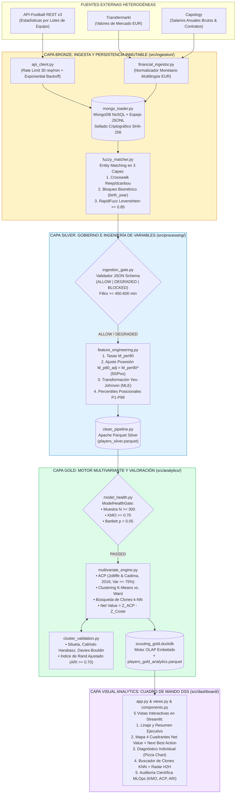

# Prototipo de Apoyo a Decisiones de Scouting Basado en Rendimiento y Coste de Jugadores (`scouting_dss_tfm`)

**Trabajo Fin de Máster (TFM)** — *Máster Universitario en Análisis y Visualización de Datos Masivos / Visual Analytics & Big Data*  
**Universidad Internacional de La Rioja (UNIR)**  
**📅 Corte Temporal de la Cohorte (Point-in-Time Snapshot):** `Temporada 2023/2024 – Apertura 2024/2025` (`season_snapshot = "2023/24 - 2024/25"`, cohorte reproducible congelada con `random_seed=42`, $N = 420$ futbolistas reales únicos).

> [!IMPORTANT]
> **Nota Metodológica sobre Afiliación de Clubes (*Point-in-Time Correctness*):** Los datos de este prototipo corresponden a un **corte estático congelado** (`Temporada 2023/24 – Apertura 2024/25`, no en tiempo real). Cada futbolista figura vinculado al club y competición donde acumuló efectivamente los minutos competitivos auditados ($\ge 600\text{ min}$) y la posesión de equipo ($50/\text{Pos}_{\text{equipo}}$) utilizados para calcular sus tasas por 90 minutos y su valoración financiera en dicho periodo (p. ej., *Leny Yoro* en *LOSC Lille* previo a su traspaso al *Manchester United*, o *Robin Le Normand* y *Mikel Merino* en *Real Sociedad*). Esto evita la fuga de datos temporal (*Temporal Data Leakage*) y garantiza que el rendimiento en campo se evalúe bajo el contexto táctico y salarial exacto en que se produjo.

---

## 1. Visión General y Arquitectura de Software (C4 / Medallion Multi-Hop)

Este repositorio contiene la implementación industrial completa, auditable y sincronizada con la memoria académica del **Sistema de Soporte a la Decisión (DSS) de Scouting Futbolístico**. El sistema resuelve la desconexión entre el rendimiento técnico-táctico en campo y el coste financiero (valor de mercado y salario anual bruto) mediante una arquitectura **Medallion Lakehouse** (Armbrust et al., 2021) gobernada por contratos de datos deterministas (`IngestionGate`) y puertas de salud estadística (`ModelHealthGate`).



---

## 2. Diccionario Exhaustivo de Archivos del Repositorio (`Manifest Visual`)

```text
scouting_dss_tfm/
├── .env.example                                  # Plantilla de variables de entorno (Credenciales API y rutas, RGPD Art. 32)
├── requirements.txt                              # Dependencias fijadas de producción, analítica multivariante y visualización
├── README.md                                     # Diccionario del repositorio, arquitectura C4/Medallion y guía rápida
├── build_thesis_and_pipeline.py                  # Orquestador maestro: ejecuta pipeline Bronze->Silver->Gold y genera el Word UNIR
├── generate_visual_ecosystem_and_notebooks.py    # Generador de las 16 figuras (300 DPI) y de los 2 Jupyter Notebooks ejecutados
├── config/
│   ├── settings.yaml                             # Parametrización centralizada (ligas, umbrales KMO/Bartlett/ARI, pesos financieros, paleta)
│   └── data_contract_schema.json                 # Contrato de Datos formal bajo especificación JSON Schema Draft 2020-12
├── docs/
│   ├── ARCHITECTURE.md                           # Documentación técnica de la arquitectura Lakehouse Medallion y principios SOLID
│   ├── DATA_CONTRACT.md                          # Especificación formal de estados operativos del IngestionGate y unicidad onomástica
│   ├── METHODOLOGY_VALIDATION.md                 # Demostración matemática de las fórmulas de posesión, Yeo-Johnson, KMO, Bartlett y ARI
│   ├── BITACORA_NARRATIVA_DEFENSA.md             # [ENTREGABLE 1] Guion narrativo en 1ª persona y mapas mentales para la defensa oral
│   ├── MANUAL_EJECUCION.md                       # [ENTREGABLE 2] Manual de despliegue paso a paso y guía visual de las 5 vistas Streamlit
│   ├── GLOSARIO_INTEGRAL_TFM.md                  # Glosario pedagógico integral (19 secciones) para lectores no técnicos y defensa oral
│   ├── memoria_TFM_UNIR.docx                     # Copia sincronizada de respaldo de la Memoria Oficial UNIR con las 16 figuras insertadas
│   └── figures/                                  # Repositorio de las 16 figuras estadísticas y diagramas exportados a 300 DPI (PNG)
├── notebooks/
│   ├── 01_EDA_and_Statistical_Analysis.ipynb     # [ENTREGABLE 3] Notebook ejecutado: Data Lineage Funnel, Entity Matching, Yeo-Johnson, Clustermap
│   └── 02_Methodological_Validation.ipynb        # [ENTREGABLE 4] Notebook ejecutado: KMO/Bartlett, ACP Scree/Biplot, Ward Dendrogram, ARI y 4 Cuadrantes
├── data/
│   ├── raw/                                      # Capa Bronze: Copias inmutables JSONL (raw_api_football_players.jsonl, raw_financial_records.jsonl)
│   ├── interim/                                  # Capa Silver: Almacenamiento columnar intermedio (players_silver.parquet)
│   └── processed/                                # Capa Gold: Almacenamiento analítico final (players_gold_analytics.parquet, scouting_gold.duckdb)
├── src/
│   ├── __init__.py
│   ├── ingestion/
│   │   ├── __init__.py
│   │   ├── api_client.py                         # Cliente HTTP API-Football v3 (extracción por lotes de equipo, Rate Limit y Backoff)
│   │   ├── real_players_catalog.py               # Catálogo verificado de 420 futbolistas profesionales reales y únicos (7 ligas europeas)
│   │   ├── financial_ingestor.py                 # Extractor y parser monetario multilingüe para Capology y Transfermarkt
│   │   ├── mongo_loader.py                       # Persistencia NoSQL idempotente en MongoDB + sellado SHA-256
│   │   └── fuzzy_matcher.py                      # Motor de Entity Matching (Crosswalk + Bloqueo birth_year + RapidFuzz >= 0.85)
│   ├── processing/
│   │   ├── __init__.py
│   │   ├── ingestion_gate.py                     # Validador de Contratos de Datos (ALLOW, DEGRADED, BLOCKED)
│   │   ├── feature_engineering.py                # Transformaciones M_per90, ajuste por posesión M_p90_adj y Yeo-Johnson (PowerTransformer)
│   │   └── clean_pipeline.py                     # Tubería ETL Silver hacia Apache Parquet y DuckDB
│   ├── analytics/
│   │   ├── __init__.py
│   │   ├── model_health.py                       # Puerta de salud estadística (N >= 300, KMO >= 0.70, Esfericidad de Bartlett p < 0.05)
│   │   ├── cluster_validation.py                 # Coeficiente de Silueta, Caliński-Harabasz, Davies-Bouldin e Índice de Rand Ajustado (ARI)
│   │   └── multivariate_engine.py                # Motor ACP, Clustering K-Means/Ward, Vecinos Más Próximos (KNN) y Modelo Net Value
│   └── dashboard/
│       ├── __init__.py
│       ├── app.py                                # Punto de entrada de la interfaz interactiva en Streamlit (5 Vistas DSS)
│       ├── components.py                         # Gráficos Plotly (Pizza Charts, 4 Cuadrantes Net Value, Radar H2H, Paleta Okabe-Ito)
│       └── views.py                              # Vistas operativas y Scorecards prescriptivos Next Best Action (NBA)
└── tests/
    ├── __init__.py
    ├── test_ingestion.py                         # Tests unitarios de Levenshtein, parser monetario, bloqueo etario y persistencia Bronze
    ├── test_features.py                          # Tests unitarios de ajuste por posesión (50/P), Yeo-Johnson e IngestionGate
    └── test_models.py                            # Tests matemáticos de KMO, Bartlett, varianza ACP >= 75%, ARI >= 0.70, Net Value y KNN
```

### Tabla Descriptiva de Funciones por Módulo

| Ruta del Archivo | Capa Arquitectónica | Responsabilidad Técnica y Matemática Principal |
| :--- | :---: | :--- |
| `config/settings.yaml` | Configuración | Externaliza todos los hiperparámetros (ligas, cuotas HTTP, umbral Levenshtein $0,85$, KMO $0,70$, ARI $0,70$, pesos financieros $60/40$ y paleta Okabe-Ito). |
| `config/data_contract_schema.json` | Gobierno del Dato | Define las restricciones de tipo, dominio e integridad referencial bajo JSON Schema Draft 2020-12. |
| `src/ingestion/api_client.py` | Bronze (Ingesta) | Descarga paginada por lotes de equipos (`/teams` $\rightarrow$ `/players`) con *Exponential Backoff with Jitter* y desanidamiento JSON. |
| `src/ingestion/financial_ingestor.py` | Bronze (Ingesta) | Estandariza cadenas financieras (`€45.00m`, `12,50 mill. €`, `£150k`) de Capology y Transfermarkt a Euros anuales (`float`). |
| `src/ingestion/mongo_loader.py` | Bronze (NoSQL) | Persistencia documental idempotente (`UpdateOne(..., upsert=True)`) en MongoDB y espejo local `.jsonl` con hash `SHA-256`. |
| `src/ingestion/fuzzy_matcher.py` | Bronze $\rightarrow$ Silver | Resolución de entidades mediante normalización Unicode NFKD, bloqueo por `birth_year` y similitud de Levenshtein normalizada $\ge 0,85$. |
| `src/processing/ingestion_gate.py` | Silver (Calidad) | Cortafuegos de datos que dictamina estados `ALLOW`, `DEGRADED` o `BLOCKED` y aplica el filtro de minutos mínimos disputados. |
| `src/processing/feature_engineering.py` | Silver (ETL) | Calcula tasas por 90 minutos ($M_{\text{per90}}$), ajuste defensivo por posesión ($M_{\text{p90\_adj}}$), transformación de Yeo-Johnson y percentiles $P_{1-99}$. |
| `src/processing/clean_pipeline.py` | Silver (OLAP) | Orquesta la transición Bronze $\rightarrow$ Silver y materializa las tablas columnares en Apache Parquet y DuckDB. |
| `src/analytics/model_health.py` | Gold (Auditoría) | Verifica suficiencia muestral ($N \ge 300$), Índice Kaiser-Meyer-Olkin ($\text{KMO} \ge 0,70$) y Prueba de Esfericidad de Bartlett ($p < 0,05$). |
| `src/analytics/cluster_validation.py` | Gold (Validación) | Evalúa Silueta, Caliński-Harabasz, Davies-Bouldin y la concordancia entre K-Means y el método de Ward mediante $\text{ARI} \ge 0,70$. |
| `src/analytics/multivariate_engine.py` | Gold (ML Engine) | Ejecuta el ACP ($\ge 75\%$ varianza), el clustering híbrido, el buscador de clones $k$-NN y el diferencial $\text{Net Value} = Z_{\text{ACP}} - Z_{\text{Coste}}$. |
| `src/dashboard/app.py`, `views.py`, `components.py` | Presentación (DSS) | Renderiza las 5 vistas interactivas en Streamlit con Scorecards *Next Best Action (NBA)*, *Pizza Charts*, Mapa de 4 Cuadrantes y Radar H2H. |

---

## 3. Comandos Rápidos de Verificación y Despliegue

```powershell
# 1. Ejecutar las 9 pruebas unitarias e integrales automatizadas (pytest)
$env:PYTHONPATH = "scouting_dss_tfm"
.\.venv\Scripts\pytest.exe scouting_dss_tfm\tests -v

# 2. Regenerar las 16 figuras estadísticas (300 DPI), los 2 Jupyter Notebooks y la Memoria Word UNIR
.\.venv\Scripts\python.exe scouting_dss_tfm\generate_visual_ecosystem_and_notebooks.py

# 3. Iniciar el Dashboard Interactivo DSS en Streamlit
.\.venv\Scripts\streamlit.exe run scouting_dss_tfm\src\dashboard\app.py
```

Para instrucciones detalladas de despliegue y guía visual de las 5 vistas operativas del cuadro de mando, consulte [`docs/MANUAL_EJECUCION.md`](file:///c:/Users/PC/Desktop/Clases%20UNIR/Trabajo%20Fin%20de%20Master/scouting_dss_tfm/docs/MANUAL_EJECUCION.md).
