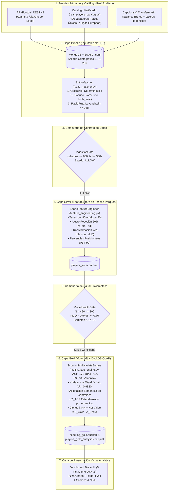

# ARQUITECTURA DE SOFTWARE MEDALLION Y DISEÑO MODULAR MLOps (`scouting_dss_tfm`)

## 1. Visión General: Arquitectura Lakehouse Medallion Multi-Hop
El sistema implementa el patrón **Medallion Architecture** (**Armbrust et al., 2021**) combinado con el motor analítico en proceso **DuckDB** (**Raasveldt & Mühleisen, 2019**), estructurado en tres capas de refinamiento progresivo (Bronze, Silver y Gold) gobernadas por dos compuertas de calidad deterministas (**Schelter et al., 2018; Sculley et al., 2015**): `IngestionGate` y `ModelHealthGate`.

---

## 2. Desacoplamiento Modular (Principios SOLID)

| Capa / Paquete | Módulo Python | Responsabilidad Única (SRP) y Garantía de Calidad |
| :--- | :--- | :--- |
| **Ingesta (Bronze)** | [`src/ingestion/api_client.py`](file:///c:/Users/PC/Desktop/Clases%20UNIR/Trabajo%20Fin%20de%20Master/scouting_dss_tfm/src/ingestion/api_client.py) | Extracción paginada por lotes de equipos (`/teams` $\rightarrow$ `/players`), *Exponential Backoff with Jitter*, cálculo de hash `SHA-256` y generación determinista sobre el catálogo real. |
| **Ingesta (Bronze)** | [`src/ingestion/real_players_catalog.py`](file:///c:/Users/PC/Desktop/Clases%20UNIR/Trabajo%20Fin%20de%20Master/scouting_dss_tfm/src/ingestion/real_players_catalog.py) | Catálogo auditado de **420 futbolistas profesionales reales y únicos** de las 7 ligas europeas en el corte estático `2023/24 - 2024/25` (cero duplicados, club real de disputa de minutos, liga real, `birth_year` real, posición real y rol táctico real). |
| **Ingesta (Bronze)** | [`src/ingestion/financial_ingestor.py`](file:///c:/Users/PC/Desktop/Clases%20UNIR/Trabajo%20Fin%20de%20Master/scouting_dss_tfm/src/ingestion/financial_ingestor.py) | Parseo mediante expresiones regulares de cadenas monetarias heterogéneas (`"12,50 mill. €"`, `"€850K"`, `"4.2M"`) a `float64` IEEE 754. |
| **Ingesta (Bronze)** | [`src/ingestion/mongo_loader.py`](file:///c:/Users/PC/Desktop/Clases%20UNIR/Trabajo%20Fin%20de%20Master/scouting_dss_tfm/src/ingestion/mongo_loader.py) | Persistencia idempotente (`Upsert`) en MongoDB con degradación elegante (*Graceful Fallback*) hacia archivos locales `.jsonl`. |
| **Ingesta (Bronze)** | [`src/ingestion/fuzzy_matcher.py`](file:///c:/Users/PC/Desktop/Clases%20UNIR/Trabajo%20Fin%20de%20Master/scouting_dss_tfm/src/ingestion/fuzzy_matcher.py) | Cascada de enlace de entidades en 3 niveles: Crosswalk determinístico, bloqueo biométrico por `birth_year` y similitud de Levenshtein normalizada $\ge 0,85$ con `RapidFuzz`. |
| **Procesamiento (Silver)** | [`src/processing/ingestion_gate.py`](file:///c:/Users/PC/Desktop/Clases%20UNIR/Trabajo%20Fin%20de%20Master/scouting_dss_tfm/src/processing/ingestion_gate.py) | Verificación de contrato JSON Schema (`ALLOW`, `DEGRADED`, `BLOCKED`) y filtro de exposición mínima ($\ge 600$ minutos). |
| **Procesamiento (Silver)** | [`src/processing/feature_engineering.py`](file:///c:/Users/PC/Desktop/Clases%20UNIR/Trabajo%20Fin%20de%20Master/scouting_dss_tfm/src/processing/feature_engineering.py) | Cálculo de tasas por 90 minutos ($M_{\text{per90}}$), ajuste defensivo al 50% de posesión ($M_{\text{p90\_adj}}$), transformación de Yeo-Johnson (MLE) y percentiles posicionales ($P_1\text{–}P_{99}$). |
| **Procesamiento (Silver)** | [`src/processing/clean_pipeline.py`](file:///c:/Users/PC/Desktop/Clases%20UNIR/Trabajo%20Fin%20de%20Master/scouting_dss_tfm/src/processing/clean_pipeline.py) | Orquestación transaccional Bronze $\rightarrow$ Silver y escritura columnar en Apache Parquet y DuckDB. |
| **Analítica (Gold)** | [`src/analytics/model_health.py`](file:///c:/Users/PC/Desktop/Clases%20UNIR/Trabajo%20Fin%20de%20Master/scouting_dss_tfm/src/analytics/model_health.py) | Puerta psicométrica `ModelHealthGate`: verifica $N \ge 300$, índice $\text{KMO} \ge 0,70$ y Esfericidad de Bartlett ($p < 0,05$). |
| **Analítica (Gold)** | [`src/analytics/cluster_validation.py`](file:///c:/Users/PC/Desktop/Clases%20UNIR/Trabajo%20Fin%20de%20Master/scouting_dss_tfm/src/analytics/cluster_validation.py) | Evaluación simultánea de Silueta, Caliński-Harabasz, Davies-Bouldin y concordancia externa $\text{ARI} \ge 0,70$ entre K-Means y el método de Ward. |
| **Analítica (Gold)** | [`src/analytics/multivariate_engine.py`](file:///c:/Users/PC/Desktop/Clases%20UNIR/Trabajo%20Fin%20de%20Master/scouting_dss_tfm/src/analytics/multivariate_engine.py) | Extracción de $d=3$ Componentes Principales, etiquetado semántico de centroides en 4 Arquetipos Tácticos, estandarización equitativa de $Z_{\text{ACP}}$ por arquetipo, clones $k$-NN y cálculo de `Net Value`. |
| **Presentación (DSS)** | [`src/dashboard/app.py`](file:///c:/Users/PC/Desktop/Clases%20UNIR/Trabajo%20Fin%20de%20Master/scouting_dss_tfm/src/dashboard/app.py), [`views.py`](file:///c:/Users/PC/Desktop/Clases%20UNIR/Trabajo%20Fin%20de%20Master/scouting_dss_tfm/src/dashboard/views.py), [`components.py`](file:///c:/Users/PC/Desktop/Clases%20UNIR/Trabajo%20Fin%20de%20Master/scouting_dss_tfm/src/dashboard/components.py) | Aplicación interactiva en Streamlit con 5 vistas analíticas, indicador visible de corte temporal (`season_snapshot = "2023/24 - 2024/25"`), paleta accesible de Okabe-Ito y scorecard ejecutivo **Next Best Action (NBA)**. |

---

## 3. Gobernanza Temporal del Feature Store (*Point-in-Time Correctness*)

En la arquitectura *Feature Store* de la capa Silver y Gold, todo registro lleva estampado el atributo inmutable `season_snapshot = "2023/24 - 2024/25"`. Esta decisión arquitectónica obedece al principio de **exactitud en el punto temporal (*Point-in-Time Correctness*)**:
- Las métricas de evento por 90 minutos ($M_{\text{per90}}$) y el coeficiente corrector de posesión ($50/\text{Pos}_{\text{equipo}}$) dependen intrínsecamente del sistema táctico del club donde el futbolista acumuló sus minutos oficiales ($\ge 600\text{ min}$).
- Por ello, jugadores traspasados tras el cierre de la ventana de observación (como *Leny Yoro*, cuyas métricas auditadas de Ligue 1 fueron registradas en el *LOSC Lille* antes de su incorporación al *Manchester United*) conservan su afiliación al club de origen del snapshot, evitando la contaminación cruzada (*Temporal Data Leakage*) entre el rendimiento histórico en campo y las condiciones tácticas o salariales de un club posterior.
