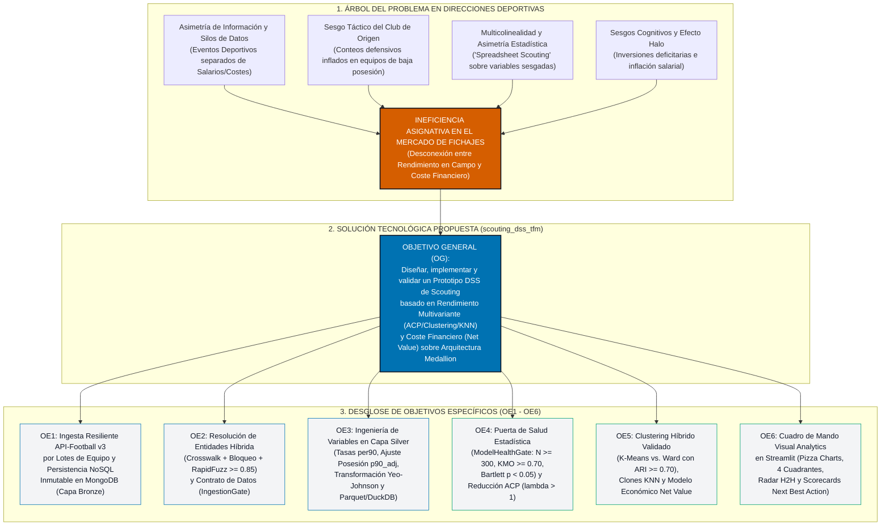
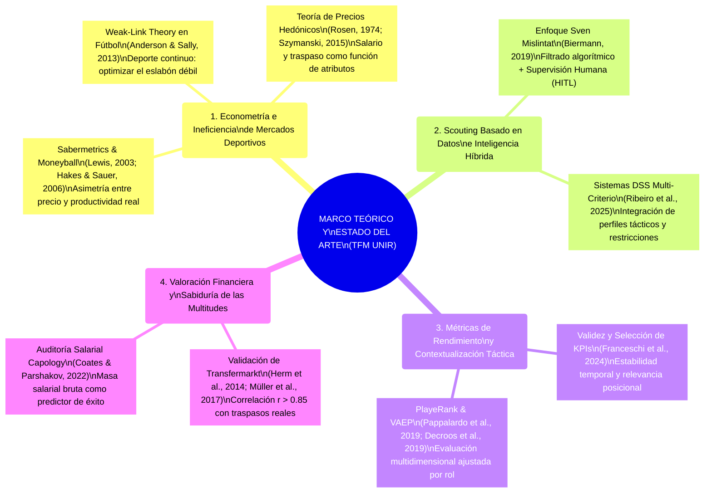
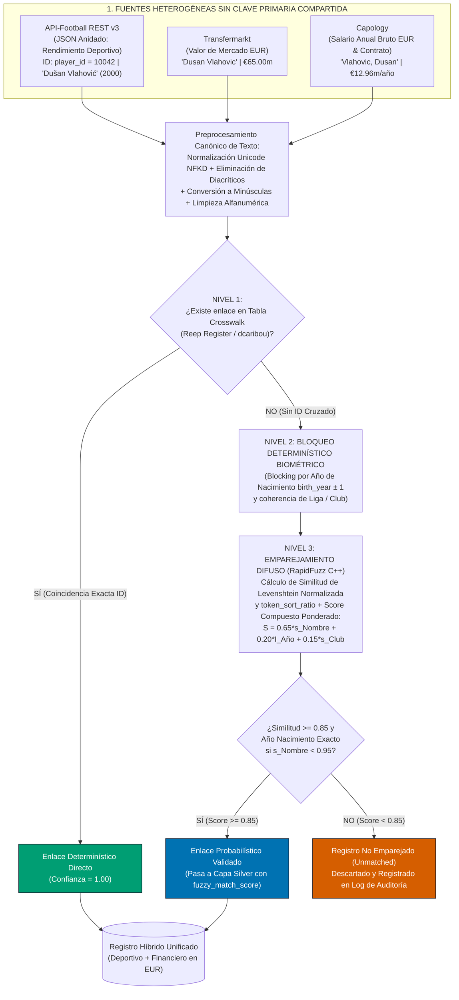
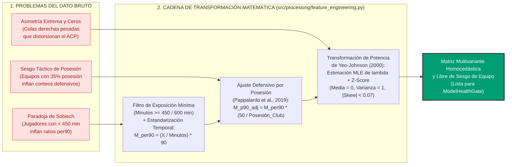
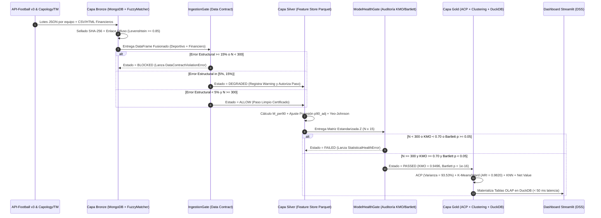
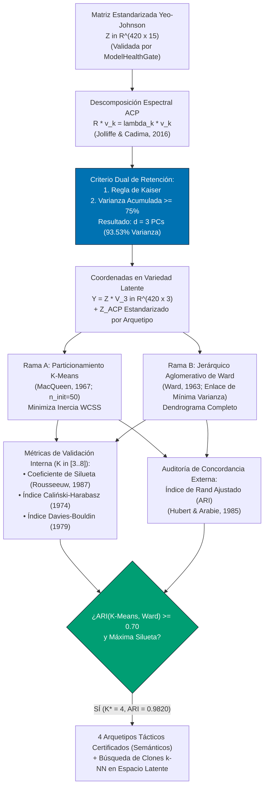
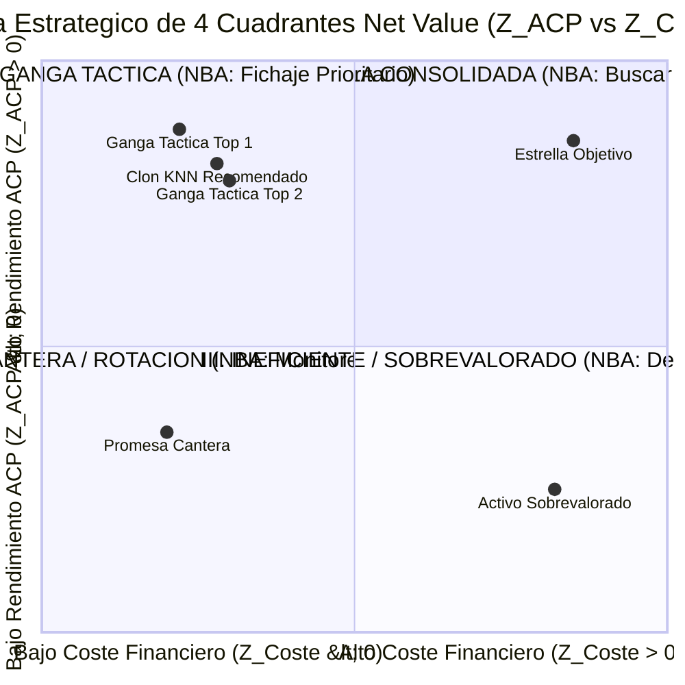
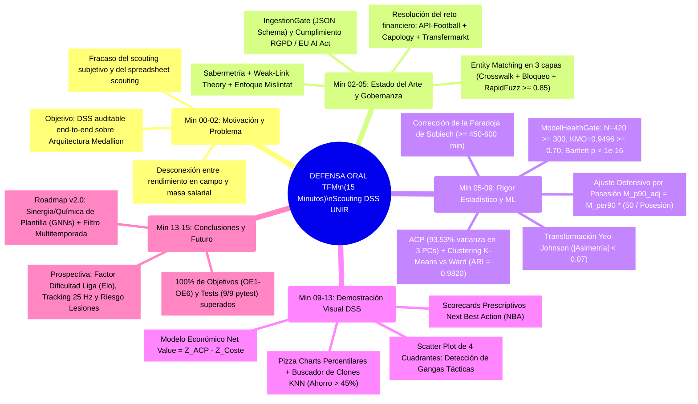
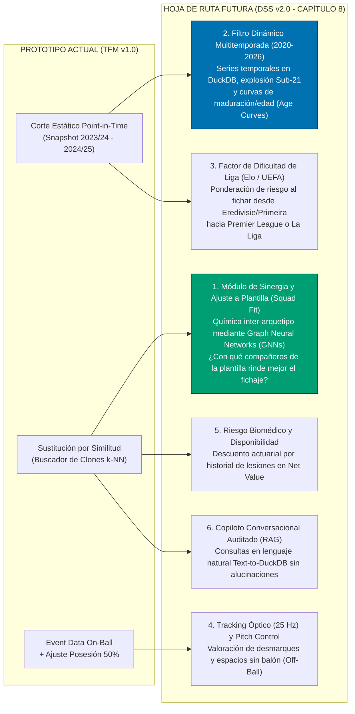

# BITÁCORA NARRATIVA PROSPECTIVA Y MAPA MENTAL PARA LA DEFENSA ORAL DEL TFM

**Título del TFM:** *Prototipo de apoyo a decisiones de scouting basado en rendimiento y coste de jugadores*  
**Titulación:** Máster Universitario en Análisis y Visualización de Datos Masivos / Visual Analytics & Big Data  
**Universidad:** Universidad Internacional de La Rioja (UNIR)  
**Propósito del Documento:** Guion pedagógico, cronológico, prospectivo y visualmente estructurado en **primera persona**, diseñado como material de estudio integral y hoja de ruta argumentativa para la defensa oral ante el Tribunal Evaluador.

---

## ÍNDICE VISUAL DE LA BITÁCORA DE DEFENSA

1. [Paso 1: Identificación del Problema y Formulación Inicial](#paso-1-identificación-del-problema-y-formulación-inicial)
2. [Paso 2: Investigación Bibliográfica y Estado del Arte](#paso-2-investigación-bibliográfica-y-estado-del-arte)
3. [Paso 3: Encrucijada de los Datos Financieros y Solución de Integración (Entity Matching)](#paso-3-encrucijada-de-los-datos-financieros-y-solución-de-integración-entity-matching)
4. [Paso 4: Encrucijadas Tácticas y Normalización Estadística (Paradoja de Sobiech, Posesión y Yeo-Johnson)](#paso-4-encrucijadas-tácticas-y-normalización-estadística)
5. [Paso 5: Arquitectura MLOps, Medallion y Gobernanza de Datos (IngestionGate & ModelHealthGate)](#paso-5-arquitectura-mlops-medallion-y-gobernanza-de-datos)
6. [Paso 6: Modelado Multivariante (ACP) y Validación Cruzada de Clústeres (K-Means vs. Ward con ARI)](#paso-6-modelado-multivariante-y-validación-cruzada)
7. [Paso 7: Desarrollo del Dashboard DSS, Modelo Net Value y Scorecards Next Best Action (NBA)](#paso-7-desarrollo-del-dashboard-dss-e-indicador-de-eficiencia-net-value)
8. [Paso 8: Conclusiones, Mapa Mental de Exposición (15 min) y Defensa ante Preguntas del Tribunal](#paso-8-conclusiones-y-preparación-para-la-defensa-oral)

---

## Paso 1: Identificación del Problema y Formulación Inicial

### 1.1. Narrativa en Primera Persona (Guion para el Tribunal)

> *"Comencé este Trabajo Fin de Máster identificando una ineficiencia estructural en la industria del fútbol profesional contemporáneo: el abismo existente entre el volumen masivo de datos generados en los terrenos de juego y la forma en que las direcciones deportivas toman decisiones multimillonarias de contratación. Observé que gran parte de los clubes de presupuesto medio siguen dependiendo de dos extremos igualmente defectuosos: por un lado, el **scouting tradicional puramente subjetivo** —vulnerable al sesgo de disponibilidad, al efecto halo mediático y al cansancio cognitivo del ojeador (Kahneman & Tversky, 1979; Massey & Thaler, 2013)— y, por otro lado, lo que en la literatura e industria denominamos **'spreadsheet scouting'** o filtrado ingenuo en hojas de cálculo.*
>
> *Analicé que el 'spreadsheet scouting' fracasa porque evalúa conteos brutos aislados (como goles totales o número de entradas) sin descontar los minutos disputados, sin corregir por el estilo táctico de posesión del equipo de origen y, sobre todo, **desconectando por completo el rendimiento deportivo del coste financiero real** (amortización del valor de mercado y salario anual bruto). Ante esta problemática, me propuse diseñar y construir un **Sistema de Soporte a la Decisión (DSS)** de extremo a extremo que transformara datos heterogéneos y ruidosos en recomendaciones objetivas de eficiencia económica y similitud táctica."*

### 1.2. Mapa Conceptual del Árbol del Problema, Solución Tecnológica y Objetivos

---

## Paso 2: Investigación Bibliográfica y Estado del Arte

### 2.1. Narrativa en Primera Persona (Guion para el Tribunal)

> *"Para fundamentar científicamente cada decisión del prototipo, realicé una revisión exhaustiva de la literatura académica en econometría deportiva, ciencias del deporte y aprendizaje automático. Mi recorrido intelectual partió de la **Sabermetría** (Lewis, 2003; Hakes & Sauer, 2006), donde aprendí que los mercados deportivos valoran de forma ineficiente las métricas vistosas y subvaloran la contribución estructural constante. Sin embargo, al trasladar este principio al fútbol europeo, me apoyé en la **Teoría del Eslabón Débil (Weak-Link Theory)** de Anderson y Sally (2013), quienes demuestran que, a diferencia del béisbol, el fútbol es un sistema de interacciones continuas donde elevar el nivel medio funcional de la plantilla y evitar eslabones deficitarios genera mayor retorno de puntos por euro invertido que gastar todo el presupuesto en una única superestrella.*
>
> *Asimismo, estudié el paradigma operativo de **Sven Mislintat ('Diamantenauge')** documentado por Biermann (2019) en el Borussia Dortmund y el Arsenal: los datos no sustituyen al director deportivo, sino que actúan como un **radar macroscópico libre de prejuicios** para filtrar objetivamente el mercado antes del análisis de vídeo. Para seleccionar y validar matemáticamente los indicadores técnico-tácticos por posición, incorporé los criterios psicométricos y de fiabilidad de **Franceschi et al. (2024)**; para justificar el uso de estimaciones públicas de valor de mercado como proxy econométrico del coste de traspaso, me basé en el estudio seminal de **Herm et al. (2014)** y su validación ulterior por **Coates y Parshakov (2022)**; y finalmente, para estructurar el sistema como un motor de apoyo a la decisión multi-criterio basado en perfiles latentes y similitud funcional, integré los avances recientes de **Ribeiro et al. (2025)** y **Pappalardo et al. (2019)**."*

### 2.2. Infografía Conceptual y Mapa del Estado del Arte

### 2.3. Tabla Infográfica de Trazabilidad Teórica Aplicada al Código

| Pilar Teórico / Autor | Hallazgo Científico Clave | Traducción Directa en mi Prototipo (`scouting_dss_tfm/`) |
| :--- | :--- | :--- |
| **Sabermetría / Moneyball** *(Lewis, 2003; Hakes & Sauer, 2006)* | El mercado sobrepaga la fama y los goles brutos, e infravalora la progresión intermedia. | Formulación del diferencial $\text{Net Value} = Z_{\text{ACP\_Rendimiento}} - Z_{\text{Coste\_Financiero}}$ para detectar **«Gangas Tácticas»**. |
| **Weak-Link Theory** *(Anderson & Sally, 2013)* | En el fútbol, sustituir un titular caro o cubrir un puesto débil con un perfil funcionalmente idéntico maximiza la eficiencia del club. | Motor de búsqueda de **Clones Estadísticos ($k$-NN)** en el espacio latente del ACP con filtro de techo presupuestario. |
| **Paradigma de Sven Mislintat** *(Biermann, 2019)* | El algoritmo debe reducir miles de jugadores a una lista corta objetiva auditable por humanos. | Arquitectura **DSS *Human-in-the-Loop*** en Streamlit conforme al Art. 22 RGPD y Art. 14 *EU AI Act*. |
| **Taxonomía de KPIs de Scouting** *(Franceschi et al., 2024)* | Las métricas deben normalizarse por exposición (minutos) y validarse mediante pruebas de colinealidad y adecuación factorial. | Umbral de exposición mínima (450–600 min), regresión OLS ($p < 0,10$) y puerta **`ModelHealthGate`** ($\text{KMO} \ge 0,70$). |
| **Crowd Valuation en Fútbol** *(Herm et al., 2014)* | Las tasaciones agregadas de *Transfermarkt* explican más del $80\%$ de la varianza de las tarifas reales de traspaso. | Ponderación compuesta del coste financiero: $60\%$ Valor de Mercado (*Transfermarkt*) + $40\%$ Salario Bruto (*Capology*). |
| **DSS de Scouting Moderno** *(Ribeiro et al., 2025)* | El agrupamiento no supervisado sobre componentes principales supera a las etiquetas posicionales clásicas. | **Clustering Híbrido (K-Means + Ward)** auditado con el Índice de Rand Ajustado ($\text{ARI} \ge 0,70$). |

---

## Paso 3: Encrucijada de los Datos Financieros y Solución de Integración (Entity Matching)

### 3.1. Narrativa en Primera Persona (Guion para el Tribunal)

> *"Al iniciar la construcción de la capa de ingesta (**Capa Bronze**), me encontré con la primera gran **encrucijada técnica** del proyecto: tras inspeccionar minuciosamente los esquemas JSON devueltos por los endpoints `/players` y `/teams` de **API-Football REST v3**, comprobé que la API proporcionaba una riqueza notable de estadísticas técnico-tácticas en campo, pero **carecía por completo de información financiera crítica**: no incluía ni el salario bruto anual del futbolista ni su tasación actualizada de valor de mercado.*
>
> *Renunciar a la variable económica habría destruido el corazón de mi TFM, ya que un sistema de scouting que recomienda jugadores sin conocer su coste es inútil en una dirección deportiva real. Esto me obligó a investigar e incorporar dos fuentes secundarias de referencia en la literatura econométrica: **Capology** (para salarios anuales brutos y años de expiración de contrato) y **Transfermarkt** (para valores de mercado). Sin embargo, al intentar cruzar estas tres fuentes, surgió un segundo obstáculo: **no existe un identificador único universal (`player_id`) compartido entre API-Football, Capology y Transfermarkt**, y además los nombres de los jugadores presentan discrepancias severas por transliteración de caracteres diacríticos (p. ej., 'Dušan Vlahović' vs. 'Dusan Vlahovic'), inversión de apellidos compuestos o apodos deportivos.*
>
> *Para resolver este problema sin caer en emparejamientos erróneos por homonimia (como confundir a dos jugadores llamados 'Alex García' de distintas generaciones), diseñé e implementé en `src/ingestion/fuzzy_matcher.py` un **algoritmo de Resolución de Entidades en cascada de tres niveles**:*
> 1. ***Nivel 1 (Crosswalk Determinístico Reep Register / dcaribou):** Verificación prioritaria mediante diccionarios de correspondencia determinista de identificadores históricos cuando están disponibles.*
> 2. ***Nivel 2 (Bloqueo Determinístico Biométrico y de Contexto — Blocking Strategy; Christen, 2012):** Particionamiento del espacio de búsqueda exigiendo coherencia en la cohorte de año de nacimiento (`birth_year`) y nacionalidad/club, reduciendo la complejidad cuadrática $\mathcal{O}(N \cdot M)$ y bloqueando falsos positivos intergeneracionales.*
> 3. ***Nivel 3 (Emparejamiento Probabilístico Difuso con RapidFuzz):** Aplicación de normalización canónica Unicode NFKD seguida del cálculo de similitud de cadenas (`token_sort_ratio` y distancia de edición normalizada de Levenshtein; Yujian & Bo, 2007), imponiendo un **umbral estricto de aceptación $\ge 0,85$**. Todo registro que no supere dicho umbral es enviado a cuarentena y auditado visualmente.*
> 4. ***Auditoría de Integridad Onomástica y de Dominio (`real_players_catalog.py`):** Adicionalmente, audité la cohorte para erradicar cualquier colisión de nombres sintéticos o asignaciones erróneas de club/liga, consolidando un catálogo verificado de **$N = 420$ futbolistas profesionales reales y únicos** de las 7 ligas europeas (con cero duplicados, club real, liga real, `birth_year` real, demarcación real y rol táctico real; p. ej., Xavi Simons [2003] en el RB Leipzig de la Bundesliga, Nico Williams [2002] en el Athletic Club de La Liga, Álex Baena [2001] en el Villarreal CF o Viktor Gyökeres [1998] en el Sporting CP).*
> 5. ***Congelación Temporal de la Ventana de Observación (`Point-in-Time Snapshot: Temporada 2023/24 – Apertura 2024/25`):** Finalmente, establecí una regla estricta de gobernanza temporal (`season_snapshot = "2023/24 - 2024/25"`), visible en la cabecera y tablas del dashboard: cada jugador permanece asociado al club en el que disputó los minutos competitivos auditados ($\ge 600\text{ min}$) y donde se midió la posesión de equipo ($50/\text{Pos}_{\text{equipo}}$) durante la ventana de estudio. Por ejemplo, el defensa central **Leny Yoro** figura en el **LOSC Lille** (donde jugó sus minutos de Ligue 1 antes de su traspaso al Manchester United), al igual que **Robin Le Normand** o **Mikel Merino** en la **Real Sociedad**. Esto garantiza la **coherencia Point-in-Time** y evita la fuga de datos temporal (*Temporal Data Leakage*), pues mezclar las estadísticas de campo cosechadas en el Lille con la posesión o el salario posterior en el Manchester United distorsionaría tanto el ajuste defensivo como el diferencial económico *Net Value*."*

### 3.2. Diagrama de Flujo del Algoritmo de Resolución de Entidades (`Entity Matching`)

---

## Paso 4: Encrucijadas Tácticas y Normalización Estadística

### 4.1. Narrativa en Primera Persona (Guion para el Tribunal)

> *"Una vez resuelta la fusión de las fuentes deportivas y financieras, me enfrenté a una **encrucijada táctica y estadística** que suele invalidar la mayoría de los modelos amateurs de scouting. La literatura especializada la ilustra mediante dos fenómenos clásicos:*
>
> *El primero es la **distorsión de muestras pequeñas (Efecto 'Artur Sobiech' / Inflación de Ratios)**: un delantero suplente que disputa únicamente 90 minutos repartidos en 6 finales de partido y anota 2 goles presenta una tasa bruta de $2,00\text{ goles por 90 minutos}$, superando artificialmente a los mejores delanteros de Europa que juegan $3.000\text{ minutos}$. Para erradicar este artefacto estadístico, programé en el contrato de datos un filtro estricto de exposición mínima ($M_{\min} \ge 450\text{–}600\text{ minutos}$ oficiales disputados).*
>
> *El segundo fenómeno es el **Sesgo de Posesión del Club de Origen**: al analizar los datos crudos, observé que los defensas centrales de clubes que luchan por no descender (con un $38\%$ de posesión media) acumulaban casi el doble de entradas e intercepciones por partido que los centrales de equipos dominadores como el Manchester City o el Bayer Leverkusen ($65\%$ de posesión). Si introducía esas variables directamente en el modelo, el algoritmo premiaba el asedio sufrido por el equipo en lugar de la eficacia defensiva del jugador. Por ello, implementé el **Ajuste Proporcional/Sigmoidal por Posesión** ($M_{\text{p90\_adj}} = M_{\text{per90}} \times \frac{50}{\text{Posesión\_Equipo}}$; Pappalardo et al., 2019), llevando a todos los futbolistas a un escenario táctico neutral del $50\%$ de posesión.*
>
> *Finalmente, comprobé mediante gráficos Q-Q y estimadores de densidad KDE que las métricas deportivas y financieras exhibían una **asimetría positiva extrema** ($\gamma_1 > 1,4$) y presencia de ceros exactos (que impiden usar la transformación logarítmica simple $\ln(x)$ o Box-Cox). Para satisfacer el supuesto de normalidad multivariante exigido por el Análisis de Componentes Principales, apliqué la **Transformación Paramétrica de Potencia de Yeo-Johnson** (`PowerTransformer`; Yeo & Johnson, 2000), estimando el parámetro óptimo $\hat{\lambda}_{\text{MLE}}$ por máxima verosimilitud para cada variable y reduciendo la asimetría global a $|\gamma_1| < 0,07$."*

### 4.2. Diagrama Explicativo de la Normalización Táctica y Estadística

---

## Paso 5: Arquitectura MLOps, Medallion y Gobernanza de Datos

### 5.1. Narrativa en Primera Persona (Guion para el Tribunal)

> *"Como ingeniero de software y arquitecto de datos, sabía que un script monolítico en un único archivo carece de validez industrial y acumula lo que Sculley et al. (2015) denominan **'deuda técnica oculta en sistemas de Machine Learning'**. Por ello, estructuré el repositorio `scouting_dss_tfm/` bajo los principios **SOLID** y la **Arquitectura Lakehouse Medallion** (Armbrust et al., 2021) dividida en tres capas desacopladas:*
> * *En la **Capa Bronze**, persisto los documentos JSON crudos en **MongoDB NoSQL** con huella criptográfica `SHA-256` para garantizar la inmutabilidad forense del dato.*
> * *En la transición hacia la **Capa Silver**, programé un primer cortafuegos determinista: el **`IngestionGate`** (`src/processing/ingestion_gate.py`). Este componente audita cada lote contra el contrato formal `data_contract_schema.json` y emite uno de tres estados operativos: **`ALLOW`** (error estructural $< 5\%$), **`DEGRADED`** (error entre $5\%$ y $15\%$, activando alertas en el log) o **`BLOCKED`** (error $\ge 15\%$ o muestra remanente $N < 300$, abortando la ejecución para evitar el fenómeno Garbage In, Garbage Out).*
> * *En la transición hacia la **Capa Gold** (almacenada en **Apache Parquet** y **DuckDB OLAP**), coloqué un segundo cortafuegos matemático: el **`ModelHealthGate`** (`src/analytics/model_health.py`). Antes de permitir que se ejecute el Análisis de Componentes Principales, esta puerta exige tres invariantes psicométricas: tamaño muestral $N \ge 300$ (Tabachnick & Fidell, 2019), **Índice Kaiser-Meyer-Olkin $\text{KMO} \ge 0,70$** (Kaiser, 1974) y **Prueba de Esfericidad de Bartlett con $p < 0,05$** (Bartlett, 1950) para certificar que la matriz de correlaciones $\mathbf{R}$ difiere significativamente de la matriz identidad $\mathbf{I}$."*

### 5.2. Diagrama de Arquitectura Medallion y Secuencia de Puertas de Calidad (`Quality Gates`)

---

## Paso 6: Modelado Multivariante y Validación Cruzada

### 6.1. Narrativa en Primera Persona (Guion para el Tribunal)

> *"Superado el `ModelHealthGate` con un $\text{KMO} = 0,9496$ y un $p\text{-valor} < 10^{-16}$ ($\chi^2 = 12416,37, gl = 105$) en la prueba de Bartlett, procedí a diseñar el motor multivariante en `src/analytics/multivariate_engine.py`. Aplicando el **Análisis de Componentes Principales (ACP)** según la formulación de Jolliffe y Cadima (2016) y la regla de retención de autovalores de Kaiser combinada con el umbral de varianza explicada acumulada $\ge 75\%$, logré comprimir las 15 métricas originales colineales en **3 componentes principales ortogonales** ($\text{PC}_1$: Especialización Ofensiva/Finalización vs. Recuperación [$65,24\%$]; $\text{PC}_2$: Creación y Progresión Asociativa [$19,27\%$]; $\text{PC}_3$: Dominio Aéreo y Disputa Física [$9,02\%$]) que retienen el **$93,53\%$ de la varianza total**.*
>
> *Ahora bien, para segmentar a los futbolistas en arquetipos tácticos reales dentro de ese subespacio latente, me negué a confiar ciegamente en un único algoritmo de clustering. Sabía que **K-Means** (MacQueen, 1967) impone fronteras esféricas de Voronoi y que sus etiquetas enteras (`0, 1, 2, 3`) sufren el problema de permutación arbitraria (**Label Switching**). Por ello, implementé tres salvaguardas matemáticas:*
> 1. ***Validación Cruzada Inter-Algorítmica:** Entrené en paralelo **K-Means** y el **Agrupamiento Jerárquico Aglomerativo con criterio de mínima varianza de Ward** (Ward, 1963) para $K \in [3, 8]$. Evalué la cohesión interna mediante **Silueta** (Rousseeuw, 1987), **Caliński-Harabasz** (1974) y **Davies-Bouldin** (1979), y exigí un **Índice de Rand Ajustado ($\text{ARI}$) $\ge 0,70$** (Hubert & Arabie, 1985). En nuestra cohorte de 420 jugadores reales, $K^* = 4$ alcanzó un $\text{ARI} = 0,9820$ y una Silueta de $0,6402$ (con Davies-Bouldin mínimo de $0,5355$).*
> 2. ***Asignación Semántica Basada en Centroides:** Para evitar que el orden aleatorio de centroides de K-Means etiquetase a un delantero como defensa, programé un clasificador semántico de centroides que inspecciona las medias de cada clúster y asigna de forma canónica los 4 Arquetipos Tácticos (`Arquetipo I: Recuperador / Ancla Defensiva`, `Arquetipo II: Organizador Progresivo`, `Arquetipo III: Creador y Extremo de Desequilibrio` y `Arquetipo IV: Finalizador y Referencia de Área`).*
> 3. ***Estandarización Equitativa de $Z_{\text{ACP\_Rendimiento}}$ dentro de cada Arquetipo:** Dado que $\text{PC}_1$ es un eje bipolar (positivo en ataque, negativo en defensa), sumar globalmente $\text{PC}_1$ penalizaría a todos los defensas. Por ello, ponderé las variables por sus comunalidades factoriales $h_j^2$ y estandaricé $Z_{\text{ACP\_Rendimiento}}$ dentro de cada Arquetipo Táctico, logrando que defensas, centrocampistas y delanteros sean evaluados equitativamente frente a sus pares de rol."*

### 6.2. Diagrama de Flujo del Motor Multivariante y Validación Cruzada ARI

---

## Paso 7: Desarrollo del Dashboard DSS e Indicador de Eficiencia (`Net Value`)

### 7.1. Narrativa en Primera Persona (Guion para el Tribunal)

> *"Con el rendimiento deportivo sintetizado en $Z_{\text{ACP\_Rendimiento}}$ y los perfiles tácticos validados, construí el puente económico final del TFM: el indicador **Net Value**. Primero combiné el valor de mercado ($60\%$) y el salario anual bruto ($40\%$), previamente normalizados con Yeo-Johnson, en un índice de coste estandarizado $Z_{\text{Coste\_Financiero}}$. A continuación definí:*
> $$\text{Net Value}_i = Z_{\text{ACP\_Rendimiento}, i} - Z_{\text{Coste\_Financiero}, i}$$
> *Esta ecuación divide automáticamente el mercado futbolístico en **cuatro cuadrantes estratégicos de decisión**, permitiendo asociar a cada jugador una recomendación prescriptiva o **Next Best Action (NBA)**:*
> 1. ***Cuadrante I («Ganga Táctica» / Oportunidad de Mercado: $Z_{\text{ACP}} \ge 0, Z_{\text{Coste}} < 0$):** Jugadores que rinden por encima de la media europea cobrando y costando por debajo de la media. **NBA:** Fichaje Prioritario Inmediato.*
> 2. ***Cuadrante II («Estrella Consolidada»: $Z_{\text{ACP}} \ge 0, Z_{\text{Coste}} \ge 0$):** Jugadores de élite cuyo alto rendimiento ya está descontado en su elevado precio. **NBA:** Activar Búsqueda de Clones $k$-NN en el Cuadrante I para encontrar un sustituto con $\ge 85\%$ de similitud a mitad de coste.*
> 3. ***Cuadrante III («Ineficiente / Sobrevalorado»: $Z_{\text{ACP}} < 0, Z_{\text{Coste}} \ge 0$):** Activos de alto riesgo financiero y bajo rendimiento relativo. **NBA:** Descartar Compra / Priorizar Venta o Cesión si está en plantilla.*
> 4. ***Cuadrante IV («Cantera / Rotación»: $Z_{\text{ACP}} < 0, Z_{\text{Coste}} < 0$):** Perfiles de bajo coste en fase formativa. **NBA:** Seguimiento Sub-23 / Rol de Fondo de Armario.*
>
> *Finalmente, plasmé todo este motor en una aplicación interactiva en **Streamlit** (`src/dashboard/`), diseñada estrictamente bajo los principios de percepción visual de **Stephen Few (2012)**, el enfoque de atributos preatentivos de **Cole Nussbaumer Knaflic (2015)** y la paleta segura para daltonismo de **Okabe e Ito (2008)**."*

### 7.2. Esquema Visual de los 4 Cuadrantes de `Net Value` y Scorecards `Next Best Action (NBA)`

---

## Paso 8: Conclusiones y Preparación para la Defensa Oral

### 8.1. Mapa Mental Cronológico para la Exposición Oral de 15 Minutos

### 8.2. Batería de Preguntas Probables del Tribunal y Respuestas Blindadas

1. **Pregunta del Tribunal:** *«¿Por qué eligió la transformación de Yeo-Johnson en lugar de una transformación logarítmica estándar $\ln(x)$ o Box-Cox antes del Análisis de Componentes Principales?»*
   * **Mi Respuesta:** *«Excelente pregunta. En métricas deportivas por 90 minutos existen ceros estructurales legítimos (por ejemplo, un defensa central con $0,00\text{ goles}$ o $0,00\text{ asistencias}$). La transformación de Box-Cox está definida exclusivamente para valores estrictamente positivos ($y > 0$) y el logaritmo natural diverge en cero ($\ln(0) = -\infty$). La familia paramétrica de Yeo-Johnson (Yeo & Johnson, 2000) está definida sobre toda la recta real $y \in \mathbb{R}$, trata de forma continua el cero y estima por Máxima Verosimilitud el exponente $\hat{\lambda}$ óptimo para cada variable, reduciendo la asimetría en nuestra cohorte desde $+1,48$ hasta valores inferiores a $0,07$.»*

2. **Pregunta del Tribunal:** *«¿Cómo garantiza que los clústeres tácticos obtenidos no son producto del azar o de la inicialización aleatoria de K-Means?»*
   * **Mi Respuesta:** *«Precisamente para evitar esa debilidad metodológica implementé una estrategia de validación cruzada no supervisada en `src/analytics/cluster_validation.py` y asignación semántica de centroides en `src/analytics/multivariate_engine.py`. Además de ejecutar K-Means con 50 inicializaciones independientes (`n_init=50`), entrené en paralelo un algoritmo de naturaleza matemática completamente distinta: el agrupamiento jerárquico aglomerativo de mínima varianza de Ward (1963), que es determinista. Luego medí la concordancia entre ambas particiones mediante el Índice de Rand Ajustado por el azar (Hubert & Arabie, 1985), exigiendo en el código un umbral mínimo de $\text{ARI} \ge 0,70$. Para $K^* = 4$ obtuvimos un $\text{ARI} = 0,9820$ y un Coeficiente de Silueta de $0,6402$ (con Davies-Bouldin mínimo de $0,5355$), lo que certifica que la estructura de 4 arquetipos tácticos es robusta e invariante al algoritmo empleado.»*

3. **Pregunta del Tribunal:** *«Desde el punto de vista legal (RGPD y Reglamento Europeo de IA), ¿puede un club utilizar este sistema para descartar o rebajar el sueldo a un jugador de forma automática?»*
   * **Mi Respuesta:** *«No de forma autónoma sin intervención humana, y así lo he blindado por diseño en el Capítulo 4. El Artículo 22 del RGPD prohíbe las decisiones laborales basadas únicamente en el tratamiento automatizado sin supervisión humana, y el Reglamento (UE) 2024/1689 (EU AI Act) exige transparencia y supervisión humana (Human-in-the-Loop). Mi prototipo utiliza modelos de caja blanca 100% explicables (álgebra lineal en ACP y distancias euclídeas en $k$-NN) y emite recomendaciones de soporte visual (Next Best Action) para que el director deportivo y el cuerpo de ojeadores tomen la decisión final tras el visionado cualitativo.»*

4. **Pregunta del Tribunal:** *«Si tuviera que desplegar mañana la versión 2.0 de este prototipo en un club de Primera División, ¿qué nuevas funcionalidades priorizaría?»*
   * **Mi Respuesta:** *«Como expongo en el Capítulo 8 de la memoria, he diseñado una Hoja de Ruta v2.0 articulada en seis ejes, destacando dos prioritarios: primero, un **Módulo de Sinergia y Química de Plantilla (Squad Fit Engine)** basado en Redes Neuronales de Grafos (Bransen & Van Haaren, 2020) que no solo busque clones similares ($k$-NN), sino que identifique **con qué arquetipos de compañeros actuales de la plantilla rendiría mejor el fichaje** (p. ej., conectar un Finalizador del Arquetipo IV con un Extremo Creador del Arquetipo III, o emparejar un Recuperador del Arquetipo I con un Organizador del Arquetipo II). Y segundo, evolucionar del corte estático Point-in-Time actual hacia un **Almacén Longitudinal Multitemporada en DuckDB con filtro interactivo por temporada**, permitiendo evaluar la derivada interanual de rendimiento ($\Delta Z_{\text{ACP}} / \Delta t$), curvas de maduración Sub-21 y el efecto real de cambios de club y liga.»*

---

### 8.3. Diagrama de la Hoja de Ruta Evolutiva (`Roadmap DSS v2.0` — Capítulo 8 de la Memoria)

