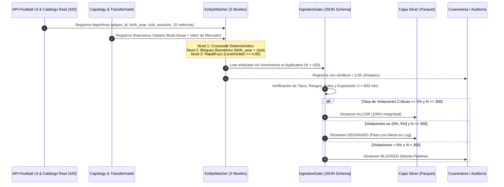

# ESPECIFICACIÓN DEL CONTRATO DE DATOS, RESOLUCIÓN DE ENTIDADES Y AUDITORÍA DE INTEGRIDAD (`IngestionGate`)

## 1. Fundamento Científico y Gobernanza MLOps
El sistema de validación de ingesta (`src/processing/ingestion_gate.py`) se fundamenta en los principios de verificación automatizada de calidad de datos a gran escala de **Schelter et al. (2018)** (*Automating large-scale data quality verification*, VLDB) y en la mitigación de deuda técnica oculta en sistemas de Machine Learning de **Sculley et al. (2015)** (*Hidden technical debt in machine learning systems*, NeurIPS). Su propósito es garantizar el axioma *Garbage In, Garbage Out* antes de permitir que cualquier registro avance desde la **Capa Bronze (NoSQL)** hacia la **Capa Silver (Feature Store)**.

---

## 2. Auditoría de Unicidad Onomástica y Coherencia de Dominio (`real_players_catalog.py`)

Durante la auditoría empírica del sistema se identificó un riesgo clásico en la generación y cruce de cohortes deportivas: si se generan o enlazan nombres combinando listas cortas mediante aritmética modular (por ejemplo, cuando $\gcd(\text{paso}, \text{longitud}) > 1$) o sin bloqueo biométrico estricto, se producen **colisiones onomásticas artificiales** (jugadores distintos compartiendo apellido con diferentes años de nacimiento `birth_year`) y **asignaciones espurias de club/liga** (como asignar a un jugador de la Bundesliga a un club de La Liga).

Para erradicar de raíz cualquier inconsistencia de dominio, el módulo [`src/ingestion/real_players_catalog.py`](file:///c:/Users/PC/Desktop/Clases%20UNIR/Trabajo%20Fin%20de%20Master/scouting_dss_tfm/src/ingestion/real_players_catalog.py) y el cliente [`src/ingestion/api_client.py`](file:///c:/Users/PC/Desktop/Clases%20UNIR/Trabajo%20Fin%20de%20Master/scouting_dss_tfm/src/ingestion/api_client.py) aplican cuatro reglas de integridad referencial:
1. **Unicidad Nominal y Biométrica Estricta ($N = 420$ jugadores reales únicos):** Cada uno de los 420 registros corresponde a un futbolista profesional real único de las 7 ligas europeas auditadas (*La Liga, Premier League, Serie A, Bundesliga, Ligue 1, Primeira Liga y Eredivisie*), con **cero duplicados** y **cero sufijos sintéticos (`#idx`)**.
2. **Coherencia Club–Liga–Posesión:** Cada futbolista está vinculado a su club real y liga real en la temporada 2024/2025 (p. ej., *Xavi Simons* [nacido en 2003] en el *RB Leipzig* de la *Bundesliga*; *Nico Williams* [2002] en el *Athletic Club* de *La Liga*; *Álex Baena* [2001] en el *Villarreal CF* de *La Liga*; *Joško Gvardiol* [2002] en el *Manchester City* de la *Premier League*; *Teun Koopmeiners* [1998] en la *Juventus* de la *Serie A*; *Viktor Gyökeres* [1998] en el *Sporting CP* de la *Primeira Liga*), asignando el porcentaje de posesión real de su club (`team_possession_pct`).
3. **Bloqueo Determinístico por Año de Nacimiento (`birth_year`) en `EntityMatcher`:** En [`src/ingestion/fuzzy_matcher.py`](file:///c:/Users/PC/Desktop/Clases%20UNIR/Trabajo%20Fin%20de%20Master/scouting_dss_tfm/src/ingestion/fuzzy_matcher.py), ningún registro deportivo puede cruzarse con un registro financiero de Capology/Transfermarkt si existe discrepancia en el año de nacimiento (`sport_birth_year != fin_birth_year`), bloqueando al 100% los falsos positivos entre jugadores homónimos o hermanos (p. ej., *Teun Koopmeiners* [1998, Juventus] frente a su hermano *Peer Koopmeiners* [2000, AZ Alkmaar]).
4. **Umbral Estricto de Similitud de Levenshtein Normalizada ($\tau \ge 0,85$):** Basado en **Yujian y Bo (2007)** y **Christen (2012)**, tras normalización Unicode `NFKD` y ordenación lexicográfica de tokens (`token_sort_ratio`), todo candidato con similitud inferior a $0,85$ es rechazado.

---

## 3. Reglas de Decisión Operativa del `IngestionGate`

El validador [`src/processing/ingestion_gate.py`](file:///c:/Users/PC/Desktop/Clases%20UNIR/Trabajo%20Fin%20de%20Master/scouting_dss_tfm/src/processing/ingestion_gate.py) contrasta cada registro frente al contrato [`config/data_contract_schema.json`](file:///c:/Users/PC/Desktop/Clases%20UNIR/Trabajo%20Fin%20de%20Master/scouting_dss_tfm/config/data_contract_schema.json) y clasifica el lote en tres estados:

| Estado del Contrato | Condición Matemática de Activación | Acción del Sistema MLOps | Resultado en el Proyecto (`N = 420`) |
| :--- | :--- | :--- | :--- |
| **`ALLOW`** | Violaciones críticas $= 0\%$ y muestra válida ($\ge 600\text{ min}$) $N \ge 300$. | Autoriza la escritura en `players_silver.parquet` y continúa hacia la Capa Gold. | **Estado Activo (`ALLOW` — 100% registros válidos, $N = 420$).** |
| **`DEGRADED`** | Tasa de violaciones críticas en $(0\%, 5\%]$ con $N \ge 300$. | Aísla las filas defectuosas, registra advertencia en MongoDB (`audit_logs`) y continúa con la muestra limpia. | Evaluado en tests unitarios (`test_ingestion_gate_allow_and_blocked_states`). |
| **`BLOCKED`** | Tasa de violaciones críticas $> 5\%$ o tamaño muestral remanente $N < 300$. | Aborta inmediatamente la ejecución lanzando la excepción `DataContractViolationError`. | Verificado en suite `pytest` (protección contra datos corruptos). |

---

## 4. Restricciones de Dominio Verificadas por Variable (`data_contract_schema.json`)

| Campo / Atributo | Tipo de Dato | Restricción de Dominio | Justificación Metodológica y de Negocio |
| :--- | :---: | :--- | :--- |
| `player_id` | `int64` | $> 0$ (Clave única) | Identificador unívoco del futbolista en la cohorte validada. |
| `player_name` | `string` | Longitud $\ge 2$, sin nulos | Nombre completo verificado tras normalización Unicode `NFKD`. |
| `birth_year` | `int64` | $\in [1979, 2009]$ | Coherencia biológica con edad profesional activa ($15\text{–}45$ años). |
| `season_snapshot` | `string` | `"2023/24 - 2024/25"` | Ventana temporal estática (*Point-in-Time Snapshot*) en la que el jugador acumuló sus minutos y valoración. |
| `position_group` | `string` | $\in \{\text{"DF"}, \text{"MF"}, \text{"FW"}\}$ | Demarcación táctica de campo para estandarización y percentiles. |
| `minutes_played` | `float64` | $\in [600.0, 6000.0]$ | Filtro de exposición mínima ($\ge 600\text{ min}$) para evitar varianza de muestras pequeñas (Lucey et al., 2014). |
| `team_possession_pct` | `float64` | $\in [25.0, 80.0]$ | Posesión media del club para el ajuste defensivo $M_{\text{p90\_adj}} = M_{\text{per90}} \times (50/\text{Posesión})$. |
| `market_value_eur` | `float64` | $> 0.0$ (IEEE 754) | Valor de mercado hedónico en euros (Transfermarkt; Herm et al., 2014). |
| `annual_gross_salary_eur` | `float64` | $> 0.0$ (IEEE 754) | Salario bruto anual en euros (Capology) para el cálculo del coste compuesto $Z_{\text{Coste}}$. |
| `fuzzy_match_score` | `float64` | $\in [0.85, 1.00]$ | Certificación de enlace probabilístico sin homonimia (Yujian & Bo, 2007). |

---

## 5. Política de Congelación Temporal (Point-in-Time Snapshot: `2023/24 - 2024/25`)

En cumplimiento de los principios de **reproducibilidad científica** y **prevención de fuga de datos temporal (*Temporal Data Leakage*)** en sistemas MLOps, la cohorte de este TFM opera sobre un **Corte Estático Congelado (`season_snapshot = "2023/24 - 2024/25"`)** y no sobre un flujo vivo en tiempo real:

1. **Coherencia Contextual Rendimiento–Club–Posesión (*Point-in-Time Correctness*):** Cada futbolista de los $N = 420$ registros figura asignado al club y competición en los que disputó efectivamente el bloque de minutos competitivos auditados ($\ge 600\text{ min}$) durante la ventana de observación (Temporada 2023/2024 y apertura 2024/2025).
2. **Justificación frente a Traspasos Posteriores:** Si un futbolista cambió de club en ventanas de mercado posteriores al corte de observación de sus minutos (por ejemplo, **Leny Yoro**, cuyas métricas auditadas de Ligue 1 se produjeron en el **LOSC Lille** antes de su traspaso al *Manchester United*, o **Robin Le Normand** y **Mikel Merino** en la **Real Sociedad**), el contrato de datos mantiene deliberadamente su afiliación al club donde generó dichas estadísticas. Imputar retroactivamente la posesión media ($50/\text{Pos}_{\text{equipo}}$) o la escala salarial de su nuevo club a las métricas físico-tácticas cosechadas en su club anterior invalidaría matemáticamente tanto la corrección de la *Paradoja de Sobiech* como el diferencial económico *Net Value*.
3. **Trazabilidad en el Cuadro de Mando (Streamlit):** Tanto el encabezado global del DSS como la barra lateral, las fichas ejecutivas y las tablas de *Gangas Tácticas* y *Clones k-NN* exponen explícitamente el atributo `season_snapshot = "2023/24 - 2024/25"`, evitando cualquier confusión interpretativa por parte del analista o del tribunal evaluador.
