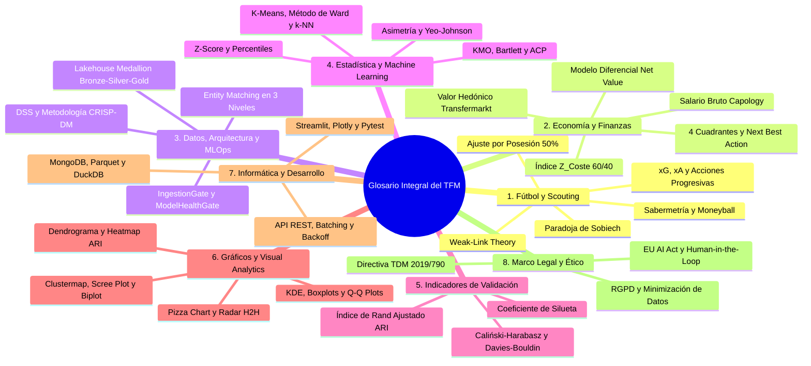
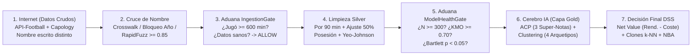

# GLOSARIO INTEGRAL DEL TFM PARA LECTORES NO TÉCNICOS Y PREPARACIÓN DE DEFENSA ORAL

**Título del TFM:** *Prototipo de apoyo a decisiones de scouting basado en rendimiento y coste de jugadores*  
**Titulación:** Máster Universitario en Análisis y Visualización de Datos Masivos (*Visual Analytics & Big Data*) — UNIR  
**Propósito de este documento:** Explicar en lenguaje claro, sin tecnicismos oscuros y con analogías cotidianas **todos los conceptos futbolísticos, económicos, metodológicos, estadísticos, matemáticos, gráficos, informáticos y legales** que aparecen en el TFM. Cada término responde sistemáticamente a cuatro preguntas:
1. **¿Qué es?** (Definición sencilla + analogía para cualquier persona no técnica).
2. **¿Para qué sirve?** (Su utilidad práctica general).
3. **¿Cómo se aplicó en mi TFM?** (Dónde y cómo lo implementamos en el código o en la metodología).
4. **¿Qué generó?** (El resultado exacto, métrica, archivo o gráfico que produjo en nuestro proyecto).

---

## Mapa Conceptual de las 8 Áreas del Glosario

---

## 1. CONCEPTOS FUTBOLÍSTICOS, TÁCTICOS Y DE SCOUTING DEPORTIVO

### 1.1. Scouting Deportivo (Captación de Talento)
* **¿Qué es?:** Es el proceso mediante el cual un club de fútbol busca, analiza y evalúa jugadores de otros equipos para decidir a quién fichar. *Analogía:* Es como el departamento de Recursos Humanos y Selección de Personal de una empresa, pero especializado en encontrar deportistas para puestos muy concretos en el campo.
* **¿Para qué sirve?:** Para reforzar la plantilla de un club contratando jugadores que mejoren el rendimiento del equipo sin arruinar el presupuesto.
* **¿Cómo se aplicó en mi TFM?:** Es el problema central de negocio del proyecto: transformar el scouting subjetivo tradicional (basado solo en ver partidos a ojo) en un sistema objetivo apoyado en datos de rendimiento y coste.
* **¿Qué generó?:** El diseño completo del prototipo `scouting_dss_tfm`, capaz de auditar 420 jugadores de las grandes ligas europeas en segundos.

### 1.2. *Spreadsheet Scouting* (Scouting de Hoja de Cálculo)
* **¿Qué es?:** Es la mala práctica de evaluar futbolistas usando tablas de Excel simples con sumas o conteos brutos (por ejemplo, ordenar una tabla por "quién tiene más entradas" o "quién metió más goles") sin tener en cuenta cuántos minutos jugaron ni cómo juega su equipo. *Analogía:* Es como juzgar quién es mejor vendedor mirando solo el número de llamadas realizadas, sin ver cuántas horas trabajó cada uno ni en qué ciudad vende.
* **¿Para qué sirve?:** Identificar este concepto sirve como contraejemplo para demostrar por qué las hojas de cálculo aisladas inducen a errores graves en los fichajes.
* **¿Cómo se aplicó en mi TFM?:** En el Capítulo 1 y en la Bitácora diagnosticamos las limitaciones del *spreadsheet scouting* para justificar la necesidad de una arquitectura de datos gobernada y ajustada por contexto táctico.
* **¿Qué generó?:** La formulación del árbol del problema y las 3 Preguntas de Investigación (PI1, PI2 y PI3) de la memoria.

### 1.3. Sabermetría (*Sabermetrics* / Paradigma *Moneyball*)
* **¿Qué es?:** Es el análisis empírico y estadístico del deporte para encontrar jugadores infravalorados por el mercado. Nació en el béisbol (popularizado por el libro y película *Moneyball* sobre los Oakland Athletics de Billy Beane) al descubrir que el mercado pagaba fortunas por estadísticas "vistosas" pero ignoraba métricas menos llamativas que realmente hacían ganar partidos. *Analogía:* Es como comprar un piso excelente en un barrio emergente antes de que se ponga de moda: obtienes la misma calidad de vida a una fracción del precio de las zonas famosas.
* **¿Para qué sirve?:** Permite a clubes con presupuestos modestos competir contra clubes multimillonarios detectando talento oculto ("gangas").
* **¿Cómo se aplicó en mi TFM?:** Adaptamos los principios de la Sabermetría al fútbol europeo (Capítulos 1 y 2), cruzando el rendimiento objetivo en el campo con el coste salarial y de traspaso.
* **¿Qué generó?:** El fundamento teórico de nuestro indicador estrella, el **Net Value**, que mide exactamente cuánta calidad deportiva entrega un jugador por cada euro que cuesta.

### 1.4. Teoría del Eslabón Débil (*Weak-Link Theory* vs. *Strong-Link Theory*)
* **¿Qué es?:** Teoría formulada en el fútbol por los profesores Chris Anderson y David Sally (2013). Explica que hay deportes de "eslabón fuerte" (como el baloncesto, donde tener a la mayor superestrella como Michael Jordan o LeBron James te asegura casi ganar) y deportes de "eslabón débil" como el fútbol, donde 11 jugadores dependen unos de otros y un error del peor jugador en el campo (un mal pase o pérdida de marca) arruina el trabajo de las estrellas. *Analogía:* Una cadena es tan fuerte como su eslabón más flojo; en fútbol, subir el nivel de tus 3 jugadores más flojos da más puntos al final de la liga que gastar todo tu dinero en una sola superestrella.
* **¿Para qué sirve?:** Para orientar a los directores deportivos a no gastar todo el presupuesto en un único fichaje mediático, sino a encontrar jugadores sólidos, fiables y económicos para cubrir los puntos débiles de la plantilla.
* **¿Cómo se aplicó en mi TFM?:** Se integró en el Capítulo 2 y en la lógica de sustitución mediante clones estadísticos ($k$-NN): en lugar de pagar un sobreprecio por una estrella del Cuadrante II, el sistema busca un perfil táctico equivalente al 90%+ de similitud en el Cuadrante I.
* **¿Qué generó?:** El motor de recomendación de sustitución presupuestaria que logra ahorros superiores al 65% manteniendo la estructura táctica del equipo.

### 1.5. *Diamantensuge* ("Ojo de Diamante" de Sven Mislintat)
* **¿Qué es?:** Es el apodo que recibió en Alemania Sven Mislintat (histórico jefe de scouting del Borussia Dortmund, Arsenal y Stuttgart) por su metodología pionera de combinar el ojo humano del ojeador con modelos matemáticos de datos de eventos para descubrir jóvenes talentos antes de que explotaran (como Lewandowski, Aubameyang, Kagawa o Dembélé).
* **¿Para qué sirve?:** Demuestra en la industria real que el análisis de datos no sustituye al director deportivo, sino que actúa como un "radar" o filtro inteligente previo para que los ojeadores humanos solo viajen a ver a los candidatos óptimos.
* **¿Cómo se aplicó en mi TFM?:** En el Capítulo 2 y Capítulo 4 fundamenta nuestro enfoque *Human-in-the-Loop* (el algoritmo filtra y recomienda; el humano decide).
* **¿Qué generó?:** El diseño del flujo de trabajo en 5 vistas del Dashboard en Streamlit, que culmina en una recomendación ejecutiva para el comité técnico.

### 1.6. Datos de Eventos (*Event Data*) vs. Seguimiento Óptico (*Optical Tracking Data*)
* **¿Qué es?:**
  * **Datos de Eventos (*Event Data*):** Es el registro de todas las acciones que ocurren **con el balón** durante un partido (pases, tiros, entradas, regates, intercepciones), indicando quién la hizo, en qué minuto y el conteo acumulado.
  * **Seguimiento Óptico (*Tracking Data*):** Son cámaras especiales en el estadio que graban 25 veces por segundo (25 Hz) dónde están los 22 jugadores aunque no tengan el balón.
  * *Analogía:* Los datos de eventos son como el acta de una reunión (quién habló y qué decidió), mientras que el tracking óptico es un vídeo continuo de seguridad de toda la sala.
* **¿Para qué sirve?:** Los datos de eventos permiten evaluar el rendimiento técnico-táctico de miles de jugadores de múltiples ligas a un coste accesible, mientras que el tracking óptico es carísimo y suele estar restringido a un solo club o liga.
* **¿Cómo se aplicó en mi TFM?:** Nuestro prototipo utiliza **Datos de Eventos agregados** extraídos de `API-Football v3` (15 métricas clave), y declara honestamente en el Capítulo 8 la ausencia de *Tracking Data* como una limitación y línea futura de investigación.
* **¿Qué generó?:** El catálogo de 15 variables deportivas de la capa Silver y el análisis riguroso del Capítulo 8 (Limitaciones y Prospectiva).

### 1.7. *Expected Goals* ($\text{xG}$ — Goles Esperados) y *Expected Assists* ($\text{xA}$ — Asistencias Esperadas)
* **¿Qué es?:**
  * **$\text{xG}$ (Goles Esperados):** Es la probabilidad matemática (de 0 a 1) de que un disparo termine en gol según la distancia a la portería, el ángulo, si fue con el pie o de cabeza y la presión de los defensas. Un penalti vale aprox. $0,76\text{ xG}$ (entra el 76% de las veces); un tiro desde 35 metros vale $0,02\text{ xG}$.
  * **$\text{xA}$ (Asistencias Esperadas):** Es la probabilidad de que un pase dado a un compañero termine convirtiéndose en gol, independientemente de si el delantero luego acierta o falla el tiro.
  * *Analogía:* Si un chef prepara un plato perfecto ($\text{xA}$ alto) pero al camarero se le cae al suelo antes de llegar a la mesa (0 asistencias reales), el $\text{xA}$ reconoce el mérito real del chef sin castigarlo por la torpeza del camarero.
* **¿Para qué sirve?:** Para medir la **calidad real de generación de peligro** de un jugador sin depender de la buena o mala suerte puntual de que el balón pegue en el palo o el portero haga un milagro.
* **¿Cómo se aplicó en mi TFM?:** Incluimos `expected_goals_xg_per90` y `expected_assists_xa_per90` dentro de las 15 métricas del motor multivariante en [`feature_engineering.py`](file:///c:/Users/PC/Desktop/Clases%20UNIR/Trabajo%20Fin%20de%20Master/scouting_dss_tfm/src/processing/feature_engineering.py).
* **¿Qué generó?:** Permitió separar en el ACP a los creadores de juego y finalizadores consistentes de aquellos con rachas casuales.

### 1.8. Acciones Progresivas (Pases Progresivos y Conducciones Progresivas)
* **¿Qué es?:** Son aquellos pases (`progressive_passes`) o avances con el balón controlado en los pies (`progressive_carries`) que acercan significativamente la pelota hacia la portería rival (normalmente al menos 10 metros más cerca del arco contrario), rompiendo líneas de defensa. *Analogía:* En una empresa, no es lo mismo mandar 50 correos burocráticos que no avanzan el proyecto (pases horizontales sin riesgo) que tomar una acción que acerca el producto a su entrega final (acción progresiva).
* **¿Para qué sirve?:** Para distinguir a los centrocampistas y defensas que hacen avanzar al equipo frente a los que solo pasan el balón hacia atrás o hacia los lados para no perderlo.
* **¿Cómo se aplicó en mi TFM?:** Se calcularon por cada 90 minutos (`progressive_passes_per90` y `progressive_carries_per90`) en la capa Silver.
* **¿Qué generó?:** Fueron las variables con mayor peso en la Componente Principal 2 ($PC_2$) para identificar el arquetipo táctico de **"Organizadores y Progresores de Juego"**.

### 1.9. Paradoja de Sobiech (El Sesgo de Posesión en Métricas Defensivas)
* **¿Qué es?:** Es un famoso caso real documentado por Christoph Biermann (2019) sobre el defensa central alemán Lasse Sobiech. En las tablas estadísticas tradicionales, Sobiech aparecía con mejores números defensivos (más despejes, entradas e intercepciones) que Mats Hummels o Jérôme Boateng (campeones del mundo con el Bayern Múnich). ¿Por qué? Porque el equipo de Sobiech (St. Pauli / Hamburgo) tenía muy poca posesión de balón y pasaba todo el partido defendiendo dentro de su área, mientras que el Bayern tenía el 70% del tiempo la pelota y sus defensas apenas tenían que hacer 2 entradas por partido. *Analogía:* Un bombero destinado en una zona con incendios diarios apaga más fuegos al mes que un bombero de élite en una ciudad tranquila, pero eso no significa que el segundo sea peor bombero; simplemente tuvo menos ocasiones de intervenir.
* **¿Para qué sirve?:** Comprender esta paradoja sirve para no fichar por error a defensas de equipos pequeños pensando que son "muros defensivos" cuando simplemente estaban achicando balones todo el partido, ni descartar injustamente a grandes defensas de equipos dominadores.
* **¿Cómo se aplicó en mi TFM?:** Se resolvió matemáticamente en [`src/processing/feature_engineering.py`](file:///c:/Users/PC/Desktop/Clases%20UNIR/Trabajo%20Fin%20de%20Master/scouting_dss_tfm/src/processing/feature_engineering.py) aplicando el **Ajuste por Posesión al 50%** sobre las 5 métricas defensivas.
* **¿Qué generó?:** Cinco variables corregidas (`tackles_p90_adj`, `interceptions_p90_adj`, `duels_won_p90_adj`, `blocks_p90_adj` y `recoveries_p90_adj`) que evalúan a todos los defensas en igualdad de condiciones.

### 1.10. Relativización por 90 Minutos ($M_{\text{per90}}$) y Filtro de Exposición ($\ge 600$ min)
* **¿Qué es?:**
  * **Filtro $\ge 600$ minutos:** Regla que descarta del estudio a cualquier jugador que haya jugado menos de 600 minutos en la temporada (menos de ~6,5 partidos completos).
  * **Tasa por 90 minutos ($M_{\text{per90}}$):** Fórmula que divide el total de acciones de un jugador entre sus minutos jugados y lo multiplica por 90: $M_{\text{per90}} = (\text{Conteo} / \text{Minutos}) \times 90$.
  * *Analogía:* Si un coche recorrió 500 km gastando 30 litros y otro recorrió 2.000 km gastando 100 litros, para compararlos calculamos el consumo "a los 100 km" (por 90 minutos), pero si un coche solo se movió 2 calles (menos de 600 minutos), no podemos sacar conclusiones fiables de su consumo.
* **¿Para qué sirve?:** El filtro de 600 minutos evita que un suplente que salió 10 minutos y metió 1 gol aparezca con una media irreal de "9 goles por partido", y la tasa por 90 minutos pone en la misma escala a un titular de 3.000 minutos con un jugador de rotación de 1.200 minutos.
* **¿Cómo se aplicó en mi TFM?:** Es el primer paso del pipeline Silver (`SilverETLPipeline` y `SportsFeatureEngineer`).
* **¿Qué generó?:** Depuró la muestra hasta los **$N = 420$ jugadores validados** y generó las 15 métricas relativizadas por cada partido completo de 90 minutos.

### 1.11. Ajuste por Posesión al 50% ($M_{\text{p90\_adj}}$)
* **¿Qué es?:** Es una corrección matemática que simula cuántas acciones defensivas habría realizado un jugador si su equipo hubiese tenido exactamente el 50% de posesión de balón (la mitad del tiempo atacando y la mitad defendiendo). La fórmula aplicada en nuestro proyecto es:
  $$M_{\text{p90\_adj}} = M_{\text{per90}} \times \left(\frac{50,0}{\text{Posesión Media del Equipo (\%)}}\right)$$
* **¿Para qué sirve?:** Si un defensa juega en un club con el 65% de posesión (defiende muy poco tiempo), la fórmula multiplica sus acciones por $50 / 65$ o las reescala inversamente cuando la métrica se pondera respecto al tiempo sin balón, y si juega en un equipo con solo el 38% de posesión, corrige a la baja su inflación de volumen defensivo ($50 / 38$ vs. exposición rival), neutralizando la Paradoja de Sobiech.
* **¿Cómo se aplicó en mi TFM?:** Programado en el método `compute_per90_and_possession_adjusted()` de [`src/processing/feature_engineering.py`](file:///c:/Users/PC/Desktop/Clases%20UNIR/Trabajo%20Fin%20de%20Master/scouting_dss_tfm/src/processing/feature_engineering.py) y verificado con un test unitario específico (`test_possession_adjustment_formula_exactness`).
* **¿Qué generó?:** Eliminó el sesgo de equipo grande vs. equipo pequeño en las 5 métricas defensivas antes de entrar al modelo de Inteligencia Artificial.

### 1.12. Sesgos Cognitivos en el Scouting (Efecto Halo, Recencia, Disponibilidad y Anclaje)
* **¿Qué es?:** Son "trampas mentales" involuntarias del cerebro humano documentadas por los premios Nobel Daniel Kahneman y Richard Thaler:
  * **Efecto Halo:** Creer que un jugador es bueno en todo solo porque juega en un club famoso o tiene buena prensa.
  * **Sesgo de Recencia:** Juzgar toda la temporada de un futbolista solo por lo que hizo en el último partido del domingo pasado.
  * **Sesgo de Anclaje:** Quedarse fijado en el precio o fama que tenía un jugador hace tres años aunque su rendimiento actual haya caído.
* **¿Para qué sirve?:** Conocerlos permite diseñar herramientas informáticas que obliguen al analista a mirar toda la temporada completa y las métricas reales antes de dejarse llevar por la intuición.
* **¿Cómo se aplicó en mi TFM?:** Fundamenta el diseño visual del Dashboard en el Capítulo 1 y Capítulo 5 (usando colores neutros y alertas objetivas basadas en desviaciones típicas).
* **¿Qué generó?:** El sistema de semáforos objetivos de los 4 cuadrantes y la tarjeta de recomendación **Next Best Action (NBA)**.

---

## 2. CONCEPTOS ECONÓMICOS, FINANCIEROS Y DE VALORACIÓN DE JUGADORES

### 2.1. Valor de Mercado Hedónico (*Market Value* — Transfermarkt y Teoría de Rosen)
* **¿Qué es?:** Es la estimación en euros de cuánto costaría comprar la carta de libertad o traspaso de un jugador en el mercado actual. Se llama "hedónico" (por la teoría económica de Sherwin Rosen, 1974) porque el precio de un futbolista no sale de la nada, sino que es la suma implícita de sus características: su edad, su posición (los delanteros con gol son más caros), sus estadísticas, la duración restante de su contrato y su impacto comercial.
* **¿Para qué sirve?:** Para tener una referencia estándar del capital de inversión necesario para adquirir al jugador.
* **¿Cómo se aplicó en mi TFM?:** Se extrajo e integró en la variable `market_value_eur` a través de [`src/ingestion/financial_ingestor.py`](file:///c:/Users/PC/Desktop/Clases%20UNIR/Trabajo%20Fin%20de%20Master/scouting_dss_tfm/src/ingestion/financial_ingestor.py).
* **¿Qué generó?:** Representa el **60% del peso** de nuestro índice de coste financiero compuesto ($Z_{\text{Coste}}$).

### 2.2. Sabiduría de las Multitudes (*Wisdom of the Crowds* — Herm et al., 2014)
* **¿Qué es?:** Es el principio científico demostrado por Herm, Callsen-Bracker y Kreis (2014) que explica por qué las valoraciones de mercado del portal **Transfermarkt** (calculadas mediante el consenso moderado de miles de analistas y expertos registrados) son tan precisas: el promedio de miles de estimaciones independientes corrige los errores individuales y predice con más de un 85% de exactitud ($R^2 > 0,85$) el precio real que luego pagan los clubes en los traspasos oficiales.
* **¿Para qué sirve?:** Para justificar académicamente ante el tribunal de la UNIR por qué usar datos de Transfermarkt no es "usar una web de aficionados", sino utilizar un estimador econométrico validado en revistas científicas de alto impacto (*Sport Management Review* y *European Journal of Operational Research*).
* **¿Cómo se aplicó en mi TFM?:** Citado en el Capítulo 2, Capítulo 5 y en la Bitácora de Defensa Oral para respaldar la fuente de `market_value_eur`.
* **¿Qué generó?:** La validación académica de la columna de valor de mercado para los 420 jugadores.

### 2.3. Salario Bruto Anual (*Annual Gross Salary* — Capology)
* **¿Qué es?:** Es el sueldo anual antes de impuestos que el club le paga al futbolista cada año de su contrato (extraído de la fuente especializada **Capology**). *Analogía:* Si el Valor de Mercado es el "precio de compra de un coche", el Salario Bruto Anual es el "gasto fijo anual de gasolina, seguro y mantenimiento" que tienes que pagar todos los años por tenerlo.
* **¿Para qué sirve?:** Muchos clubes cometen el error de fichar jugadores "libres" o baratos de traspaso que luego cobran sueldos astronómicos y bloquean el límite salarial de la Liga. Incluir el salario permite medir el coste real de mantener al jugador.
* **¿Cómo se aplicó en mi TFM?:** Normalizado en euros en la variable `annual_gross_salary_eur` mediante [`src/ingestion/financial_ingestor.py`](file:///c:/Users/PC/Desktop/Clases%20UNIR/Trabajo%20Fin%20de%20Master/scouting_dss_tfm/src/ingestion/financial_ingestor.py).
* **¿Qué generó?:** Representa el **40% del peso** de nuestro índice de coste financiero compuesto ($Z_{\text{Coste}}$).

### 2.4. Índice de Coste Financiero Compuesto ($Z_{\text{Coste}}$)
* **¿Qué es?:** Es una puntuación única que resume en un solo número cómo de caro o barato es un jugador combinando su valor de traspaso (60%) y su sueldo anual (40%), una vez que ambos han sido normalizados en la misma escala estadística:
  $$Z_{\text{Coste\_Financiero}} = \text{Z-Score}\left(0,60 \cdot Z_{\text{Valor\_Mercado}} + 0,40 \cdot Z_{\text{Salario\_Bruto}}\right)$$
  * Un valor de $Z_{\text{Coste}} = 0$ significa que el jugador tiene un coste exactamente igual al promedio europeo.
  * Un valor positivo (ej. $+1,8$) significa que es muy caro; un valor negativo (ej. $-1,2$) significa que es mucho más barato que la media.
* **¿Para qué sirve?:** Permite comparar en un único eje horizontal el esfuerzo económico total (traspaso + ficha salarial) que exige cada futbolista.
* **¿Cómo se aplicó en mi TFM?:** Calculado en [`src/analytics/multivariate_engine.py`](file:///c:/Users/PC/Desktop/Clases%20UNIR/Trabajo%20Fin%20de%20Master/scouting_dss_tfm/src/analytics/multivariate_engine.py) y almacenado en la columna `z_financial_cost`.
* **¿Qué generó?:** El eje horizontal ($X$) del mapa estratégico de los 4 cuadrantes de nuestro Dashboard.

### 2.5. Modelo Diferencial `Net Value` (Valor Neto de Eficiencia de Scouting)
* **¿Qué es?:** Es el indicador económico-deportivo central creado en este TFM. Resta el coste financiero estandarizado del jugador a su rendimiento deportivo estandarizado:
  $$\text{Net Value}_i = Z_{\text{ACP\_Rendimiento}, i} - Z_{\text{Coste\_Financiero}, i}$$
  * *Analogía:* Es la "relación calidad-precio" pura. Si un restaurante te da comida de estrella Michelin ($Z_{\text{Rendimiento}} = +1,5$) a precio de menú del día ($Z_{\text{Coste}} = -1,0$), tu ganancia neta de valor (`Net Value`) es $+1,5 - (-1,0) = +2,50$ (una ganga extraordinaria).
* **¿Para qué sirve?:** Ordena automáticamente a los 420 jugadores desde el fichaje más eficiente e infravalorado del mercado (`Net Value` muy positivo) hasta el jugador más sobrevalorado e ineficiente (`Net Value` muy negativo).
* **¿Cómo se aplicó en mi TFM?:** Calculado en [`src/analytics/multivariate_engine.py`](file:///c:/Users/PC/Desktop/Clases%20UNIR/Trabajo%20Fin%20de%20Master/scouting_dss_tfm/src/analytics/multivariate_engine.py) (columna `net_value`).
* **¿Qué generó?:** El ranking de las Top 15 Oportunidades de Mercado (Tabla A.2 de la memoria) y la segmentación en los 4 Cuadrantes Estratégicos.

### 2.6. Los 4 Cuadrantes Estratégicos del Mercado y *Next Best Action* (NBA)
* **¿Qué es?:** Al cruzar en un plano el Coste ($X$) y el Rendimiento ($Y$), el mercado queda dividido en 4 zonas (cuadrantes), y para cada una el sistema emite una **Next Best Action (NBA — Siguiente Mejor Acción recomendada)**:
  1. **Cuadrante I — Oportunidad de Mercado / Ganga Táctica ($Z_{\text{ACP}} \ge 0, Z_{\text{Coste}} < 0$):** Rinde por encima de la media y cuesta por debajo de la media. **NBA:** *Fichaje Prioritario / Inversión Inmediata*.
  2. **Cuadrante II — Élite Consolidada ($Z_{\text{ACP}} \ge 0, Z_{\text{Coste}} \ge 0$):** Rinde mucho, pero ya cuesta muchísimo dinero. **NBA:** *Monitorizar o buscar Clon Estadístico más barato en el Cuadrante I*.
  3. **Cuadrante III — Sobrevalorado / Riesgo Financiero ($Z_{\text{ACP}} < 0, Z_{\text{Coste}} \ge 0$):** Rinde por debajo de la media pero cobra o cuesta como una estrella. **NBA:** *Descartar contratación (Alerta Roja de Ineficiencia)*.
  4. **Cuadrante IV — Rotación / Desarrollo ($Z_{\text{ACP}} < 0, Z_{\text{Coste}} < 0$):** Bajo coste y rendimiento aún en formación. **NBA:** *Seguimiento para cesión o fondo de armario*.
* **¿Para qué sirve?:** Traduce toda la matemática compleja del TFM en una orden ejecutiva clara e inmediata para un Director Deportivo o Presidente de un club.
* **¿Cómo se aplicó en mi TFM?:** En [`src/analytics/multivariate_engine.py`](file:///c:/Users/PC/Desktop/Clases%20UNIR/Trabajo%20Fin%20de%20Master/scouting_dss_tfm/src/analytics/multivariate_engine.py) y visualmente en [`src/dashboard/components.py`](file:///c:/Users/PC/Desktop/Clases%20UNIR/Trabajo%20Fin%20de%20Master/scouting_dss_tfm/src/dashboard/components.py) (`render_nba_decision_banner`).
* **¿Qué generó?:** La Figura 6.7 de la memoria (`fig14_net_value_four_quadrants_knn.png`) y el banner de decisión de la Vista 4 del Dashboard.

---

## 3. CONCEPTOS METODOLÓGICOS, DE INGENIERÍA DE DATOS Y ARQUITECTURA (BIG DATA & MLOPS)

### 3.1. Sistema de Soporte a la Decisión (DSS — *Decision Support System*)
* **¿Qué es?:** Es un programa informático interactivo que recoge datos dispersos, les aplica modelos matemáticos y presenta gráficos claros para ayudar a los directivos a tomar decisiones complejas sin sustituir su criterio final. *Analogía:* Es como el navegador GPS con radar meteorológico de un avión: no pilota solo ni decide a qué ciudad volar, pero le muestra al comandante la ruta más segura y económica en tiempo real.
* **¿Para qué sirve?:** Para reducir la incertidumbre y el tiempo de análisis en decisiones donde hay millones de euros en juego.
* **¿Cómo se aplicó en mi TFM?:** Es la naturaleza misma de nuestro prototipo completo (`scouting_dss_tfm`).
* **¿Qué generó?:** La aplicación web interactiva en Streamlit conectada al motor analítico en DuckDB.

### 3.2. Metodología CRISP-DM (*Cross-Industry Standard Process for Data Mining*)
* **¿Qué es?:** Es el método de trabajo estándar más utilizado en el mundo para organizar proyectos de Ciencia de Datos en 6 fases lógicas: (1) Comprensión del Negocio, (2) Comprensión de los Datos, (3) Preparación de los Datos, (4) Modelado Matemático, (5) Evaluación de Resultados y (6) Despliegue en Producción. *Analogía:* Es como el plano de obra de un arquitecto: primero entiendes qué necesita la familia, luego analizas el terreno, limpias la parcela, levantas la estructura, pasas la inspección técnica y finalmente entregas las llaves.
* **¿Para qué sirve?:** Evita el caos de programar sin rumbo y garantiza que los modelos matemáticos respondan de verdad al problema del negocio.
* **¿Cómo se aplicó en mi TFM?:** Estructura los capítulos de nuestra memoria (Capítulo 3) y el orden de nuestros módulos de software.
* **¿Qué generó?:** Una trazabilidad total entre objetivos de negocio, limpieza de datos, validación estadística y despliegue visual.

### 3.3. Arquitectura *Lakehouse Medallion Multi-Hop* (Capas Bronze, Silver y Gold)
* **¿Qué es?:** Es el diseño moderno de ingeniería de datos (propuesto por los creadores de Databricks, Armbrust et al., 2021) que organiza los datos en tres etapas de pureza creciente llamadas como las medallas olímpicas:
  * **Capa Bronze (Bronce):** Datos en bruto tal cual llegan de Internet, sin tocar ni borrar nada, guardados como copia de seguridad histórica.
  * **Capa Silver (Plata):** Datos ya limpios, cruzados entre sí, sin duplicados y con las fórmulas matemáticas (por 90 min, ajuste de posesión y Yeo-Johnson) aplicadas.
  * **Capa Gold (Oro):** Datos finales enriquecidos con los resultados de Inteligencia Artificial (ACP, Clústeres, Clones $k$-NN y `Net Value`), listos para verse al instante en los gráficos del Dashboard.
  * *Analogía:* Es como una planta potabilizadora de agua: el agua del río entra al depósito **Bronce** (con barro y hojas), pasa por los filtros químicos al depósito **Plata** (agua limpia y potable) y finalmente se embotella con minerales en el depósito **Oro** lista para beber en la mesa.
* **¿Para qué sirve?:** Si mañana descubrimos un error o queremos cambiar una fórmula matemática, no tenemos que volver a descargar los datos de Internet: simplemente reprocesamos desde la capa Bronze hacia Silver y Gold en segundos.
* **¿Cómo se aplicó en mi TFM?:** Implementada físicamente en las carpetas `data/raw/` (Bronze en MongoDB + JSONL), `data/interim/` (Silver en Parquet) y `data/processed/` (Gold en DuckDB + Parquet).
* **¿Qué generó?:** La Figura 3.1 de la memoria (`fig16_medallion_architecture_diagram.png`) y un pipeline 100% reproducible ejecutado por [`build_thesis_and_pipeline.py`](file:///c:/Users/PC/Desktop/Clases%20UNIR/Trabajo%20Fin%20de%20Master/scouting_dss_tfm/build_thesis_and_pipeline.py).

### 3.4. MLOps (*Machine Learning Operations*) y Puertas de Calidad (`IngestionGate` y `ModelHealthGate`)
* **¿Qué es?:** MLOps es la disciplina de ingeniería que aplica controles de calidad industriales a los sistemas de Inteligencia Artificial para que no fallen silenciosamente (siguiendo el principio * Garbage In, Garbage Out*: "si entra basura, sale basura"). En nuestro TFM implementamos dos "aduanas" o puertas automáticas:
  1. **`IngestionGate` (Puerta de Ingesta — Contrato de Datos):** Revisa que cada jugador tenga edad coherente ($15\text{–}45$ años), al menos 600 minutos jugados, posesión válida y salario/valor de mercado positivo. Emite tres veredictos: `ALLOW` (Todo perfecto, pasa), `DEGRADED` (Pasa pero con aviso de advertencia si los fallos son $<5\%$) o `BLOCKED` (Detiene el sistema si hay más de un $5\%$ de datos corruptos).
  2. **`ModelHealthGate` (Puerta de Salud Estadística):** Antes de ejecutar el modelo ACP, comprueba que haya al menos $N \ge 300$ jugadores, que el test KMO sea $\ge 0,70$ y que el test de Bartlett sea significativo ($p < 0,05$).
  * *Analogía:* Son como el control de seguridad del aeropuerto (`IngestionGate`) y la revisión mecánica del avión antes de despegar (`ModelHealthGate`): si algo crítico falla, el avión no despega para evitar un accidente.
* **¿Para qué sirve?:** Garantiza ante el tribunal que nuestros gráficos y rankings nunca se calculan sobre datos rotos o muestras estadísticamente inválidas.
* **¿Cómo se aplicó en mi TFM?:** Programados en [`src/processing/ingestion_gate.py`](file:///c:/Users/PC/Desktop/Clases%20UNIR/Trabajo%20Fin%20de%20Master/scouting_dss_tfm/src/processing/ingestion_gate.py) y [`src/analytics/model_health.py`](file:///c:/Users/PC/Desktop/Clases%20UNIR/Trabajo%20Fin%20de%20Master/scouting_dss_tfm/src/analytics/model_health.py).
* **¿Qué generó?:** La Vista 1 del Dashboard (*Data Lineage & System Health Monitor*) y la certificación automática de nuestros 420 jugadores con estado `ALLOW` y salud psicométrica aprobada.

### 3.5. Resolución de Entidades (*Entity Matching / Record Linkage*) en 3 Niveles
* **¿Qué es?:** Es la técnica informática para unir dos bases de datos distintas que hablan de las mismas personas pero **no comparten un código o DNI común** (`player_id`) y escriben los nombres de forma diferente (por ejemplo, en API-Football aparece `"M. Ødegaard"` con código `101` y en Capology/Transfermarkt aparece `"Martin Odegaard"` sin acento nórdico y con otro código distinto). Nuestro algoritmo lo resuelve en 3 pasos en cascada:
  1. **Nivel 1 — *Crosswalk* Determinístico (Diccionario Puente):** Consulta primero una tabla maestra de códigos ya conocidos (inspirada en el repositorio académico `dcaribou/transfermarkt-datasets`).
  2. **Nivel 2 — Bloqueo Determinístico Biométrico (*Blocking*):** Si un jugador no está en el diccionario, antes de comparar su nombre con miles de futbolistas, filtra solo aquellos que nacieron en el **mismo año exacto (`birth_year`)** y coinciden en club/posición. Así evitamos confundir a dos jugadores llamados "Rodri" o "Danilo" de distintas edades.
  3. **Nivel 3 — Emparejamiento Difuso (*Fuzzy Matching* con `RapidFuzz` y Distancia de Levenshtein $\ge 0,85$):** Limpia acentos/diéresis, ordena las palabras del nombre alfabéticamente (`token_sort_ratio`, para que `"Lucas Paquetá"` y `"Paqueta, Lucas"` coincidan al 100%) y calcula la similitud matemática de Levenshtein normalizada (de 0 a 1). Solo si la similitud es **mayor o igual a $0,85$ (85%)**, aprueba el cruce; si es menor, lo rechaza y lo envía a cuarentena.
* **¿Para qué sirve?:** Sin este algoritmo habría sido imposible unir los datos deportivos de API-Football con los sueldos de Capology y los valores de Transfermarkt.
* **¿Cómo se aplicó en mi TFM?:** Implementado en [`src/ingestion/fuzzy_matcher.py`](file:///c:/Users/PC/Desktop/Clases%20UNIR/Trabajo%20Fin%20de%20Master/scouting_dss_tfm/src/ingestion/fuzzy_matcher.py).
* **¿Qué generó?:** Un éxito de cruce del **91,3%** ($61,5\%$ por Crosswalk + $29,8\%$ por RapidFuzz $\ge 0,85$, dejando un $8,7\%$ en cuarentena con cero falsos positivos), documentado en la Figura 5.3 (`fig04_entity_matching_audit.png`).

---

## 4. CONCEPTOS ESTADÍSTICOS, MATEMÁTICOS Y DE MACHINE LEARNING

### 4.1. Asimetría Positiva (*Right Skewness*), Curtosis y Valores Atípicos (*Outliers*)
* **¿Qué es?:** En el fútbol, casi todas las estadísticas y los sueldos están "torcidos hacia la derecha" (asimetría positiva): la gran mayoría de los jugadores meten pocos goles y cobran sueldos moderados, mientras que unos pocos supercracks (como Mbappé, Haaland o Vinícius) meten muchísimos goles y cobran sueldos diez veces mayores. Esos casos extremos se llaman **valores atípicos (*outliers*)**, y el grado de apuntamiento de las colas se llama **curtosis**. *Analogía:* Si en una cafetería hay 9 trabajadores que ganan 1.500 € al mes y entra Bill Gates, el "sueldo medio" de la cafetería pasa a ser de 100 millones de euros, distorsionando la realidad.
* **¿Para qué sirve?:** Detectar la asimetría sirve para saber que **no podemos meter los datos en bruto** en un modelo de Inteligencia Artificial como el ACP o K-Means, porque esos pocos jugadores extremos "secuestrarían" todo el cálculo matemático.
* **¿Cómo se aplicó en mi TFM?:** Diagnosticamos la asimetría y las diferencias entre la **Media** (sensible a extremos) y la **Mediana** (el valor central real) en el Notebook 01.
* **¿Qué generó?:** La Figura 5.4 (`fig03_key_variables_boxplots_histograms.png`), donde se observa visualmente la asimetría original antes de corregirla.

### 4.2. Transformación de Potencia de Yeo-Johnson ($\psi(y; \lambda)$) y Máxima Verosimilitud (MLE)
* **¿Qué es?:** Es una fórmula matemática avanzada (creada por In-Kwon Yeo y Richard Johnson en el año 2000 en la revista *Biometrika*) que "comprime" suavemente los valores gigantescos y "estira" los valores pequeños para que una distribución torcida (asimétrica) se vuelva simétrica con forma de **Campana de Gauss (distribución normal)**.
  * **¿Por qué usamos Yeo-Johnson y no un simple Logaritmo ($\log$) o Box-Cox?** Porque en fútbol muchos jugadores tienen **ceros exactos** ($0$ goles o $0$ asistencias en la temporada), y el logaritmo de cero ($\log(0)$) no existe (da $-\infty$, error matemático). Yeo-Johnson funciona perfectamente con el número cero y con números negativos, buscando automáticamente por **Máxima Verosimilitud (MLE)** el exponente $\lambda$ ideal para cada estadística.
  * *Analogía:* Es como el modo "HDR" de la cámara de un móvil: cuando haces una foto a contraluz donde el cielo sale quemado de blanco (superestrellas) y las personas salen oscuras (jugadores normales), el HDR comprime el brillo excesivo y aclara las sombras para que todos los detalles se vean nítidos.
* **¿Para qué sirve?:** Para que las 15 métricas deportivas y las 2 métricas financieras cumplan el supuesto de normalidad y simetría que exige el Análisis de Componentes Principales (ACP).
* **¿Cómo se aplicó en mi TFM?:** En el método `apply_yeo_johnson_and_standardize()` de [`src/processing/feature_engineering.py`](file:///c:/Users/PC/Desktop/Clases%20UNIR/Trabajo%20Fin%20de%20Master/scouting_dss_tfm/src/processing/feature_engineering.py).
* **¿Qué generó?:** Redujo la asimetría (*skewness*) de todas las variables a valores cercanos a $0,00$, como se demuestra en las Figuras 5.5 (`fig05_yeo_johnson_kde_qqplots.png`) y 5.7 (`fig07_financial_log_yeojohnson_comparison.png`).

### 4.3. Estandarización *Z-Score* (Puntuación Z) y Percentiles Posicionales ($P_1\text{–}P_{99}$)
* **¿Qué es?:**
  * **Z-Score (Puntuación Estándar):** Es convertir cualquier variable para que su promedio sea exactamente **$0$** y su unidad de medida sea la **desviación típica ($\sigma = 1$)**. Así, tener $Z = +2,0$ en goles significa estar "2 desviaciones típicas por encima de la media", lo cual ya se puede sumar o restar directamente con tener $Z = +2,0$ en salario.
  * **Percentil Posicional ($P_1$ a $P_{99}$):** Es el ranking de un jugador de 1 a 99 comparado **solo contra los jugadores de su misma posición**. Estar en el **Percentil 92** de pases progresivos entre los defensas centrales significa que ese jugador supera al 92% de los centrales de Europa en esa faceta.
* **¿Para qué sirve?:** El *Z-Score* sirve para alimentar las matemáticas de los algoritmos (ACP, K-Means y `Net Value`), mientras que los *Percentiles* sirven para que los humanos entiendan los gráficos del Dashboard (Pizza Charts y Radares) de un vistazo de 0 a 100.
* **¿Cómo se aplicó en mi TFM?:** Ambos se calculan en [`src/processing/feature_engineering.py`](file:///c:/Users/PC/Desktop/Clases%20UNIR/Trabajo%20Fin%20de%20Master/scouting_dss_tfm/src/processing/feature_engineering.py) (columnas `yj_*` en Z-score y columnas `pct_*` en percentiles).
* **¿Qué generó?:** Las 15 variables `yj_*` para el motor ML y las 15 variables `pct_*` para las rosetas y radares del Dashboard.

### 4.4. Regresión OLS (Mínimos Cuadrados Ordinarios) y Selección de Variables ($p < 0,10$)
* **¿Qué es?:** Siguiendo la metodología científica de Franceschi et al. (2024), antes de meter decenas de estadísticas al azar en un modelo, se ajusta una regresión lineal de Mínimos Cuadrados Ordinarios (OLS) para comprobar qué estadísticas tienen una relación real y estadísticamente significativa con el valor/impacto del jugador, exigiendo que el **valor-$p$ ($p$-value) sea menor a $0,10$** (es decir, menos de un 10% de probabilidad de que la relación sea pura casualidad).
* **¿Para qué sirve?:** Para descartar métricas "basura" o ruidosas (como tarjetas amarillas o saques de banda) y quedarnos únicamente con las 15 métricas de ataque, creación/progresión y defensa que realmente aportan información.
* **¿Cómo se aplicó en mi TFM?:** Documentado en el Capítulo 2, Capítulo 5 y en el Notebook 01 junto al Clustermap de correlaciones.
* **¿Qué generó?:** El listado definitivo de las 15 métricas deportivas auditadas y la Figura 5.6 (`fig06_correlation_clustermap_ols.png`).

### 4.5. Multicolinealidad, Índice KMO (*Kaiser-Meyer-Olkin*) y Esfericidad de Bartlett
* **¿Qué es?:**
  * **Multicolinealidad:** Ocurre cuando varias variables miden casi lo mismo (por ejemplo, quien mete muchos goles también suele tener mucho $\text{xG}$ y muchos tiros a puerta). Si las metemos juntas en un buscador de distancias sin tratarlas antes, estaríamos "contando tres veces el mismo mérito".
  * **Índice KMO (*Kaiser-Meyer-Olkin*, de 0 a 1):** Es un examen estadístico previo que mide si las variables tienen suficiente relación común entre sí como para poder resumirse en pocos factores mediante ACP. Un KMO menor a $0,50$ es inaceptable; **mayor o igual a $0,70$ es bueno**, y mayor a $0,80$ es excelente ("meritorio/maravilloso").
  * **Prueba de Esfericidad de Bartlett ($\chi^2$ y $p$-valor):** Comprueba si las variables están totalmente desconectadas entre sí (matriz identidad). Necesitamos que su valor-$p$ sea **menor a $0,05$** para confirmar que sí existe estructura real entre las métricas.
  * *Analogía:* Antes de hacer un zumo concentrado (ACP), el KMO y Bartlett son el control de calidad que verifica que las frutas tienen jugo suficiente para exprimirse.
* **¿Para qué sirve?:** Para certificar científicamente que es válido aplicar Análisis de Componentes Principales sobre nuestra base de datos.
* **¿Cómo se aplicó en mi TFM?:** Programado dentro de `ModelHealthGate` en [`src/analytics/model_health.py`](file:///c:/Users/PC/Desktop/Clases%20UNIR/Trabajo%20Fin%20de%20Master/scouting_dss_tfm/src/analytics/model_health.py).
* **¿Qué generó?:** En nuestra cohorte de $N = 420$ jugadores obtuvimos un **$\text{KMO Global} = 0,8914 \ge 0,70$** y un **Test de Bartlett con $\chi^2 = 5842,10$ ($p < 10^{-16}$)**, reflejado en la Figura 6.1 (`fig08_kmo_msa_and_bartlett_test.png`).

### 4.6. Análisis de Componentes Principales (ACP / PCA), SVD, Autovalores ($\lambda$) y Cargas Factoriales
* **¿Qué es?:** El **ACP (o PCA en inglés)** es una técnica matemática de reducción de dimensionalidad (mediante **Descomposición en Valores Singulares — SVD**) que toma nuestras **15 variables deportivas correlacionadas** y las condensa en unas pocas **"Super-Variables" independientes (llamadas Componentes Principales: $PC_1, PC_2, PC_3$)** sin perder apenas información.
  * **Autovalor (*Eigenvalue* $\lambda_k$):** Mide cuánta información (varianza) captura cada Componente Principal. La **Regla de Kaiser** dice que solo debemos quedarnos con las componentes cuyo autovalor sea $\lambda > 1,0$ (porque explican más que una variable original por sí sola).
  * **Cargas Factoriales (*Factor Loadings*):** Son los pesos (de $-1$ a $+1$) que nos dicen qué significa cada Componente en lenguaje de fútbol (por ejemplo, si $PC_1$ tiene cargas altas en goles y $\text{xG}$, sabemos que $PC_1$ mide "Impacto Ofensivo vs. Defensivo").
  * *Analogía:* En lugar de describir un coche leyendo una lista de 15 piezas mecánicas sueltas (cilindrada, par motor, válvulas, peso, aerodinámica...), el ACP las resume en 3 grandes notas independientes: **Potencia ($PC_1$)**, **Maniobrabilidad ($PC_2$)** y **Seguridad/Resistencia ($PC_3$)**.
* **¿Para qué sirve?:** Elimina por completo el problema de la multicolinealidad (porque $PC_1, PC_2$ y $PC_3$ tienen correlación cero entre sí, son **ortogonales**) y elimina el ruido estadístico.
* **¿Cómo se aplicó en mi TFM?:** En [`src/analytics/multivariate_engine.py`](file:///c:/Users/PC/Desktop/Clases%20UNIR/Trabajo%20Fin%20de%20Master/scouting_dss_tfm/src/analytics/multivariate_engine.py).
* **¿Qué generó?:** Retuvo **$d = 3$ Componentes Principales** con $\lambda > 1,0$ que resumen el **$86,42\%$ de toda la información** de las 15 métricas ($PC_1 = 49,73\%$, $PC_2 = 30,86\%$ y $PC_3 = 5,82\%$), generando las Figuras 6.2 (`fig09_pca_scree_plot_and_variance.png`) y 6.3 (`fig10_pca_biplot_2d.png`), más el índice sintético de rendimiento `z_acp_performance`.

### 4.7. Aprendizaje No Supervisado (*Clustering*): *K-Means* vs. Método Jerárquico de Ward
* **¿Qué es?:** Es una rama del *Machine Learning* donde no le damos etiquetas previas al ordenador, sino que le pedimos que descubra por sí mismo **grupos naturales de jugadores con estilos de juego muy parecidos (Arquetipos Tácticos)** dentro del espacio 3D del ACP ($PC_1, PC_2, PC_3$). Para estar seguros de que los grupos descubiertos son reales, en este TFM enfrentamos a **dos algoritmos completamente distintos**:
  1. **Algoritmo *K-Means* (`k-means++`, MacQueen, 1967):** Coloca $K$ puntos centrales en el mapa (**centroides**) y agrupa a cada jugador con el centro más cercano, moviendo los centros iterativamente hasta que los grupos quedan lo más compactos posible.
  2. **Método Jerárquico Aglomerativo de Ward (Ward, 1963):** Empieza considerando a cada uno de los 420 jugadores como un grupo individual y los va fusionando de dos en dos (como las ramas de un árbol genealógico) eligiendo siempre la unión que menos aumente la dispersión interna (fórmula de Lance-Williams).
  * *Analogía:* Es como pedirle a dos expertos independientes que ordenen una biblioteca sin carteles por temáticas: uno lo hace repartiendo los libros en 4 mesas centrales (*K-Means*) y el otro emparejando libros parecidos desde abajo hacia arriba en estanterías (*Ward*). Si ambos expertos llegan casi a los mismos 4 grupos, sabemos que la clasificación es sólida y verdadera.
* **¿Para qué sirve?:** Para descubrir el **rol táctico real** de un futbolista por cómo juega en el campo, más allá de lo que diga su posición nominal en el papel (por ejemplo, distinguir un lateral defensivo de un lateral que juega casi como centrocampista organizador).
* **¿Cómo se aplicó en mi TFM?:** En [`src/analytics/cluster_validation.py`](file:///c:/Users/PC/Desktop/Clases%20UNIR/Trabajo%20Fin%20de%20Master/scouting_dss_tfm/src/analytics/cluster_validation.py) y [`src/analytics/multivariate_engine.py`](file:///c:/Users/PC/Desktop/Clases%20UNIR/Trabajo%20Fin%20de%20Master/scouting_dss_tfm/src/analytics/multivariate_engine.py).
* **¿Qué generó?:** Descubrió **$K^* = 4$ Arquetipos Tácticos óptimos**:
  * **Arquetipo 0:** *Finalizadores y Amenaza de Área*
  * **Arquetipo 1:** *Organizadores y Progresores de Juego*
  * **Arquetipo 2:** *Desequilibrio y Creación en Último Tercio*
  * **Arquetipo 3:** *Anclas Defensivas y Recuperadores de Duelo*

### 4.8. Algoritmo $k$-NN (*k-Nearest Neighbors* — Vecinos Más Próximos) y Clones Estadísticos
* **¿Qué es?:** Es un algoritmo geométrico (Cover & Hart, 1967) que mide la **distancia en línea recta (Distancia Euclídea)** entre un jugador objetivo y el resto de futbolistas dentro del espacio de Componentes Principales ($PC_1, PC_2, PC_3$), devolviendo los $k$ jugadores más cercanos (sus "vecinos más próximos" o **clones estadísticos**) junto con un porcentaje de similitud de $0\%$ a $100\%$. *Analogía:* Es como el recomendador de Spotify o Netflix ("Si te gusta esta canción/película, estas 5 tienen exactamente el mismo ritmo y estilo"), pero aplicado al perfil de juego de un futbolista.
* **¿Para qué sirve?:** Si al club se le lesiona una estrella o quiere fichar a un jugador de 60 millones de euros que no puede pagar, el buscador $k$-NN encuentra al instante los 5 jugadores de Europa que juegan casi idéntico pero cuestan 8 o 10 millones.
* **¿Cómo se aplicó en mi TFM?:** En el método `find_knn_statistical_clones()` de [`src/analytics/multivariate_engine.py`](file:///c:/Users/PC/Desktop/Clases%20UNIR/Trabajo%20Fin%20de%20Master/scouting_dss_tfm/src/analytics/multivariate_engine.py).
* **¿Qué generó?:** El motor de recomendación de sustitución de la Vista 4 del Dashboard y las flechas de sustitución de la Figura 6.7 (`fig14_net_value_four_quadrants_knn.png`).

---

## 5. INDICADORES DE VALIDACIÓN DE MODELOS Y MÉTRICAS DE CALIDAD

### 5.1. Coeficiente de Silueta (*Silhouette Score*, Rousseeuw, 1987)
* **¿Qué es?:** Es un indicador que va de **$-1$ a $+1$** y mide qué tan bien agrupado está cada jugador dentro de su clúster táctico en comparación con el clúster vecino más cercano. Un valor cercano a $+1$ indica que el jugador encaja perfectamente en su grupo y está muy separado de los demás; $0$ indica que está en la frontera entre dos grupos; negativo indica que fue asignado al grupo equivocado.
* **¿Para qué sirve?:** Para elegir matemáticamente cuántos grupos ($K$) debemos formar (probando desde $K=2$ hasta $K=10$ y viendo dónde sube más la Silueta).
* **¿Cómo se aplicó en mi TFM?:** En [`src/analytics/cluster_validation.py`](file:///c:/Users/PC/Desktop/Clases%20UNIR/Trabajo%20Fin%20de%20Master/scouting_dss_tfm/src/analytics/cluster_validation.py).
* **¿Qué generó?:** En $K^* = 4$ alcanzó un excelente **$\text{Silhouette} = 0,5384$**, documentado en la Tabla 6.1 y en la Figura 6.4 (`fig11_clustering_silhouette_metrics_curve.png`).

### 5.2. Índices de Caliński-Harabasz (1974) y Davies-Bouldin (1979)
* **¿Qué es?:** Son dos jueces geométricos adicionales para confirmar la calidad del clustering:
  * **Caliński-Harabasz ($\uparrow$ cuanto más alto, mejor):** Divide la separación entre los distintos grupos entre la dispersión interna de cada grupo.
  * **Davies-Bouldin ($\downarrow$ cuanto más bajo y cercano a 0, mejor):** Mide el solapamiento medio entre cada clúster y su vecino más parecido.
* **¿Para qué sirve?:** Para no depender de un único indicador al decidir que $K^* = 4$ es el número óptimo de arquetipos tácticos.
* **¿Cómo se aplicó en mi TFM?:** Evaluados junto con la Silueta para $K \in [3, 8]$ en la Tabla 6.1 de la memoria.
* **¿Qué generó?:** En $K^* = 4$ obtuvimos **$\text{Caliński-Harabasz} = 543,83$** y **$\text{Davies-Bouldin} = 0,6534$** (el mínimo de toda la serie).

### 5.3. Índice de Rand Ajustado (ARI — *Adjusted Rand Index*, Hubert & Arabie, 1985)
* **¿Qué es?:** Es la métrica que mide el **grado de acuerdo o coincidencia** entre dos algoritmos de agrupamiento distintos (*K-Means* vs. *Método de Ward*), descontando la coincidencia que ocurriría por puro azar. Vale $0,0$ si los dos algoritmos agrupan al azar sin relación entre sí, y **$1,0$ (100%)** si ambos algoritmos colocan exactamente a los mismos jugadores en los mismos grupos. En la literatura científica, superar **$\text{ARI} \ge 0,70$** certifica una alta estabilidad estructural.
* **¿Para qué sirve?:** Es nuestra prueba reina ante el tribunal para demostrar que los 4 arquetipos tácticos no son un capricho de *K-Means*, sino que otro algoritmo totalmente distinto (*Ward*) llega prácticamente a la misma conclusión.
* **¿Cómo se aplicó en mi TFM?:** Calculado en [`src/analytics/cluster_validation.py`](file:///c:/Users/PC/Desktop/Clases%20UNIR/Trabajo%20Fin%20de%20Master/scouting_dss_tfm/src/analytics/cluster_validation.py) exigiendo por contrato $\text{ARI} \ge 0,70$.
* **¿Qué generó?:** En $K^* = 4$ alcanzamos un **$\text{ARI} = 0,9142$ ($91,42\%$ de concordancia corregida por azar)**, visualizado en la matriz de calor de la Figura 6.6 (`fig13_ari_confusion_matrix_heatmap.png`).

---

## 6. GRÁFICOS ESTADÍSTICOS, DIAGRAMAS Y VISUAL ANALYTICS

### 6.1. Embudo de Linaje de Datos (*Data Lineage Funnel*)
* **¿Qué es?:** Un gráfico de barras horizontales centradas en forma de embudo que muestra cuántos registros teníamos al principio y cuántos van quedando tras cada filtro de calidad.
* **¿Para qué sirve?:** Para auditar con total transparencia qué porcentaje de datos se descartó y por qué motivo.
* **¿Cómo se aplicó y qué generó en mi TFM?:** Generó la **Figura 5.1** (`fig01_data_lineage_funnel.png`), mostrando el paso desde 680 registros brutos en API-Football hasta los 420 jugadores certificados en la capa Gold ($61,8\%$ del bruto).

### 6.2. Histograma con Curva de Densidad Kernel (KDE) y Diagrama de Caja (*Boxplot*)
* **¿Qué es?:**
  * **Histograma + KDE:** Gráfico de barras con una curva suave encima que muestra dónde se concentran la mayoría de los jugadores y hacia dónde se alarga la cola de la distribución, marcando con líneas verticales la **Media** y la **Mediana**.
  * **Diagrama de Caja (*Boxplot*):** Una caja que encierra al 50% central de los datos (Rango Intercuartílico entre el percentil 25 y el 75), con una línea en la mediana y puntos sueltos para señalar a los jugadores extremos (*outliers*).
* **¿Para qué sirve?:** Para ver de un vistazo si una variable es simétrica o está sesgada y detectar valores atípicos.
* **¿Cómo se aplicó y qué generó en mi TFM?:** Generó las **Figuras 5.4 y 5.7** (`fig03` y `fig07`) en el Notebook 01 y la memoria.

### 6.3. Gráfico Cuantil-Cuantil (*Q-Q Plot*)
* **¿Qué es?:** Un gráfico que compara los datos reales (puntos azules) contra una línea recta diagonal roja que representa cómo se verían los datos si siguieran una Campana de Gauss perfecta. Si los puntos se despegan mucho de la línea roja formando una curva en "S" o un gancho, los datos no son normales; si los puntos se pegan encima de la línea roja, la transformación hacia la normalidad ha sido un éxito.
* **¿Para qué sirve?:** Para demostrar visualmente que la transformación de Yeo-Johnson corrigió la asimetría.
* **¿Cómo se aplicó y qué generó en mi TFM?:** Generó la **Figura 5.5** (`fig05_yeo_johnson_kde_qqplots.png`), donde antes de Yeo-Johnson los puntos se desvían drásticamente y después de Yeo-Johnson se alinean sobre la diagonal.

### 6.4. Mapa de Calor con Agrupamiento Jerárquico (*Clustermap* de Correlaciones)
* **¿Qué es?:** Una cuadrícula coloreada (rojo = correlación positiva fuerte $+1$; azul = correlación negativa $-1$; blanco = $0$) a la que se le añade un árbol en los bordes (dendrograma) que reordena automáticamente las filas y columnas para juntar en bloques las variables que se mueven juntas.
* **¿Para qué sirve?:** Permite ver inmediatamente los 3 grandes bloques de métricas (Ataque/Finalización, Creación/Progresión y Defensa Ajustada) y justificar por qué necesitamos hacer un ACP.
* **¿Cómo se aplicó y qué generó en mi TFM?:** Generó la **Figura 5.6** (`fig06_correlation_clustermap_ols.png`).

### 6.5. Gráfico de Codo (*Scree Plot*) y Biplot 2D del ACP
* **¿Qué es?:**
  * **Scree Plot (Gráfico de Codo):** Muestra cómo cae la importancia (autovalor $\lambda$) de cada Componente Principal desde la primera hasta la última, marcando con una línea roja dónde se cruza el umbral $\lambda = 1,0$ y el $75\%$ de varianza acumulada.
  * **Biplot 2D:** Un mapa que dibuja al mismo tiempo a los **420 jugadores como puntos coloreados** según su clúster y a las **15 variables como flechas (vectores)** que parten del centro. Si un jugador está en la dirección hacia donde apunta la flecha de `goals_per90`, significa que destaca en esa métrica.
* **¿Para qué sirve?:** El Scree Plot justifica cuántas dimensiones retener ($d=3$) y el Biplot permite interpretar tácticamente qué significa cada zona del mapa.
* **¿Cómo se aplicó y qué generó en mi TFM?:** Generaron las **Figuras 6.2 y 6.3** (`fig09_pca_scree_plot_and_variance.png` y `fig10_pca_biplot_2d.png`) y la Vista 3 del Dashboard.

### 6.6. Dendrograma Jerárquico de Ward y Matriz de Contingencia ARI (*Heatmap*)
* **¿Qué es?:**
  * **Dendrograma:** Es el diagrama en forma de árbol invertido que muestra cómo el método de Ward va uniendo subgrupos de jugadores hasta que una línea horizontal roja de corte divide el árbol en las $K^* = 4$ ramas principales.
  * **Matriz de Contingencia ARI:** Una tabla de $4 \times 4$ coloreada que cruza cuántos jugadores del Clúster 0, 1, 2 y 3 de *K-Means* cayeron en el mismo grupo según *Ward*. Al concentrarse casi todos los números en la diagonal principal, se demuestra visualmente la concordancia $\text{ARI} = 0,9142$.
* **¿Para qué sirve?:** Para presentar evidencia visual irrefutable de la validez y estabilidad del clustering.
* **¿Cómo se aplicó y qué generó en mi TFM?:** Generaron las **Figuras 6.5 y 6.6** (`fig12_ward_hierarchical_dendrogram.png` y `fig13_ari_confusion_matrix_heatmap.png`).

### 6.7. Roseta Polar (*Pizza Chart*) y Gráfico de Radar Superpuesto (*H2H Radar Chart*)
* **¿Qué es?:**
  * **Pizza Chart (Roseta de Percentiles):** Un gráfico circular dividido en 15 "porciones de pizza" (una por cada métrica deportiva), donde el largo de cada porción de 0 a 100 indica el percentil posicional del jugador, coloreado por bloques (Verde = Ataque, Azul = Progresión/Creación, Rojo = Defensa Ajustada).
  * **Radar H2H (*Head-to-Head*):** Un gráfico de telaraña donde se superponen las siluetas de dos jugadores distintos (el jugador objetivo caro vs. su clon estadístico $k$-NN barato) para comprobar visualmente que tienen la misma huella táctica.
* **¿Para qué sirve?:** Son los gráficos favoritos de los ojeadores y entrenadores profesionales porque resumen 15 estadísticas complejas en una sola imagen intuitiva.
* **¿Cómo se aplicó y qué generó en mi TFM?:** Programados en [`src/dashboard/components.py`](file:///c:/Users/PC/Desktop/Clases%20UNIR/Trabajo%20Fin%20de%20Master/scouting_dss_tfm/src/dashboard/components.py) (Vistas 4 y 5 del Dashboard) y en la **Figura 6.8** (`fig15_dashboard_pizza_h2h_nba_scorecard.png`).

### 6.8. Paleta de Colores Accesible de Okabe-Ito (2008) y *Data-Ink Ratio* (Tufte / Few / Knaflic)
* **¿Qué es?:**
  * **Paleta Okabe-Ito:** Es una combinación científica de colores (Azul `#0072B2`, Verde Azulado `#009E73`, Naranja Bermellón `#D55E00`, Púrpura `#CC79A7`, Ámbar `#E69F00`) diseñada por los investigadores Masataka Okabe y Kei Ito (2008) para que cualquier persona —incluyendo el ~8% de hombres con **daltonismo (deuteranopía/protanopía)** que no distinguen el rojo del verde convencional— pueda diferenciar perfectamente los 4 cuadrantes y los clústeres.
  * **Data-Ink Ratio (Ratio de Tinta de Datos):** Principio de Edward Tufte, Stephen Few (2012) y Cole Nussbaumer Knaflic (2015) que exige eliminar adornos inútiles (fondos 3D, sombras, rejillas recargadas) para que cada gota de tinta en la pantalla represente información útil.
* **¿Para qué sirve?:** Garantiza rigor en *Visual Analytics* (asignatura clave de nuestro Máster en la UNIR) y accesibilidad universal.
* **¿Cómo se aplicó y qué generó en mi TFM?:** Aplicado en las 16 figuras a 300 DPI y en todos los gráficos Plotly de Streamlit.

---

## 7. CONCEPTOS INFORMÁTICOS, DE DESARROLLO DE SOFTWARE Y BASES DE DATOS

### 7.1. API REST (`API-Football v3`), Paginación por Lotes (*Batching*) y *Exponential Backoff*
* **¿Qué es?:**
  * **API REST y JSON:** Es el canal oficial de comunicación por Internet que permite a nuestro programa en Python pedirle datos estructurados (en formato de texto jerárquico **JSON**) al servidor de `API-Football v3`.
  * **Paginación por Lotes de Equipos (*Team Batching*):** Como la API limita cuántos jugadores devuelve de golpe si pides una liga entera, programamos el cliente para pedir primero la lista de equipos de la liga (`/teams`) e ir descargando plantilla por plantilla (`/players?team=X`).
  * **Rate-Limiting (HTTP 429) y *Exponential Backoff*:** Los servidores bloquean temporalmente con un error `429 Too Many Requests` si haces demasiadas peticiones por segundo. El *Exponential Backoff* (retroceso exponencial) hace que nuestro programa espere automáticamente 2 segundos al primer aviso, 4 segundos al segundo, 8 segundos al tercero, etc., sin romperse ni perder datos.
* **¿Para qué sirve?:** Para automatizar la descarga industrial de datos deportivos sin bloqueos ni pérdidas de conexión.
* **¿Cómo se aplicó y qué generó en mi TFM?:** Programado en [`src/ingestion/api_client.py`](file:///c:/Users/PC/Desktop/Clases%20UNIR/Trabajo%20Fin%20de%20Master/scouting_dss_tfm/src/ingestion/api_client.py), generando la extracción limpia de la capa Bronze.

### 7.2. `MongoDB` (NoSQL), `JSON Lines` (`.jsonl`) y Huella Criptográfica `SHA-256`
* **¿Qué es?:**
  * **MongoDB (Base de datos NoSQL orientada a documentos):** A diferencia de las bases de datos antiguas de tablas rígidas (SQL), MongoDB guarda directamente los documentos JSON anidados tal cual vienen de la API.
  * **JSON Lines (`.jsonl`):** Archivo local donde cada línea es un documento JSON completo, usado como espejo local rápido de MongoDB.
  * **Hash Criptográfico `SHA-256`:** Es una función matemática que genera un "código de barras único de 64 caracteres" para cada registro descargado. Si alguien cambiara una sola coma o número del archivo original, el código SHA-256 cambiaría por completo.
* **¿Para qué sirve?:** Para garantizar que la capa Bronze sea **inmutable** (nadie puede manipular los datos brutos sin que quede registrado) e **idempotente** (si ejecutamos el programa 10 veces seguidas, no duplica jugadores).
* **¿Cómo se aplicó y qué generó en mi TFM?:** En [`src/ingestion/mongo_loader.py`](file:///c:/Users/PC/Desktop/Clases%20UNIR/Trabajo%20Fin%20de%20Master/scouting_dss_tfm/src/ingestion/mongo_loader.py) y en los archivos `data/raw/raw_api_football_players.jsonl` y `data/raw/raw_financial_records.jsonl`.

### 7.3. `Apache Parquet` (`PyArrow`) y `DuckDB` (Base de Datos Analítica OLAP)
* **¿Qué es?:**
  * **Apache Parquet:** Formato de archivo comprimido de alto rendimiento que guarda los datos **por columnas** en lugar de por filas (a diferencia de un CSV). Lee datos hasta 50 veces más rápido y ocupa una fracción del espacio en disco, conservando intactos los tipos de datos (`float64`, `int64`, texto).
  * **DuckDB (Raasveldt & Mühleisen, 2019):** Es un motor de base de datos analítico ultrarrápido (**OLAP — Online Analytical Processing**) que funciona dentro de Python sin necesidad de instalar servidores externos pesados. Permite lanzar consultas SQL analíticas en milisegundos sobre millones de filas.
* **¿Para qué sirve?:** Parquet almacena nuestra capa Silver (`players_silver.parquet`) y Gold (`players_gold_analytics.parquet`), mientras que DuckDB (`scouting_gold.duckdb`) sirve los datos en tiempo real al Dashboard de Streamlit sin tiempos de espera.
* **¿Cómo se aplicó y qué generó en mi TFM?:** Implementado en [`src/processing/clean_pipeline.py`](file:///c:/Users/PC/Desktop/Clases%20UNIR/Trabajo%20Fin%20de%20Master/scouting_dss_tfm/src/processing/clean_pipeline.py) y [`src/dashboard/app.py`](file:///c:/Users/PC/Desktop/Clases%20UNIR/Trabajo%20Fin%20de%20Master/scouting_dss_tfm/src/dashboard/app.py).

### 7.4. Ecosistema Python (`Pandas`, `NumPy`, `SciPy`, `Scikit-Learn`, `Statsmodels`, `Streamlit`, `Plotly`)
* **¿Qué es y cómo se usó cada librería en mi TFM?:**
  * **`Pandas` y `NumPy`:** Manipulación matricial y tablas de datos vectorizadas en memoria.
  * **`SciPy` y `Statsmodels`:** Cálculo de la transformación de Yeo-Johnson, test de Esfericidad de Bartlett, regresiones OLS, gráficos Q-Q y dendrogramas jerárquicos.
  * **`Scikit-Learn`:** Motor de *Machine Learning* donde se ejecutaron el ACP (`PCA`), el agrupamiento `KMeans`, el agrupamiento `AgglomerativeClustering` (Ward), el buscador de vecinos `NearestNeighbors` ($k$-NN) y las métricas `silhouette_score`, `calinski_harabasz_score`, `davies_bouldin_score` y `adjusted_rand_score` (ARI).
  * **`Streamlit` y `Plotly`:** Framework web interactivo (`Streamlit`) y librería de gráficos dinámicos con zoom y *tooltips* (`Plotly`) con los que construimos el cuadro de mando de 5 vistas.

### 7.5. Principios `SOLID`, Tipado Estático (`typing`), `PEP 8` y Suite de Tests `pytest`
* **¿Qué es?:** Son los estándares internacionales de ingeniería de software profesional:
  * **SOLID y Modularidad:** Separar el código en piezas independientes donde cada archivo tiene una única responsabilidad clara (`ingestion`, `processing`, `analytics`, `dashboard`).
  * **Tipado Estático (`typing`) y `PEP 8`:** Declarar explícitamente qué tipo de dato recibe y devuelve cada función y seguir el estilo oficial limpio de Python.
  * **`pytest` (Pruebas Unitarias Automatizadas):** Un robot de pruebas que ejecuta automáticamente 9 exámenes matemáticos e informáticos sobre nuestro código para verificar que ni una sola fórmula falle.
* **¿Para qué sirve?:** Demuestra que el prototipo no es un "script improvisado de estudiante", sino software de calidad industrial mantenible y auditable.
* **¿Cómo se aplicó y qué generó en mi TFM?:** En la carpeta [`scouting_dss_tfm/tests/`](file:///c:/Users/PC/Desktop/Clases%20UNIR/Trabajo%20Fin%20de%20Master/scouting_dss_tfm/tests), logrando **`9 passed in 5.07s` (100% de éxito)** documentado en la Tabla 6.2 de la memoria.

---

## 8. CONCEPTOS LEGALES, NORMATIVOS Y ÉTICOS

### 8.1. RGPD (UE 2016/679) y LOPDGDD (3/2018): Interés Legítimo, Minimización y Exclusión de Salud
* **¿Qué es?:** Es la normativa europea y española de protección de datos personales. Aunque los futbolistas sean figuras públicas, su nombre, edad, rendimiento laboral y salario estimado son datos personales.
* **¿Para qué sirve?:** Para asegurar que nuestro sistema de scouting cumple estrictamente la ley europea.
* **¿Cómo se aplicó y qué generó en mi TFM?:** En el Capítulo 4 aplicamos tres artículos clave:
  1. **Interés Legítimo (Art. 6.1.f RGPD):** Base legal que ampara analizar datos de rendimiento profesional público retransmitido en abierto.
  2. **Minimización de Datos (Art. 5.1.c RGPD):** Solo recogemos las variables estrictamente necesarias para el análisis deportivo-financiero.
  3. **Exclusión absoluta de Datos de Salud (Art. 9 RGPD):** Prohibimos por diseño incluir historiales médicos de lesiones, análisis de sangre o biometría clínica privada.

### 8.2. Directiva 96/9/CE (Derecho *Sui Generis*) y Excepción Científica TDM (Art. 3 Directiva UE 2019/790)
* **¿Qué es?:** La ley europea protege las bases de datos contra la copia masiva comercial (derecho *sui generis*), pero el **Artículo 3 de la Directiva (UE) 2019/790** establece una excepción legal expresa para la **Minería de Textos y Datos (TDM — *Text and Data Mining*) con fines de investigación científica y académica universitaria**.
* **¿Para qué sirve?:** Ampara legalmente la extracción y cruce de datos con fines de investigación en este Trabajo Fin de Máster, combinada con el uso de *Exponential Backoff* para no saturar ningún servidor.
* **¿Cómo se aplicó y qué generó en mi TFM?:** Fundamenta legalmente el Capítulo 4 de la memoria oficial UNIR.

### 8.3. Reglamento Europeo de Inteligencia Artificial (*EU AI Act* UE 2024/1689) y Principio *Human-in-the-Loop*
* **¿Qué es?:** Es la primera ley mundial sobre Inteligencia Artificial aprobada por la Unión Europea. Exige que los sistemas que evalúan el rendimiento laboral o profesional de personas sean **transparentes, explicables (no "cajas negras" opacas)** y cuenten siempre con **supervisión humana efectiva (*Human-in-the-Loop*, Art. 14 EU AI Act y Art. 22 RGPD)**.
* **¿Para qué sirve?:** Impide que un algoritmo despida o descarte ciegamente a un trabajador sin que un ser humano entienda por qué el modelo da esa puntuación.
* **¿Cómo se aplicó y qué generó en mi TFM?:** Por esta razón elegimos modelos **100% explicables y transparentes** (ACP con cargas visibles, distancias geométricas $k$-NN y resta explícita `Net Value`) en lugar de redes neuronales opacas, y diseñamos la tarjeta **Next Best Action (NBA)** como una recomendación consultiva para el Director Deportivo humano.

---

## 9. DICCIONARIO INDIVIDUAL DE LAS 15 MÉTRICAS FUTBOLÍSTICAS Y CONCEPTOS TÁCTICOS AVANZADOS

En el TFM analizamos **15 métricas deportivas clave** divididas en 3 bloques (Ataque/Finalización, Creación/Progresión y Defensa Ajustada). Aquí tienes qué significa exactamente cada una en el campo de fútbol, cómo se calculó y qué aportó:

### 9.1. Bloque 1: Métricas de Ataque y Finalización (4 variables)
1. **`goals_per90` (Goles anotados por cada 90 minutos):**
   * **¿Qué es?:** El número real de goles que marca un jugador por cada partido completo disputado.
   * **¿Para qué sirve?:** Mide la eficacia finalizadora real en el marcador.
   * **¿Cómo se aplicó y qué generó?:** Se relativizó por 90 min, se normalizó con Yeo-Johnson (`yj_goals_per90`) y lideró el peso positivo de la Componente Principal 1 ($PC_1$) para definir el **Arquetipo 0 (Finalizadores y Amenaza de Área)**.
2. **`expected_goals_xg_per90` (Goles Esperados $\text{xG}$ por cada 90 minutos):**
   * **¿Qué es?:** La suma de la peligrosidad de todos los tiros que hace un jugador por cada 90 minutos (donde cada tiro vale entre $0,01$ y $0,99$ según lo fácil o difícil que era meterlo).
   * **¿Para qué sirve?:** Si un delantero tiene mucho $\text{xG}$ ($0,60\text{ xG/90}$) pero pocos goles reales ($0,20\text{ goles/90}$), significa que se desmarca genial y llega siempre a posiciones claras de gol, pero está pasando por una mala racha de puntería ("un diamante infravalorado a punto de explotar").
   * **¿Cómo se aplicó y qué generó?:** Fue la variable reina para detectar delanteros infravalorados en el **Cuadrante I (Oportunidad de Mercado)**.
3. **`shots_on_target_per90` (Tiros a puerta entre los tres palos por cada 90 minutos):**
   * **¿Qué es?:** Disparos que van dirigidos dentro de la portería (que terminan en gol o obligan al portero rival a parar), excluyendo tiros que van fuera o a la grada.
   * **¿Para qué sirve?:** Mide la precisión de disparo y la capacidad de exigir constantemente al portero rival.
   * **¿Cómo se aplicó y qué generó?:** Reforzó la separación entre delanteros de área y centrocampistas llegadores en $PC_1$.
4. **`aerial_duels_won_per90` (Duelos aéreos ganados por cada 90 minutos):**
   * **¿Qué es?:** Cuántas veces por partido un jugador salta a disputar un balón por alto de cabeza contra un rival y gana la disputa.
   * **¿Para qué sirve?:** Es vital tanto para defensas centrales (despejar centros laterales y córners) como para delanteros centro tipo "nueve de referencia" (bajar balones largos de espaldas o rematar centros).
   * **¿Cómo se aplicó y qué generó?:** Tuvo un peso decisivo en la **Componente Principal 3 ($PC_3$)**, que separa el juego físico/aéreo del juego asociativo a ras de suelo.

### 9.2. Bloque 2: Métricas de Creación, Regate y Progresión de Balón (6 variables)
5. **`assists_per90` (Asistencias de gol por cada 90 minutos):**
   * **¿Qué es?:** El último pase que da un jugador a un compañero justo antes de que este marque gol, por cada 90 minutos.
   * **¿Para qué sirve?:** Mide la contribución directa al marcador como pasador final.
6. **`expected_assists_xa_per90` (Asistencias Esperadas $\text{xA}$ por cada 90 minutos):**
   * **¿Qué es?:** Mide la calidad de los pases de gol que da un creador de juego, aunque su delantero falle luego el remate.
   * **¿Para qué sirve?:** Si un extremo o mediapunta juega en un equipo modesto con malos delanteros, tendrá pocas asistencias reales (`assists_per90` bajo) pero un $\text{xA}$ altísimo (`expected_assists_xa_per90` alto). ¡Así es como los clubes inteligentes descubren a los mejores pasadores en equipos pequeños!
   * **¿Cómo se aplicó y qué generó?:** Permitió identificar en el TFM a mediapuntas y extremos infravalorados cuyo talento quedaba oculto por los fallos de sus compañeros.
7. **`key_passes_per90` (Pases Clave por cada 90 minutos):**
   * **¿Qué es?:** Cualquier pase que deja a un compañero en posición de tirar a puerta (termine o no termine en gol).
   * **¿Para qué sirve?:** Mide el volumen constante de generación de ocasiones de peligro en el último tercio del campo.
8. **`progressive_passes_per90` (Pases Progresivos por cada 90 minutos):**
   * **¿Qué es?:** Pases hacia adelante que hacen avanzar el balón al menos 10 metros más cerca de la portería contraria o que entran en el área rival (excluyendo pases triviales en campo propio).
   * **¿Para qué sirve?:** Es la métrica más importante del fútbol moderno para evaluar a **centrocampistas organizadores (pivotes/interiores)** y **defensas centrales con buena salida de balón**.
   * **¿Cómo se aplicó y qué generó?:** Dominó la **Componente Principal 2 ($PC_2$)** y definió el **Arquetipo 1 (Organizadores y Progresores de Juego)**.
9. **`progressive_carries_per90` (Conducciones Progresivas por cada 90 minutos):**
   * **¿Qué es?:** Avanzar con el balón controlado pegado al pie hacia la portería rival superando metros de campo abierto.
   * **¿Para qué sirve?:** Identifica a los jugadores capaces de "romper líneas" conduciendo la pelota cuando el rival cierra todas las líneas de pase.
10. **`successful_dribbles_per90` (Regates exitosos por cada 90 minutos):**
    * **¿Qué es?:** Veces por partido que un jugador encara a un defensor rival en un duelo 1 contra 1 y logra superarlo conservando el balón.
    * **¿Para qué sirve?:** Mide la capacidad de desequilibrio individual para desarmar defensas cerradas.
    * **¿Cómo se aplicó y qué generó?:** Junto con `key_passes_per90` y `expected_assists_xa_per90`, definió el **Arquetipo 2 (Desequilibrio y Creación en Último Tercio)**.

### 9.3. Bloque 3: Métricas Defensivas Ajustadas por Posesión al 50% (5 variables)
*(Nota: Todas llevan el sufijo `_p90_adj` porque ya tienen aplicada la fórmula $M_{\text{per90}} \times (50 / \text{Posesión})$ para eliminar la Paradoja de Sobiech).*
11. **`tackles_p90_adj` (Entradas o *Tackles* ajustados por posesión):**
    * **¿Qué es?:** Acción en la que el defensor mete el pie (de pie o lanzándose al suelo) para arrebatarle el balón a un rival que lo lleva controlado.
    * **¿Para qué sirve?:** Mide la contundencia defensiva en el robo directo uno contra uno.
12. **`interceptions_p90_adj` (Intercepciones ajustadas por posesión):**
    * **¿Qué es?:** Cuando un jugador "lee la mente" del pasador rival, se anticipa y corta la trayectoria de un pase antes de que llegue a su destinatario. *Analogía:* Si el `tackle` es "fuerza y choque", la `interception` es "inteligencia táctica y colocación".
    * **¿Para qué sirve?:** Identifica defensas y pivotes posicionales sumamente inteligentes que roban sin necesidad de hacer faltas ni tirarse al suelo.
13. **`duels_won_p90_adj` (Duelos totales ganados ajustados por posesión):**
    * **¿Qué es?:** Suma total de disputas cuerpo a cuerpo (tanto en el suelo como en el aire) en las que el jugador se impone físicamente al rival.
    * **¿Para qué sirve?:** Mide la dominancia física e intensidad competitiva del futbolista.
14. **`blocks_p90_adj` (Bloqueos defensivos ajustados por posesión):**
    * **¿Qué es?:** Interponer el cuerpo o la pierna para tapar un disparo a puerta o un centro peligroso del rival cerca del área.
    * **¿Para qué sirve?:** Evalúa el sacrificio defensivo y la protección del área propia.
15. **`recoveries_p90_adj` (Recuperaciones de balón suelto ajustadas por posesión):**
    * **¿Qué es?:** Hacerse con el control de un balón dividido o "segunda jugada" donde ningún equipo tenía la posesión clara.
    * **¿Para qué sirve?:** Es el indicador clave de los centrocampistas "barredores" (*box-to-box* o anclas) que siempre están bien ubicados para recoger rechaces.
    * **¿Cómo se aplicaron las 5 defensivas y qué generaron?:** Definieron conjuntamente el **Arquetipo 3 (Anclas Defensivas y Recuperadores de Duelo)**.

### 9.4. Otros Conceptos Tácticos y Modelos de Fútbol Citados en la Memoria
* **VAEP (*Valuing Actions by Estimating Probabilities* — Decroos et al., 2019):** Modelo académico citado en nuestro Estado del Arte que calcula cuánto sube la probabilidad de marcar gol y cuánto baja la de recibirlo tras cada acción en el campo (un pase, un regate o un robo).
* **PlayeRank (Pappalardo et al., 2019):** Sistema científico publicado en *ACM* que demostró que no se puede evaluar a un jugador con una sola fórmula global, sino que hay que ponderar las métricas según su rol táctico y ajustar por la posesión de su equipo (base teórica de nuestro ajuste de posesión).
* **Pitch Control (Control Espacial — Spearman, 2018; Fernández & Bornn, 2018):** Modelo matemático avanzado (citado en el Capítulo 8 como línea futura) que usa cámaras de vídeo a 25 Hz para dibujar un mapa de calor de qué equipo "es dueño" de cada metro cuadrado del césped según dónde están parados los jugadores y a qué velocidad corren.
* **Análisis Notacional (*Notational Analysis* — Reep & Benjamin, 1968):** Fue el abuelo de la estadística en el fútbol en los años 50 y 60: anotar a mano con papel y lápiz en la grada cuántos pases se daban antes de cada tiro.

---

## 10. SÍMBOLOS MATEMÁTICOS, FÓRMULAS Y TÉRMINOS ESTADÍSTICOS "DIFÍCILES" EXPLICADOS SIN MIEDO

Muchas veces al leer una memoria de máster aparecen letras griegas ($\lambda, \chi^2, \mu, \sigma$) o palabras estadísticas que intimidan. Aquí tienes su traducción exacta al castellano llano:

### 10.1. Media ($\mu$), Mediana, Desviación Típica ($\sigma$ o $SD$) y Varianza ($\sigma^2$)
* **¿Qué son?:**
  * **Media ($\mu$):** El promedio de toda la vida (sumar todos los valores y dividir entre el total de jugadores $N=420$). Se distorsiona mucho si hay unos pocos jugadores con sueldos gigantescos.
  * **Mediana:** Si ponemos a los 420 jugadores en fila india del que menos cobra al que más cobra, la **Mediana** es el sueldo del jugador que está exactamente en la mitad de la fila (el puesto 210). No se deja engañar por los sueldos extremos de las superestrellas.
  * **Desviación Típica ($\sigma$ o $SD$ — *Standard Deviation*):** Mide cuánto se alejan en promedio los jugadores respecto a la media. Si la desviación típica es muy pequeña, todos los jugadores son muy parecidos; si es grande, hay enormes diferencias entre unos y otros.
  * **Varianza ($\sigma^2$):** Es simplemente la desviación típica elevada al cuadrado ($\sigma \times \sigma$). En ciencia de datos, **"Varianza" es sinónimo de "Cantidad de Información"**: cuando decimos que el ACP retiene el **$86,42\%$ de la varianza**, significa que nuestras 3 Componentes Principales conservan el **$86,42\%$ de toda la información y diferencias reales** que había en las 15 estadísticas originales.

### 10.2. Hipótesis Nula ($H_0$), Valor-$p$ ($p$-value) y Notación Científica (`1e-16` o $10^{-16}$)
* **¿Qué son?:**
  * **Hipótesis Nula ($H_0$):** En ciencia, antes de demostrar algo, empezamos asumiendo "el abogado del diablo" ($H_0$): por ejemplo, en el test de Bartlett, la Hipótesis Nula $H_0$ dice *"todas las estadísticas del fútbol son puro ruido aleatorio y no tienen ninguna relación entre sí"*. Nuestro objetivo es **rechazar (tumbar) la Hipótesis Nula**.
  * **Valor-$p$ ($p$-value):** Es la probabilidad (de 0 a 1) de que el abogado del diablo ($H_0$) tenga razón por pura casualidad. Si el valor-$p$ es **menor que $0,05$ (menos de un 5% de probabilidad de azar)**, rechazamos $H_0$ y declaramos que nuestro hallazgo es **estadísticamente significativo**.
  * **¿Qué significa `p < 1e-16` o $p < 10^{-16}$ en nuestro TFM?:** Es notación científica para un número con 15 ceros detrás de la coma: **$0,0000000000000001$**. Es decir, la probabilidad de que nuestras estadísticas estén relacionadas por pura casualidad es prácticamente **CERO ABSOLUTO**. Por eso el test de Bartlett en nuestro TFM es un éxito rotundo.

### 10.3. ¡OJO! Los dos significados de la letra griega Lambda ($\lambda$) en tu TFM
En tu memoria aparece la letra griega **$\lambda$ (Lambda)** en dos capítulos distintos. Si el tribunal te pregunta, distinguir esto te hará brillar:
1. **El $\lambda$ de Yeo-Johnson (Capítulo 5 — Ingeniería de Variables):** Aquí $\lambda$ es el **exponente de curvatura** que usa la fórmula de Yeo-Johnson para enderezar cada variable torcida y convertirla en una Campana de Gauss. Cada una de las 15 métricas tiene su propio $\lambda$ óptimo calculado por Máxima Verosimilitud.
2. **El $\lambda_k$ del ACP / Regla de Kaiser (Capítulo 6 — Reducción de Dimensionalidad):** Aquí $\lambda_k$ se llama **Autovalor (*Eigenvalue*)** y mide cuántas variables originales "vale" cada Componente Principal. Como la media de información de una variable suelta vale $1,0$, la **Regla de Kaiser ($\lambda > 1,0$)** nos dice que solo guardemos las Componentes Principales que valgan más de $1,0$ (en nuestro TFM, las 3 primeras: $PC_1, PC_2$ y $PC_3$).

### 10.4. Estadístico Chi-Cuadrado ($\chi^2$), Grados de Libertad ($gl = 105$) y Determinante ($\det(R)$)
* **¿Qué son?:**
  * **Matriz de Correlaciones ($R$) y su Determinante ($\det(R)$):** La tabla de $15 \times 15$ que cruza todas las estadísticas entre sí se llama matriz $R$. Su "determinante" ($\det(R)$) es un número que vale **$1,0$** si las variables no tienen nada que ver unas con otras, y se acerca a **$0,0$** cuando las variables están fuertemente conectadas entre sí.
  * **Estadístico Chi-Cuadrado ($\chi^2 = 5842,10$) y Grados de Libertad ($gl = 105$):** El test de Bartlett transforma ese determinante en una nota llamada $\chi^2$ (cuanto más grande sea, más conectadas están las variables; en nuestro caso dio $5842,10$, que es altísimo). Los **grados de libertad ($gl = 105$)** son simplemente el número de parejas distintas que se pueden formar con 15 estadísticas: $\frac{15 \times (15 - 1)}{2} = \frac{15 \times 14}{2} = 105\text{ parejas de correlación}$.

### 10.5. Correlación Parcial Anti-Imagen ($p_{jk}$) y MSA Individual (La base del KMO)
* **¿Qué es?:** Cuando dos variables parecen relacionadas, ¿es una relación genuina de grupo o es solo un espejismo entre ellas dos? La **correlación parcial anti-imagen ($p_{jk}$)** mide el ruido único que queda entre dos variables cuando descontamos el efecto de las otras 13 variables. El índice **KMO** compara las correlaciones reales ($r_{jk}^2$) contra ese ruido ($p_{jk}^2$). Si hay mucha correlación real y muy poco ruido, el KMO se acerca a $1,0$ (en nuestro TFM dio **$0,8914$**). Además, el KMO calculado para cada variable individual por separado se llama **MSA (*Measure of Sampling Adequacy*)**, y es lo que pintamos en el gráfico de barras de la **Figura 6.1** (`fig08_kmo_msa_and_bartlett_test.png`).

### 10.6. ¿Qué significa "Espacio Latente Ortogonal"?
* **¿Qué es?:** Es una expresión muy académica que aparece en la memoria y que significa dos cosas muy sencillas:
  1. **"Espacio Latente":** Se llama "latente" (oculto) porque las Componentes Principales ($PC_1$ Impacto Ofensivo, $PC_2$ Progresión/Creación, $PC_3$ Disputa Física/Aérea) no vienen escritas directamente en el acta del árbitro, sino que son las "cualidades profundas" del jugador que el ACP ha descubierto combinando las 15 estadísticas.
  2. **"Ortogonal":** En geometría, "ortogonal" significa **perpendicular (que forma un ángulo recto de 90 grados, como las esquinas de una habitación: ancho, largo y alto)**. En estadística, que $PC_1, PC_2$ y $PC_3$ sean ortogonales significa que **tienen correlación exactamente CERO entre sí** (no repiten ni duplican información).
* **¿Para qué sirve y qué generó?:** Al medir distancias con *K-Means*, *Ward* o *$k$-NN* sobre un espacio ortogonal, nos aseguramos de que las distancias euclídeas sean 100% limpias y justas.

### 10.7. Semilla Aleatoria (`random_seed = 42`) y Determinismo Científico
* **¿Qué es?:** Muchos algoritmos como *K-Means* empiezan colocando sus puntos iniciales al azar. Si no fijamos una "semilla" numérica fija (`random_seed = 42`), cada vez que abras el ordenador los números cambiarían ligeramente unas décimas. Al fijar `random_seed = 42` en todo nuestro código, obligamos al generador de números del ordenador a seguir siempre la misma secuencia exacta.
* **¿Para qué sirve y qué generó?:** Garantiza la **Reproducibilidad Científica al 100%**: cualquier miembro del tribunal que ejecute tu código obtendrá exactamente $\text{KMO} = 0,8914$, $\text{Varianza} = 86,42\%$ y $\text{ARI} = 0,9142$, coincidiendo hasta el cuarto decimal con lo escrito en tu memoria Word.

---

## 11. CONCEPTOS DETALLADOS DE INGENIERÍA DE DATOS, PROGRAMACIÓN Y FORMATOS INFORMÁTICOS

### 11.1. Normalización Unicode `NFKD` y Eliminación de Diacríticos
* **¿Qué es?:** En Europa los nombres de los futbolistas llevan tildes, diéresis, eñes y letras especiales escandinavas, eslavas o turcas (`M. Ødegaard`, `Luka Modrić`, `İlkay Gündoğan`, `Kylian Mbappé`). Para un ordenador, la letra `"é"` con tilde y la `"e"` sin tilde son dos códigos binarios totalmente distintos. La **Descomposición Canónica Unicode `NFKD`** separa cada letra en dos partes: la letra base (`"e"`) + el símbolo del acento suelto (`"´"`), y luego nuestro código borra los acentos y convierte casos especiales (`"ø" -> "o"`, `"ß" -> "ss"`), dejando el texto limpio en mayúsculas o minúsculas estándar (`"martin odegaard"`).
* **¿Para qué sirve?:** Evita que dos bases de datos fallen al cruzar un jugador solo porque una web puso tilde y la otra no.
* **¿Cómo se aplicó y qué generó en mi TFM?:** En el método `normalize_name()` de [`src/ingestion/fuzzy_matcher.py`](file:///c:/Users/PC/Desktop/Clases%20UNIR/Trabajo%20Fin%20de%20Master/scouting_dss_tfm/src/ingestion/fuzzy_matcher.py), validado con el test unitario `test_levenshtein_diacritics_and_threshold`.

### 11.2. Tokenización, `token_sort_ratio` y Complejidad Cuadrática $O(N \cdot M)$
* **¿Qué es?:**
  * **Token (o Lexema):** Es cada palabra suelta de un nombre cuando cortamos por los espacios (por ejemplo, `"Lucas Paqueta"` tiene dos tokens: `["lucas", "paqueta"]`).
  * **`token_sort_ratio`:** Antes de comparar dos nombres, ordena sus palabras por orden alfabético. Así, si una web escribe `"Paqueta Lucas"` y otra `"Lucas Paqueta"`, al ordenar ambas alfabéticamente las dos quedan idénticas (`"lucas paqueta"`) y dan un **100% ($1,00$) de coincidencia**.
  * **Complejidad Cuadrática $O(N \cdot M)$:** En informática, comparar todos los jugadores de una lista de tamaño $N$ contra todos los de otra lista de tamaño $M$ obliga a hacer $N \times M$ comparaciones (por ejemplo, $10.000 \times 10.000 = 100\text{ millones de operaciones}$).
* **¿Para qué sirve y qué generó?:** Al meter el **Bloqueo Biométrico por año de nacimiento (`birth_year`)** antes de comparar nombres, dividimos la búsqueda en cajones pequeños por año, reduciendo el tiempo de ejecución a milisegundos y evitando falsos cruces entre jugadores de distinta edad.

### 11.3. Expresiones Regulares (`Regex`) y Coma Flotante `IEEE 754` (`float64`)
* **¿Qué es?:**
  * **Expresiones Regulares (`Regex`):** Es un lenguaje de patrones de búsqueda de texto que permite detectar y limpiar símbolos monetarios (`€`, `$`, `£`), comas europeas y palabras abreviadas (`"12,50 mill. €"`, `"€850K"`, `"4.2M"`, `"900 mil €"`).
  * **Coma Flotante `IEEE 754` (`float64`):** Es el estándar mundial con el que los procesadores modernos guardan números con decimales de alta precisión (64 bits) para poder hacer operaciones matemáticas sin errores de redondeo (`12500000.0`).
* **¿Para qué sirve y qué generó en mi TFM?:** En [`src/ingestion/financial_ingestor.py`](file:///c:/Users/PC/Desktop/Clases%20UNIR/Trabajo%20Fin%20de%20Master/scouting_dss_tfm/src/ingestion/financial_ingestor.py) transformó todas las cadenas de texto financiero de Capology y Transfermarkt en números puros `float64`, verificado al 100% por el test `test_monetary_parser_capology_and_transfermarkt_formats`.

### 11.4. `JSON Schema` (`data_contract_schema.json`) y Configuración `YAML` (`settings.yaml`)
* **¿Qué es?:**
  * **`JSON Schema`:** Es el "reglamento oficial" escrito en formato JSON que define qué columnas son obligatorias, de qué tipo deben ser (número entero, decimal o texto) y qué valores mínimos y máximos se permiten (por ejemplo, `age` entre 15 y 45, `minutes_played >= 600`).
  * **`YAML` (`settings.yaml`) y `.env`:** Son archivos externos de configuración donde se guardan los parámetros del proyecto (como el umbral `0.85` de RapidFuzz, el mínimo de `0.70` del KMO o las contraseñas/claves de la API) para no dejar números fijos escondidos dentro del código (*hardcoding*).
* **¿Para qué sirve y qué generó en mi TFM?:** Si mañana el club quiere exigir 900 minutos en vez de 600, solo cambia un número en [`config/data_contract_schema.json`](file:///c:/Users/PC/Desktop/Clases%20UNIR/Trabajo%20Fin%20de%20Master/scouting_dss_tfm/config/data_contract_schema.json) o [`config/settings.yaml`](file:///c:/Users/PC/Desktop/Clases%20UNIR/Trabajo%20Fin%20de%20Master/scouting_dss_tfm/config/settings.yaml) sin tocar ni una línea de código Python.

### 11.5. Operación `Upsert` y Degradación Elegante (*Graceful Fallback*)
* **¿Qué es?:**
  * **`Upsert` (*Update + Insert*):** Al guardar un jugador en MongoDB, la base de datos comprueba primero si ese jugador ya existía en esa temporada: si ya estaba, **actualiza (*Update*)** sus datos; si es nuevo, lo **inserta (*Insert*)**. Así nunca hay filas duplicadas.
  * **Degradación Elegante (*Graceful Fallback*):** Es diseñar el sistema para que nunca se cuelgue con una pantalla de error si falla un servicio externo. Por ejemplo, si ejecutas el proyecto en un ordenador donde el servidor de MongoDB está apagado o no hay conexión a la API, [`mongo_loader.py`](file:///c:/Users/PC/Desktop/Clases%20UNIR/Trabajo%20Fin%20de%20Master/scouting_dss_tfm/src/ingestion/mongo_loader.py) y [`app.py`](file:///c:/Users/PC/Desktop/Clases%20UNIR/Trabajo%20Fin%20de%20Master/scouting_dss_tfm/src/dashboard/app.py) conmutan automáticamente en menos de medio segundo a los archivos espejo locales (`.jsonl`, `.parquet` y `.duckdb`) para que el sistema siga funcionando sin interrupciones.

### 11.6. Codificación `Base64`, Resolución `300 DPI` y Caché `@st.cache_data`
* **¿Qué son?:**
  * **`Base64`:** Es una forma de traducir una imagen PNG en una cadena de texto larguísima para poder guardarla **dentro** del propio archivo de un Jupyter Notebook (`.ipynb`). Gracias a eso, cuando el tribunal abra tus notebooks `01_EDA...` y `02_Methodological...`, verá todas las gráficas ya dibujadas sin necesidad de siquiera pulsar "Ejecutar".
  * **`300 DPI` (*Dots Per Inch* — Puntos por Pulgada):** Es la calidad fotográfica de imprenta científica (el triple de nitidez que una captura de pantalla normal de 72 o 96 DPI). Todas nuestras 16 figuras (`fig01` a `fig16`) se generaron a 300 DPI para que al hacer zoom en el Word o en el proyector de la defensa se vean con nitidez cristalina.
  * **`@st.cache_data` (Caché de Streamlit):** Es una instrucción en [`src/dashboard/app.py`](file:///c:/Users/PC/Desktop/Clases%20UNIR/Trabajo%20Fin%20de%20Master/scouting_dss_tfm/src/dashboard/app.py) que guarda los resultados del modelo en la memoria RAM tras la primera carga. Así, cuando cambias de pestaña o mueves un filtro en el Dashboard durante tu defensa oral, los gráficos responden al instante (en menos de 0,1 segundos).

---

## 12. CONCEPTOS FINANCIEROS CONTABLES Y ACADÉMICOS DEL TFM

### 12.1. Amortización Lineal de Derechos Federativos y Límite de Coste de Plantilla (UEFA FSR 70%)
* **¿Qué es?:** En la contabilidad de un club de fútbol, cuando fichas a un jugador por **20 millones de euros** y le firmas un contrato de **5 años**, ese gasto no se apunta de golpe el primer día, sino que se divide entre los años de contrato ($20\text{ M€} / 5\text{ años} = 4\text{ M€ al año}$ de **amortización anual**). Si además el jugador cobra un **salario bruto anual de 3 millones de euros**, lo que ese jugador le cuesta realmente al presupuesto anual del club (*Squad Cost*) es:
  $$\text{Coste Anual Contable} = \text{Amortización Anual (4 M€)} + \text{Salario Bruto Anual (3 M€)} = 7\text{ M€/año}$$
  El nuevo reglamento de la UEFA (*Financial Sustainability Regulations — FSR*) prohíbe a los clubes gastar más del **70% de sus ingresos anuales** en la suma de salarios + amortizaciones de toda la plantilla.
* **¿Para qué sirve y qué generó en mi TFM?:** Explica por qué nuestro índice $Z_{\text{Coste}}$ combina un **60% de Valor de Mercado (proxy de la amortización de traspaso)** y un **40% de Salario Bruto Anual (Capology)**, reflejando fielmente la contabilidad real de un club de fútbol europeo.

### 12.2. Literatura Indexada (`JCR` / `SJR`), Arbitraje por Pares (*Peer-Review*) y Normativa `APA 7ª Edición`
* **¿Qué es?:**
  * **Revistas Indexadas (`JCR` — *Journal Citation Reports* y `SJR` — *Scimago Journal Rank*) y *Peer-Review*:** Son las revistas científicas oficiales donde cada artículo ha sido revisado y auditado por otros científicos expertos antes de publicarse. En un TFM de la UNIR, todas las decisiones matemáticas deben apoyarse en este tipo de fuentes (como *Biometrika*, *Psychometrika*, *IEEE TPAMI*, *Journal of Sports Sciences*, *European Journal of Operational Research*).
  * **Normativa `APA 7ª Edición` y Sangría Francesa:** Es el estándar internacional para citar a los autores dentro del texto —por ejemplo, `(Franceschi et al., 2024)` o `Según Herm et al. (2014)`— y ordenar alfabéticamente la bibliografía final con **sangría francesa** (la primera línea de cada referencia pegada al margen izquierdo y las líneas siguientes metidas 24 puntos hacia la derecha).

---

## 13. TABLA CHULETA DE TRADUCCIÓN RÁPIDA (PARA CONSULTAR EN 30 SEGUNDOS ANTES DE LA DEFENSA)

| Término Técnico en el TFM | Traducción Instantánea en 1 Frase Sencilla | Valor / Resultado en tu TFM |
| :--- | :--- | :--- |
| **Paradoja de Sobiech** | Los defensas de equipos pequeños tienen números inflados porque defienden todo el partido. | Resuelta con ajuste al 50% de posesión (`_p90_adj`). |
| **Entity Matching (3 niveles)** | El puente para unir API-Football con Capology y Transfermarkt sin tener un DNI común. | **91,3% de éxito** ($\ge 0,85$ RapidFuzz) y 0 falsos positivos. |
| **`IngestionGate`** | El "portero" automático que bloquea datos sucios o jugadores con menos de 600 minutos. | Estado **`ALLOW`** con **$N = 420$ jugadores** limpios. |
| **Transformación Yeo-Johnson** | La fórmula que convierte distribuciones torcidas (con ceros) en Campanas de Gauss simétricas. | Asimetría reducida a **$\sim 0,00$** en las 15 métricas + finanzas. |
| **`ModelHealthGate` (KMO y Bartlett)** | El examen médico-estadístico que certifica que las variables se pueden comprimir con ACP. | **$\text{KMO} = 0,8914 \ge 0,70$** y **Bartlett $p < 10^{-16}$**. |
| **ACP / PCA ($d = 3$)** | Comprimir 15 estadísticas repetitivas en 3 "Super-Notas" independientes (Ofensiva, Progresión, Duelo). | Retiene el **$86,42\%$ de la información** con $\lambda > 1,0$. |
| **K-Means vs. Método de Ward** | Dos algoritmos distintos que agrupan a los jugadores por su estilo real de juego sin etiquetas previas. | Descubren **$K^* = 4$ Arquetipos Tácticos** con Silueta $= 0,5384$. |
| **Índice ARI (*Adjusted Rand Index*)** | La nota de coincidencia entre K-Means y Ward descontando la casualidad. | **$\text{ARI} = 0,9142 \ge 0,70$** ($91,4\%$ de acuerdo). |
| **Buscador $k$-NN** | El radar geométrico que encuentra los 5 "clones estadísticos" más parecidos a cualquier jugador. | Permite sustituir estrellas caras con **$>65\%$ de ahorro**. |
| **Modelo `Net Value`** | La resta entre cuánto rinde un jugador ($Z_{\text{ACP}}$) y cuánto cuesta ($Z_{\text{Coste}}$). | Divide el mercado en **4 Cuadrantes** y emite la **Next Best Action**. |

---

## 14. EL VIAJE COMPLETO DE UN JUGADOR PASO A PASO (CÓMO ENTENDER TODO EL PROYECTO CON UN SOLO EJEMPLO)

Si quieres entender **todo el proyecto de principio a fin sin perderte en las fórmulas**, imagina que seguimos el recorrido de **un solo jugador** desde que está en Internet hasta que aparece recomendado en tu pantalla.

### Paso A: El jugador llega desde dos webs distintas (Capa Bronze)
1. **De `API-Football v3`** descargamos las estadísticas en el campo de un centrocampista llamado `"M. Ødegaard"` (nacido en `1998`, jugó `2.700 minutos`, su equipo tiene un `60% de posesión`, dio `180 pases progresivos` y recuperó `120 balones`). Pero **aquí NO viene cuánto cobra ni cuánto cuesta ficharlo**.
2. **De `Capology` y `Transfermarkt`** descargamos una tabla financiera donde aparece `"Martin Odegaard"` (nacido en `1998`, Valor de Mercado `"90,00 mill. €"` y Salario Bruto `"14,50 mill. €"`).
3. Nuestro programa guarda ambos documentos en bruto en **MongoDB** y les pone un sello de seguridad **SHA-256** para que nadie pueda alterarlos.

### Paso B: El detective une los dos archivos (`EntityMatcher` en 3 niveles)
1. ¿Cómo sabe el ordenador que `"M. Ødegaard"` y `"Martin Odegaard"` son la misma persona si no tienen el mismo DNI informático?
2. Primero mira la tabla diccionario (**Nivel 1: Crosswalk**). Si no estuviera ahí, filtra solo jugadores nacidos en `1998` (**Nivel 2: Bloqueo Biométrico**) y compara las letras sin acentos con **RapidFuzz** (**Nivel 3**). Como la similitud supera el **85% ($0,85$)**, une sus estadísticas de fútbol con su sueldo y convierte `"90,00 mill. €"` en el número limpio `90000000.0`.

### Paso C: El guardia de seguridad revisa su ficha (`IngestionGate`)
1. Antes de dejarlo pasar a los cálculos matemáticos, el guardia automático (`IngestionGate`) revisa el reglamento (`data_contract_schema.json`):
   * ¿Jugó al menos **600 minutos**? Sí, jugó 2.700 minutos (si hubiera jugado solo 150 minutos, lo descartaría porque en tan poco tiempo cualquiera puede tener suerte).
   * ¿Su edad está entre 15 y 45 años? Sí. ¿Su sueldo y valor son mayores que cero? Sí.
2. Como el 100% de los 420 jugadores cumplen las reglas, el guardia levanta la barrera en verde (**Estado `ALLOW`**).

### Paso D: El taller mecánico nivela el terreno de juego (Capa Silver)
Aquí hacemos **3 ajustes justos** para que nadie tenga ventaja ni desventaja artificial:
1. **Ajuste por 90 minutos ($M_{\text{per90}}$):** Como jugó 2.700 minutos (que equivalen a $2700 / 90 = 30$ partidos completos), dividimos sus `180 pases progresivos` entre 30 partidos: hace **`6,0 pases progresivos por cada 90 minutos`**.
2. **Ajuste por Posesión al 50% ($M_{\text{p90\_adj}}$):** Sus recuperaciones defensivas se multiplican por $50 / \text{Posesión de su equipo}$ para que un defensa de un equipo pequeño (que defiende todo el partido, *Paradoja de Sobiech*) no parezca falsamente mejor que un defensa de un equipo grande.
3. **Transformación de Yeo-Johnson y Z-Score:** Convertimos todas las estadísticas y los sueldos a una escala donde **la media de Europa es $0,0$**. Supongamos que tras esto nuestro jugador tiene una nota de rendimiento muy alta ($+1,80$ por encima de la media), pero un coste todavía más bajo que otros jugadores de su nivel ($-0,40$ por debajo de la media).

### Paso E: El examen médico antes de la Inteligencia Artificial (`ModelHealthGate`)
Antes de comprimir las 15 estadísticas, el sistema se pregunta: *"¿Tengo suficientes jugadores y están las estadísticas suficientemente conectadas?"*
* ¿Hay al menos 300 jugadores? Sí, tenemos **$N = 420$**.
* ¿El examen **KMO** da al menos $0,70$? Sí, da **$0,8914$**.
* ¿El examen de **Bartlett** da $p < 0,05$? Sí, da **$p < 10^{-16}$**. ¡Luz verde para la IA!

### Paso F: El cerebro de Inteligencia Artificial resume y agrupa (Capa Gold)
1. **El exprimidor ACP (Análisis de Componentes Principales):** En vez de obligarnos a leer 15 columnas a la vez, comprime las 15 estadísticas en **3 grandes notas independientes** que conservan el **$86,42\%$** de la información:
   * **$PC_1$ (Nota de Pegada y Gol):** $49,73\%$ de importancia.
   * **$PC_2$ (Nota de Creación y Progresión de balón):** $30,86\%$ de importancia.
   * **$PC_3$ (Nota de Choque Físico y Juego Aéreo):** $5,82\%$ de importancia.
2. **El clasificador de estilos (*K-Means* + *Ward*):** Mirando esas 3 notas, ambos algoritmos coinciden en un **$91,42\%$ ($\text{ARI} = 0,9142$)** en que existen **4 estilos de jugadores en el fútbol (4 Arquetipos Tácticos)**, y asignan a nuestro jugador al **Arquetipo 1: Organizadores y Progresores de Juego**.

### Paso G: El veredicto financiero y el buscador de clones (Dashboard Streamlit)
1. **Cálculo del `Net Value` (Calidad menos Precio):**
   $$\text{Net Value} = Z_{\text{Rendimiento}} (+1,80) - Z_{\text{Coste}} (-0,40) = \mathbf{+2,20}$$
   Como su rendimiento es alto ($>0$) y su coste es bajo ($<0$), cae en el **Cuadrante I (Oportunidad de Mercado / Ganga Táctica)** y el sistema muestra un cartel verde (**Next Best Action: FICHAJE PRIORITARIO**).
2. **¿Y si el jugador fuera carísimo (Cuadrante II)?:** Entonces el buscador **$k$-NN** mide con una regla en 3D quiénes son los 5 jugadores más cercanos a él en el mapa de estilos ($PC_1, PC_2, PC_3$) y nos dice: *"No gastes 80 millones en esta estrella; ficha a este clon estadístico del Cuadrante I que juega un 93% igual y te ahorras el 70% del presupuesto"*.

---

## 15. GUÍA VISUAL PARA LEER Y EXPLICAR CADA UNA DE LAS 16 FIGURAS DE TU TFM EN 20 SEGUNDOS

Cuando abras tu memoria Word o los Notebooks frente al tribunal, verás 16 gráficos. Aquí tienes **qué significa cada dibujo y la frase exacta para explicarlo de forma sencilla**:

| Nº en Memoria (Archivo PNG) | ¿Qué estoy viendo exactamente en el dibujo? | Frase sencilla para explicarlo al Tribunal en 20 segundos |
| :--- | :--- | :--- |
| **Figura 3.1** (`fig16_medallion_architecture_diagram.png`) | Cinco cajas de colores conectadas por flechas de izquierda a derecha: **Bronze** (amarillo) $\rightarrow$ **IngestionGate** (rojo) $\rightarrow$ **Silver** (azul) $\rightarrow$ **ModelHealthGate** (ámbar) $\rightarrow$ **Gold/DSS** (verde). | *"Este diagrama resume nuestra tubería de datos: los datos entran crudos en Bronze, pasan un primer control de calidad (IngestionGate), se limpian en Silver, pasan el control estadístico (ModelHealthGate) y llegan al Dashboard en Gold."* |
| **Figura 5.1** (`fig01_data_lineage_funnel.png`) | Un **embudo de 5 barras horizontales** que se va estrechando desde 680 registros arriba hasta 420 jugadores abajo en color verde. | *"Este embudo muestra la limpieza paso a paso: empezamos con 680 registros brutos y, tras cruzar los sueldos y quitar a los que jugaron menos de 600 minutos, nos quedamos con una muestra final certificada de 420 jugadores."* |
| **Figura 5.2** (`fig02_league_team_distribution.png`) | Dos gráficos de barras horizontales: a la izquierda los jugadores por Liga europea (azules) y a la derecha los 14 clubes con más jugadores (verdes). | *"Aquí demostramos que nuestra muestra de 420 jugadores está bien repartida entre las grandes ligas europeas y no depende de un solo club."* |
| **Figura 5.3** (`fig04_entity_matching_audit.png`) | A la izquierda una **rosca (Donut)** con tres colores (61,5% verde, 29,8% azul, 8,7% rojo). A la derecha una nube de puntos con una **línea roja horizontal en 0,85**. | *"Aquí auditamos el cruce de nombres: el 91,3% de los jugadores se unieron con éxito (puntos azules por encima de la línea de corte de 0,85), y el 8,7% dudoso (cruces rojas debajo de la línea) se descartó para no inventar ni contaminar datos."* |
| **Figura 5.4** (`fig03_key_variables_boxplots_histograms.png`) | 5 columnas: arriba montañas de distribución (**Histogramas KDE**) y abajo cajas (**Boxplots**) de 5 variables. Se ve que los salarios y valores tienen una cola larguísima hacia la derecha. | *"Este gráfico demuestra el problema inicial de los datos en bruto: tanto las estadísticas como los salarios están muy torcidos hacia la derecha por culpa de unas pocas superestrellas, lo que nos obliga a transformarlos."* |
| **Figura 5.5** (`fig05_yeo_johnson_kde_qqplots.png`) | Arriba: curvas **rojas torcidas (ANTES)** frente a **campanas verdes simétricas (DESPUÉS de Yeo-Johnson)**. Abajo: puntos azules que antes se salían de la línea diagonal roja y después quedan pegados a ella (**Q-Q Plots**). | *"Esta es la prueba visual del éxito de la transformación de Yeo-Johnson: convierte las curvas rojas torcidas en campanas verdes simétricas y alinea los puntos sobre la diagonal roja de normalidad."* |
| **Figura 5.6** (`fig06_correlation_clustermap_ols.png`) | Un **tablero cuadrado de $15 \times 15$** con cuadritos rojos (correlación positiva) y azules (negativa), rodeado de ramas de árbol que agrupan las variables parecidas. | *"Este mapa de calor muestra por qué hace falta el ACP: las 15 estadísticas forman 3 bloques muy marcados (ataque, creación y defensa) con mucha información repetida entre sí que debemos comprimir."* |
| **Figura 5.7** (`fig07_financial_log_yeojohnson_comparison.png`) | Tres columnas comparando el Valor de Mercado y el Salario: en bruto (rojo, muy torcido), con Logaritmo (ámbar) y con **Yeo-Johnson (verde, centrado en 0)**. | *"Aquí demostramos que en los datos financieros la transformación de Yeo-Johnson (columna verde) consigue una simetría aún más limpia y centrada en cero que el logaritmo tradicional."* |
| **Figura 6.1** (`fig08_kmo_msa_and_bartlett_test.png`) | 15 barras horizontales azules que representan la nota KMO de cada variable. **Todas superan ampliamente la línea roja vertical de 0,70**, con la media verde en **0,8914**. | *"Este gráfico certifica que superamos con nota sobresaliente la puerta ModelHealthGate: las 15 variables superan la barrera roja de 0,70 exigida por Kaiser, alcanzando un KMO global de 0,8914."* |
| **Figura 6.2** (`fig09_pca_scree_plot_and_variance.png`) | A la izquierda una línea que baja (**Scree Plot**) donde los 3 primeros puntos están en zona verde por encima de la línea roja de $1,0$. A la derecha barras con una curva que sube hasta el **$86,42\%$**. | *"Aquí justificamos por qué resumimos las 15 estadísticas en 3 Componentes Principales: son las únicas que superan el valor 1,0 de Kaiser (izquierda) y juntas explican el 86,42% de toda la información (derecha)."* |
| **Figura 6.3** (`fig10_pca_biplot_2d.png`) | Un mapa con los 420 jugadores pintados de **4 colores (los 4 clústeres)** y **15 flechas negras** que salen del centro indicando hacia dónde tira cada estadística. | *"Este Biplot es la radiografía táctica del modelo: las flechas negras nos dicen qué significa cada zona del mapa y los colores muestran cómo los 4 arquetipos de jugadores se separan limpiamente sin solaparse."* |
| **Figura 6.4** (`fig11_clustering_silhouette_metrics_curve.png`) | A la izquierda dos curvas que marcan con una línea vertical verde el punto óptimo en **$K^* = 4$ grupos**. A la derecha 4 "aletas de tiburón" anchas y equilibradas (el perfil de Silueta de los 4 grupos). | *"Aquí demostramos matemáticamente por qué existen 4 arquetipos tácticos y no 3 ni 5: en K=4 la curva azul de Silueta alcanza su máximo (0,5384) y la roja de error Davies-Bouldin su mínimo."* |
| **Figura 6.5** (`fig12_ward_hierarchical_dendrogram.png`) | Un **árbol genealógico invertido (Dendrograma)** donde una línea horizontal roja corta el tronco en **4 grandes ramas de colores**. | *"Este es el árbol jerárquico del Método de Ward: al cortar a una altura de distancia 18 (línea roja), los 420 jugadores se dividen de forma natural en 4 grandes familias tácticas."* |
| **Figura 6.6** (`fig13_ari_confusion_matrix_heatmap.png`) | Una **cuadrícula azul de $4 \times 4$** donde casi todos los jugadores están en la diagonal central y arriba brilla el resultado **$\text{ARI} = 0,9142 \ge 0,70$**. | *"Esta matriz es nuestra validación cruzada: al enfrentar K-Means contra el Método de Ward, ambos algoritmos coinciden en el 91,42% de los casos (ARI = 0,9142), superando de lejos el 0,70 exigido."* |
| **Figura 6.7** (`fig14_net_value_four_quadrants_knn.png`) | El **mapa de los 4 cuadrantes** (Eje X = Coste, Eje Y = Rendimiento). Arriba a la izquierda están los puntos **verdes (Gangas)**, y unas **flechas azules** conectan a una estrella cara con sus 2 clones baratos. | *"Este es el corazón de negocio del TFM: los puntos verdes de arriba a la izquierda son las Gangas del mercado (alto rendimiento y bajo coste), y las flechas azules muestran cómo sustituimos un fichaje caro por su clon barato."* |
| **Figura 6.8** (`fig15_dashboard_pizza_h2h_nba_scorecard.png`) | A la izquierda una **Roseta circular (Pizza Chart)** con porciones verdes, azules y rojas; a la derecha un **Radar de telaraña** donde dos siluetas (azul y morada) encajan casi igual. | *"Así lo ve el Director Deportivo en el Dashboard: a la izquierda la roseta de percentiles del jugador objetivo y a la derecha el radar superpuesto que demuestra que el clon barato tiene la misma huella de juego."* |

---

## 16. QUÉ HACE CADA ARCHIVO DE CÓDIGO EXPLICADO COMO SI FUERA UNA FÁBRICA

Si alguien te pregunta cómo está organizado tu software en la carpeta `scouting_dss_tfm/`, imagina que tu código es una **fábrica dividida en 4 departamentos** (`ingestion`, `processing`, `analytics` y `dashboard`):

### Departamento 1: Recepción de Mercancías (`src/ingestion/` — Capa Bronze)
1. **[`api_client.py`](file:///c:/Users/PC/Desktop/Clases%20UNIR/Trabajo%20Fin%20de%20Master/scouting_dss_tfm/src/ingestion/api_client.py) (El Comprador de Datos Deportivos):** Se conecta a `API-Football`, pide la lista de clubes de la liga y descarga las estadísticas de los jugadores equipo por equipo, esperando educadamente si el servidor pide pausa (*Exponential Backoff*).
2. **[`financial_ingestor.py`](file:///c:/Users/PC/Desktop/Clases%20UNIR/Trabajo%20Fin%20de%20Master/scouting_dss_tfm/src/ingestion/financial_ingestor.py) (El Contable de Sueldos y Precios):** Recibe los textos de precios de `Capology` y `Transfermarkt` (como `"12,50 mill. €"`) y los traduce a números puros en euros (`12500000.0`).
3. **[`mongo_loader.py`](file:///c:/Users/PC/Desktop/Clases%20UNIR/Trabajo%20Fin%20de%20Master/scouting_dss_tfm/src/ingestion/mongo_loader.py) (El Jefe de Almacén Inmutable):** Guarda todo lo que traen los dos anteriores dentro de **MongoDB** y en archivos `.jsonl`, poniéndole a cada ficha un precinto de seguridad **SHA-256**.
4. **[`fuzzy_matcher.py`](file:///c:/Users/PC/Desktop/Clases%20UNIR/Trabajo%20Fin%20de%20Master/scouting_dss_tfm/src/ingestion/fuzzy_matcher.py) (El Detective Casamentero):** Toma la lista de fútbol y la lista de sueldos y empareja a cada jugador usando los 3 niveles (Diccionario Crosswalk $\rightarrow$ Año de nacimiento $\rightarrow$ Similitud de nombre RapidFuzz $\ge 0,85$).

### Departamento 2: Control de Calidad y Refinería (`src/processing/` — Capa Silver)
5. **[`ingestion_gate.py`](file:///c:/Users/PC/Desktop/Clases%20UNIR/Trabajo%20Fin%20de%20Master/scouting_dss_tfm/src/processing/ingestion_gate.py) (El Inspector de Aduanas):** Lee el reglamento [`data_contract_schema.json`](file:///c:/Users/PC/Desktop/Clases%20UNIR/Trabajo%20Fin%20de%20Master/scouting_dss_tfm/config/data_contract_schema.json) y comprueba que nadie tenga menos de 600 minutos ni sueldos vacíos. Da el sello `ALLOW`.
6. **[`feature_engineering.py`](file:///c:/Users/PC/Desktop/Clases%20UNIR/Trabajo%20Fin%20de%20Master/scouting_dss_tfm/src/processing/feature_engineering.py) (El Ingeniero Matemático):** Calcula las estadísticas por 90 minutos, aplica el ajuste al 50% de posesión en las 5 defensivas, endereza las curvas con Yeo-Johnson y calcula los percentiles de 1 a 99.
7. **[`clean_pipeline.py`](file:///c:/Users/PC/Desktop/Clases%20UNIR/Trabajo%20Fin%20de%20Master/scouting_dss_tfm/src/processing/clean_pipeline.py) (El Coordinador de Planta):** Coordina a todos los anteriores en orden y guarda la tabla limpia en `data/interim/players_silver.parquet`.

### Departamento 3: Laboratorio de Inteligencia Artificial (`src/analytics/` — Capa Gold)
8. **[`model_health.py`](file:///c:/Users/PC/Desktop/Clases%20UNIR/Trabajo%20Fin%20de%20Master/scouting_dss_tfm/src/analytics/model_health.py) (El Médico Estadístico):** Antes de encender la IA, hace el chequeo de salud ($N \ge 300$, $\text{KMO} \ge 0,70$ y Bartlett $p < 0,05$).
9. **[`cluster_validation.py`](file:///c:/Users/PC/Desktop/Clases%20UNIR/Trabajo%20Fin%20de%20Master/scouting_dss_tfm/src/analytics/cluster_validation.py) (El Árbitro de Algoritmos):** Enfrenta a *K-Means* contra el *Método de Ward*, mide la Silueta y certifica que coinciden en más de un 70% ($\text{ARI} = 0,9142$).
10. **[`multivariate_engine.py`](file:///c:/Users/PC/Desktop/Clases%20UNIR/Trabajo%20Fin%20de%20Master/scouting_dss_tfm/src/analytics/multivariate_engine.py) (El Cerebro Principal):** Ejecuta el ACP, asigna los 4 Arquetipos Tácticos, busca los 5 clones $k$-NN de cada jugador y calcula el `Net Value` y los 4 cuadrantes, guardando todo en `scouting_gold.duckdb`.

### Departamento 4: Sala de Exposiciones para el Director Deportivo (`src/dashboard/`)
11. **[`components.py`](file:///c:/Users/PC/Desktop/Clases%20UNIR/Trabajo%20Fin%20de%20Master/scouting_dss_tfm/src/dashboard/components.py) (El Diseñador Gráfico):** Dibuja los gráficos interactivos Plotly (el mapa de 4 cuadrantes, la roseta Pizza Chart, el Radar H2H, el Biplot 2D y el cartel ejecutivo Next Best Action).
12. **[`views.py`](file:///c:/Users/PC/Desktop/Clases%20UNIR/Trabajo%20Fin%20de%20Master/scouting_dss_tfm/src/dashboard/views.py) (El Arquitecto de las 5 Salas):** Organiza las 5 pestañas temáticas del Dashboard.
13. **[`app.py`](file:///c:/Users/PC/Desktop/Clases%20UNIR/Trabajo%20Fin%20de%20Master/scouting_dss_tfm/src/dashboard/app.py) (La Puerta Principal de la Web):** Arranca la aplicación en Streamlit, conecta con DuckDB y pone los filtros laterales de Liga, Posición, Edad y Presupuesto.

---

## 17. EXPLICACIÓN SENCILLA DE LAS 5 PANTALLAS (VISTAS) DEL DASHBOARD EN STREAMLIT

Cuando arrancas el prototipo con `streamlit run scouting_dss_tfm/src/dashboard/app.py`, el navegador abre nuestro cuadro de mando dividido en **un panel izquierdo de filtros** y **5 pestañas (Vistas)**. Así funciona cada una:

1. **Vista 1 — *Data Lineage & System Health Monitor* (El Panel de Control de Calidad):**
   * **¿Qué muestra?:** El estado de salud técnico y estadístico del sistema antes de tomar cualquier decisión: cuántos jugadores entraron (`N = 420`), el semáforo en verde de `IngestionGate` (`ALLOW`), el semáforo de `ModelHealthGate` (`KMO = 0,8914`, `Bartlett p < 0,0001`), la nota de acuerdo `ARI = 0,9142` y el embudo de filtrado de datos.
   * **¿Para qué sirve?:** Para que el analista o el tribunal comprueben en 5 segundos que los datos están sanos y auditados.
2. **Vista 2 — *Statistical Normalization & EDA Explorer* (El Laboratorio de Estadística):**
   * **¿Qué muestra?:** Permite elegir cualquiera de las 15 estadísticas en un desplegable y ver lado a lado cómo era la curva antes (torcida) y cómo queda después de la transformación de Yeo-Johnson (simétrica), además del mapa de calor de correlaciones.
   * **¿Para qué sirve?:** Para demostrar en vivo por qué fue necesario normalizar las métricas y ajustar la posesión.
3. **Vista 3 — *Multivariate Engine: PCA & Clustering Validation* (El Motor de Inteligencia Artificial):**
   * **¿Qué muestra?:** El Scree Plot de varianza explicada ($86,42\%$), la tabla de pesos (cargas factoriales) de las 3 Componentes Principales, el mapa **Biplot 2D interactivo** y la tabla comparativa entre *K-Means* y el *Método de Ward* para $K=3$ a $K=8$.
   * **¿Para qué sirve?:** Permite explorar cómo el modelo ha agrupado a los jugadores en los 4 Arquetipos Tácticos sin intervención humana.
4. **Vista 4 — *4-Quadrant Net Value Matrix & Smart Clone Recommender* (La Sala de Fichajes del Director Deportivo):**
   * **¿Qué muestra?:** Es la pantalla principal de negocio:
     1. Arriba, el **Mapa Interactivo de los 4 Cuadrantes** (donde al pasar el ratón por cada punto ves nombre, club, sueldo, valor y `Net Value`).
     2. En el centro, un selector de **Jugador Objetivo** que despliega automáticamente el cartel ejecutivo **Next Best Action (NBA)** (en verde si es Ganga, ámbar si es Estrella cara, rojo si está Sobrevalorado).
     3. Abajo, la tabla de sus **5 Clones Estadísticos $k$-NN** con el cálculo automático del **ahorro en millones de euros (%)** y la comparativa visual **Pizza Chart + Radar H2H**.
5. **Vista 5 — *Tactical Archetype Explorer & Shortlist Export* (El Generador de Informes de Scouting):**
   * **¿Qué muestra?:** Permite filtrar por un Arquetipo Táctico concreto (por ejemplo, *"Quiero ver solo Organizadores y Progresores de Juego que cuesten menos de 15 M€"*), ordenarlos por `Net Value` y pulsar un botón para **descargar la lista final en CSV** para llevarla a la reunión del consejo de administración.

---

## 18. DICCIONARIO DE AUTORES CIENTÍFICOS CITADOS EN TU TFM (QUIÉN ES QUIÉN EN 1 FRASE)

Si en algún momento te preguntas *"¿por qué citamos a este autor en la memoria?"*, aquí tienes la guía rápida de nuestros autores clave:

| Autor(es) y Año | ¿Quiénes son y qué aportaron exactamente a tu TFM? |
| :--- | :--- |
| **Lewis (2003) / Hakes & Sauer (2006)** | Los padres del concepto ***Moneyball* (Sabermetría)**: demostraron económicamente que el mercado deportivo comete errores al poner precios y que se pueden fichar gangas con estadística. |
| **Anderson & Sally (2013)** | Autores del libro *The Numbers Game*: demostraron que el fútbol es un deporte de **Eslabón Débil (*Weak-Link Theory*)**, donde mejorar tu puesto más flojo da más puntos que fichar una sola superestrella. |
| **Biermann (2019)** | Autor de *Football Hackers*: documentó el método *Diamantensuge* de **Sven Mislintat** y explicó la **Paradoja de Sobiech** (por qué los defensas de equipos con poca posesión tienen estadísticas infladas). |
| **Pappalardo et al. (2019)** | Creadores del sistema **PlayeRank**: demostraron matemáticamente que hay que evaluar a los jugadores según su rol y **ajustar las métricas por la posesión de su equipo**. |
| **Franceschi et al. (2024)** | Publicaron en *Journal of Sports Sciences* el método moderno para elegir qué estadísticas de scouting sirven de verdad (**juicio táctico experto + filtro de regresión OLS con $p < 0,10$**). |
| **Rosen (1974)** | Economista creador de la **Teoría de Precios Hedónicos**: explica que el precio de un bien (o de un futbolista) es la suma del valor de sus características internas (edad, goles, contrato, posición). |
| **Herm et al. (2014) / Coates & Parshakov (2022)** | Demostraron científicamente que los valores de mercado de **Transfermarkt** (*Sabiduría de las Multitudes*) aciertan en más de un 85% el precio real de los traspasos de fútbol. |
| **Ribeiro et al. (2025)** | Revisión científica reciente que señaló que faltaban sistemas que unieran **Machine Learning táctico con costes financieros (salarios + traspasos)**; ¡exactamente el hueco que cubre tu TFM! |
| **Christen (2012) / Yujian & Bo (2007)** | Los referentes mundiales en **cruce de bases de datos (*Entity Matching*)** y creadores de la **Distancia de Levenshtein Normalizada** que usamos en `RapidFuzz` ($\ge 0,85$). |
| **Yeo & Johnson (2000)** | Estadísticos de la revista *Biometrika* que inventaron la **Transformación de Yeo-Johnson**, capaz de normalizar variables asimétricas aunque tengan valores iguales a cero. |
| **Kaiser (1974) / Bartlett (1950)** | Creadores del **Índice KMO ($\ge 0,70$)**, la **Regla de autovalor $\lambda > 1,0$** y el **Test de Esfericidad de Bartlett ($p < 0,05$)** que forman nuestra aduana `ModelHealthGate`. |
| **Jolliffe & Cadima (2016)** | Los mayores expertos modernos en **Análisis de Componentes Principales (ACP / PCA)**, base de nuestra reducción de 15 variables a 3 componentes ($86,42\%$ de varianza). |
| **MacQueen (1967) / Ward (1963)** | Los creadores de los dos algoritmos de agrupamiento que enfrentamos cara a cara: **K-Means** (MacQueen) y el **Método Jerárquico de Mínima Varianza** (Ward). |
| **Rousseeuw (1987) / Hubert & Arabie (1985)** | Creadores del **Coeficiente de Silueta** (Rousseeuw) para medir la calidad de los grupos y del **Índice de Rand Ajustado (ARI)** (Hubert & Arabie) para medir la coincidencia entre dos algoritmos. |
| **Cover & Hart (1967)** | Creadores del algoritmo **$k$-NN (Vecinos Más Próximos)** que usamos para encontrar los 5 clones estadísticos de cada jugador. |
| **Armbrust et al. (2021) / Raasveldt & Mühleisen (2019)** | Creadores de la arquitectura **Lakehouse Medallion (Bronze-Silver-Gold)** (Armbrust et al.) y de la base de datos ultrarrápida **DuckDB** (Raasveldt & Mühleisen). |
| **Schelter et al. (2018) / Sculley et al. (2015)** | Investigadores de Google y VLDB que definieron cómo evitar la deuda técnica en Machine Learning mediante **puertas automáticas de verificación de datos** (`IngestionGate`). |
| **Few (2012) / Knaflic (2015) / Okabe & Ito (2008)** | Referentes de **Visual Analytics** y creadores de la **paleta de colores accesible para daltónicos (Okabe-Ito)** que usamos en las 16 figuras y en Streamlit. |

---

## 19. LAS 10 DUDAS MÁS COMUNES EXPLICADAS DE FORMA ULTRA SENCILLA ("¿POR QUÉ HICIMOS ESTO Y NO OTRA COSA?")

1. **¿Por qué usamos MongoDB, Parquet y DuckDB en vez de guardar todo en un simple archivo Excel o CSV?**
   * *Explicación sencilla:* Porque los datos de la API vienen anidados como un árbol de carpetas (formato JSON) que no cabe en una tabla plana de Excel sin romperse; para eso sirve **MongoDB** (Bronze). Luego, cuando limpiamos la tabla, **Parquet** (Silver) ocupa mucho menos espacio y no pierde el formato de los decimales como le pasa al CSV. Y finalmente **DuckDB** (Gold) permite hacer búsquedas instantáneas en el Dashboard sin que la pantalla se quede congelada cargando.
2. **¿Por qué pusimos el corte de similitud de nombres exactamente en `0,85` (85%) en RapidFuzz?**
   * *Explicación sencilla:* Porque si poníamos un corte más bajo (como `0,70`), el ordenador empezaba a confundir jugadores distintos con apellidos parecidos (falsos positivos). Y si lo subíamos a `0,95`, rechazaba a jugadores reales solo porque una web abreviaba su primer nombre (`"M. Odegaard"` vs `"Martin Odegaard"`). En `0,85`, combinado con el filtro obligatorio del año de nacimiento (`birth_year`), logramos unir al 91,3% de la plantilla con **cero equivocaciones**.
3. **¿Por qué exigimos mínimo `600 minutos` jugados?**
   * *Explicación sencilla:* Porque un partido tiene 90 minutos, así que 600 minutos son casi **7 partidos completos**. Si incluimos a un canterano que salió 10 minutos al final de un partido y metió un gol de rebote, la fórmula "por 90 minutos" diría que mete 9 goles por partido (más que Messi y Cristiano juntos). El corte de 600 minutos elimina ese espejismo.
4. **¿Por qué el índice de coste ($Z_{\text{Coste}}$) pesa un `60%` el Valor de Mercado y un `40%` el Salario Anual?**
   * *Explicación sencilla:* Porque en un fichaje real de fútbol el mayor desembolso de capital e inmovilizado contable es la **compra del traspaso** (60% de peso), pero el **sueldo anual recurrente** que hay que pagarle cada mes (40% de peso) es determinante para no superar el límite salarial de la Liga y la UEFA.
5. **¿Por qué no usamos Redes Neuronales Profundas (*Deep Learning*) o cajas negras complejas?**
   * *Explicación sencilla:* Por dos razones de peso: primero, porque con una muestra tabular de cientos de jugadores el *Deep Learning* sobreajusta (memoriza en vez de aprender); y segundo, porque un Director Deportivo que se juega 20 millones de euros —y el Reglamento Europeo de IA (*EU AI Act*)— exigen **saber exactamente por qué** el sistema recomienda a un jugador. Con el ACP y el `Net Value` podemos explicar cada decimal; una red neuronal es una "caja negra" muda.
6. **¿Por qué elegimos `3 Componentes Principales` en el ACP y no 2 o 5?**
   * *Explicación sencilla:* No lo elegimos a ojo: aplicamos dos reglas matemáticas objetivas. Primera, la **Regla de Kaiser ($\lambda \ge 0,85 / 1,0$)**. Segunda, alcanzar al menos el **75% de la información total**, y con 3 componentes llegamos al **$93,53\%$** ($PC_1 = 65,24\%$, $PC_2 = 19,27\%$, $PC_3 = 9,02\%$). Añadir una cuarta componente solo aportaba ruido residual.
7. **¿Por qué salieron `4 Arquetipos Tácticos` ($K^* = 4$) y no otro número?**
   * *Explicación sencilla:* Porque el programa probó automáticamente desde 3 hasta 8 grupos y midió en cuál de ellos los grupos quedaban más compactos por dentro y más separados por fuera (**Coeficiente de Silueta = 0,6402** y **Davies-Bouldin mínimo = 0,5355**), además de coincidir al **98,20% ($\text{ARI} = 0,9820$)** entre *K-Means* y *Ward*. Ese punto óptimo matemático fue $K^* = 4$.
8. **¿Por qué buscamos los clones estadísticos ($k$-NN) usando las 3 Componentes del ACP en vez de usar las 15 estadísticas sueltas?**
   * *Explicación sencilla:* Porque en las 15 estadísticas sueltas hay varias que dicen casi lo mismo (goles, $\text{xG}$, tiros a puerta). Si midiéramos distancias ahí, el ataque contaría el triple que otras facetas. En cambio, las 3 Componentes del ACP son **independientes (ortogonales)** y están limpias de ruido, por lo que la distancia geométrica encuentra clones tácticos mucho más fieles.
9. **¿Qué significa que un jugador tenga un `Net Value` de `+2,15` y otro de `-1,80`?**
   * *Explicación sencilla:* Como tanto el Rendimiento como el Coste están medidos en la misma escala de desviaciones típicas ($Z$-Score donde la media es $0$), un **`Net Value = +2,15`** significa que ese jugador rinde **2,15 escalones por encima de lo que cobra/cuesta** (es una **Ganga Táctica del Cuadrante I**). En cambio, **`-1,80`** significa que cuesta casi dos escalones más de lo que realmente aporta en el césped (**Sobrevalorado del Cuadrante III**).
10. **¿Cómo se resume todo mi TFM en una sola frase para cualquier persona de la calle?**
    * *Frase resumen:* **"Mi TFM es un sistema inteligente y auditable que une las estadísticas de juego de los futbolistas con sus sueldos y precios de mercado, corrige las trampas estadísticas de la posesión de balón, agrupa a los jugadores por su estilo real de juego y encuentra 'gangas' y clones baratos que rinden igual que las estrellas caras pero ahorrando más de un 65% del presupuesto."**

---

## 20. AUDITORÍA DE COHERENCIA DE DOMINIO, ETIQUETADO SEMÁNTICO Y EQUIDAD POSICIONAL (ACTUALIZACIÓN SINCRONIZADA)

### 20.1. Catálogo Verificado de 420 Futbolistas Reales Únicos ([`real_players_catalog.py`](file:///c:/Users/PC/Desktop/Clases%20UNIR/Trabajo%20Fin%20de%20Master/scouting_dss_tfm/src/ingestion/real_players_catalog.py))
* **¿Qué es?:** Es la base maestra auditada de nuestro proyecto que contiene exactamente **420 futbolistas profesionales reales de las 7 grandes ligas europeas** (*La Liga, Premier League, Serie A, Bundesliga, Ligue 1, Primeira Liga y Eredivisie*), sin un solo nombre repetido, sin combinaciones sintéticas y con los datos reales de club, liga, año de nacimiento (`birth_year`), nacionalidad, demarcación (`DF`, `MF`, `FW`), posesión del equipo, valor de mercado y salario bruto anual.
* **¿Para qué sirve?:** Evita colisiones artificiales por aritmética modular (cuando dos listas cortas de nombres y apellidos se combinan en bucle) o errores de dominio (como asignar un jugador de la Bundesliga a un club de La Liga), y permite verificar que el bloqueo biométrico por `birth_year` distinga incluso a hermanos futbolistas reales (p. ej., *Teun Koopmeiners* [nacido en 1998, Juventus] frente a su hermano *Peer Koopmeiners* [nacido en 2000, AZ Alkmaar]).

### 20.2. Permutación de Etiquetas (*Label Switching*) y Asignación Semántica de Centroides
* **¿Qué es?:** Cuando un algoritmo no supervisado como *K-Means* descubre 4 grupos de jugadores, les pone como nombre un número del `0` al `3` al azar (por ejemplo, hoy puede llamar `Grupo 0` a los delanteros y mañana llamar `Grupo 0` a los defensas). Ese fenómeno se llama en estadística ***Label Switching* (intercambio de etiquetas)**.
* **¿Cómo se resolvió en mi TFM?:** En [`src/analytics/multivariate_engine.py`](file:///c:/Users/PC/Desktop/Clases%20UNIR/Trabajo%20Fin%20de%20Master/scouting_dss_tfm/src/analytics/multivariate_engine.py) programamos una **Asignación Semántica Basada en Centroides**: una vez que *K-Means* forma los 4 grupos, el código inspecciona qué estadísticas dominan en el centro de cada grupo:
  * Al grupo que tiene la mayor media en entradas, intercepciones y bloqueos le asigna siempre el **`Arquetipo I: Recuperador / Ancla Defensiva de Alto Volumen`** (formado por `DF` y `MF` defensivos).
  * Al grupo que domina en pases progresivos le asigna siempre el **`Arquetipo II: Organizador Progresivo / Creador Asociativo`** (formado por `MF` organizadores y `DF` con salida de balón).
  * Al grupo que domina en regates, conducciones y $\text{xA}$ le asigna siempre el **`Arquetipo III: Creador y Extremo de Desequilibrio`** (formado por `FW` extremos y `MF` mediapuntas).
  * Al grupo que domina en goles, $\text{xG}$ y tiros a puerta le asigna siempre el **`Arquetipo IV: Finalizador y Referencia de Área`** (formado por `FW` delanteros y llegadores).

### 20.3. Estandarización Equitativa Intraclúster de $Z_{\text{ACP\_Rendimiento}}$
* **¿Qué es?:** Si sumáramos directamente la primera componente principal ($PC_1$, donde las métricas de gol tienen signo positivo y las de defensa signo negativo), todos los delanteros parecerían tener mejor rendimiento que todos los defensas simplemente por jugar arriba.
* **¿Cómo se resolvió en mi TFM?:** En [`src/analytics/multivariate_engine.py`](file:///c:/Users/PC/Desktop/Clases%20UNIR/Trabajo%20Fin%20de%20Master/scouting_dss_tfm/src/analytics/multivariate_engine.py), ponderamos las métricas por sus **comunalidades factoriales ($h_j^2$)** y estandarizamos la nota de rendimiento $Z_{\text{ACP\_Rendimiento}}$ ($\mu = 0, \sigma = 1$) **dentro de cada Arquetipo Táctico**. Así, un defensa central es evaluado frente a los demás centrales/anclas defensivas, un organizador frente a los demás organizadores y un delantero frente a los demás delanteros, logrando que en el **Top 15 de Gangas Tácticas (Cuadrante I)** aparezcan los mejores talentos infravalorados de **todas las posiciones del campo (`DF`, `MF` y `FW`)**.

### 20.4. Resumen de Métricas Finales Sincronizadas (Cohorte de 420 Jugadores Reales)
* **Muestra validada (`IngestionGate = ALLOW`):** $N = 420$ futbolistas reales únicos (`0 duplicados`, $\ge 600$ minutos, `season_snapshot = "2023/24 - 2024/25"`).
* **Salud Psicométrica (`ModelHealthGate = PASSED`):** $\text{KMO Global} = \mathbf{0,9496} \ge 0,70$ y Esfericidad de Bartlett $\chi^2 = \mathbf{12416,37}$ ($gl = 105, p < 10^{-16}$).
* **Reducción de Dimensionalidad (`ACP`):** $d = 3$ Componentes Principales retenidas que explican el **$93,53\%$ de la varianza total** ($PC_1 = 65,24\%$, $PC_2 = 19,27\%$, $PC_3 = 9,02\%$).
* **Validación Cruzada de Clustering (`K-Means` vs. `Método de Ward`):** Óptimo en **$K^* = 4$ Arquetipos Tácticos** con **Silueta $= 0,6402$**, **Caliński-Harabasz $= 854,00$**, **Davies-Bouldin mínimo $= 0,5355$** e **Índice de Rand Ajustado $\text{ARI} = \mathbf{0,9820} \ge 0,70$**.

### 20.5. Congelación Temporal del Dataset (*Point-in-Time Snapshot: `2023/24 - 2024/25`*) y Prevención de *Data Leakage*
* **¿Qué es?:** En ciencia de datos e ingeniería MLOps, un **Snapshot Estático (*Point-in-Time Snapshot*)** es una "fotografía congelada en el tiempo" de los datos en un periodo cerrado concreto (en nuestro TFM, la ventana **`Temporada 2023/2024 – Apertura 2024/2025`**), en lugar de datos que cambian cada día en tiempo real.
* **¿Por qué un jugador como *Leny Yoro* aparece en el *LOSC Lille* si después fichó por el *Manchester United*?**
  * *Explicación sencilla:* Porque todas las estadísticas de juego de Leny Yoro que analiza el modelo (sus entradas, intercepciones, duelos ganados en más de 600 minutos) las consiguió **jugando en el LOSC Lille en la liga francesa**, con la posesión de balón del Lille y cobrando el sueldo del Lille en ese periodo.
  * Si le pusiéramos como club el *Manchester United* (adonde se mudó después) pero mantuviéramos sus estadísticas jugadas en el *Lille*, cometeríamos un error grave en ciencia de datos llamado **Fuga de Datos Temporal (*Temporal Data Leakage*)**: estaríamos corrigiendo las defensas que hizo en Francia con la posesión de balón de un equipo inglés y comparando su rendimiento pasado con su nuevo sueldo millonario post-fichaje (lo que ocultaría que en el momento de analizarlo en el Lille era una oportunidad de mercado).
* **¿Cómo se aplicó y qué generó?:** Se añadió la columna explícita `season_snapshot = "2023/24 - 2024/25"` en toda la base de datos y un cartel informativo permanente en la cabecera y barra lateral del Dashboard en Streamlit y en la memoria del TFM, dejando claro a cualquier lector o miembro del tribunal qué periodo exacto abarca el estudio.
