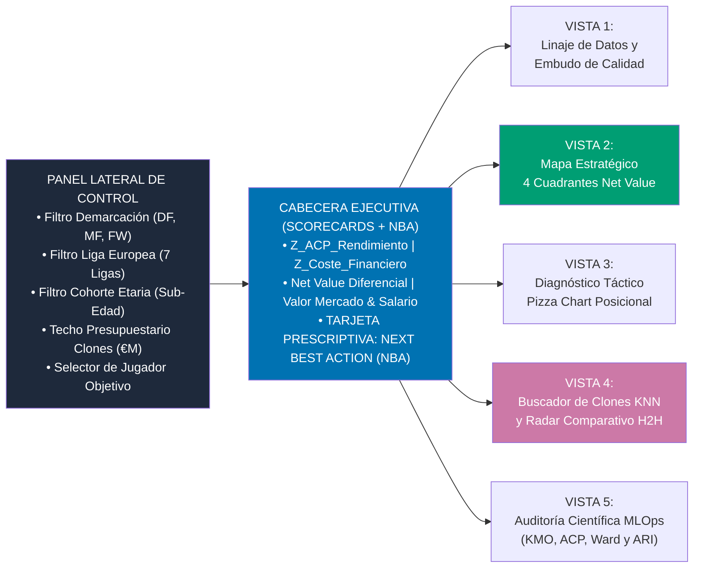

# MANUAL DE DESPLIEGUE Y GUÍA DE NAVEGACIÓN VISUAL DEL DASHBOARD DSS (`Streamlit`)

**Proyecto:** *Prototipo de apoyo a decisiones de scouting basado en rendimiento y coste de jugadores (`scouting_dss_tfm`)*  
**Universidad Internacional de La Rioja (UNIR)**  
**📅 Corte Temporal de Datos (Snapshot Estático):** `Temporada 2023/2024 – Apertura 2024/2025` (`season_snapshot = "2023/24 - 2024/25"`)

> [!NOTE]
> **Alcance Temporal en el Dashboard (*Point-in-Time Snapshot*):** El cuadro de mando muestra explícitamente en su cabecera, barra lateral, tarjetas ejecutivas y tablas el atributo `season_snapshot = "2023/24 - 2024/25"`. La cohorte de $N = 420$ futbolistas reales está congelada en la ventana en que cada jugador disputó sus minutos auditados ($\ge 600\text{ min}$); por ello, jugadores que cambiaron de club con posterioridad (como *Leny Yoro*, registrado en *LOSC Lille* donde disputó sus minutos de Ligue 1 antes de fichar por el *Manchester United*) mantienen el club de origen de sus métricas para preservar la validez matemática del ajuste por posesión ($50/\text{Pos}_{\text{equipo}}$) y del *Net Value*.

---

## 1. Requisitos del Sistema y Preparación del Entorno

### 1.1. Requisitos de Software
* **Sistema Operativo:** Windows 10/11, macOS o Linux (64 bits).
* **Intérprete Python:** Python `3.11.x` (configurado en el entorno virtual `.venv`).
* **Motores de Datos:**
  * **DuckDB `>= 1.0.0`** y **Apache PyArrow `>= 15.0.0`** (embebidos en proceso, sin necesidad de servidor externo).
  * **MongoDB Community Server `>= 6.0`** (opcional en local: `src/ingestion/mongo_loader.py` detecta automáticamente si el servicio `mongod` está activo en `localhost:27017` y mantiene en todo momento un espejo inmutable en archivos `.jsonl` dentro de `data/raw/`).

### 1.2. Instalación y Configuración Paso a Paso

```powershell
# Paso 1: Situarse en el directorio raíz del Trabajo Fin de Máster
cd "c:\Users\PC\Desktop\Clases UNIR\Trabajo Fin de Master"

# Paso 2: Instalar o actualizar las dependencias certificadas en el entorno virtual
.\.venv\Scripts\pip.exe install -r scouting_dss_tfm\requirements.txt

# Paso 3: Configurar variables de entorno (copiar plantilla .env.example a .env)
Copy-Item scouting_dss_tfm\.env.example scouting_dss_tfm\.env -Force

# Paso 4: Ejecutar la suite de auditoría y pruebas unitarias (9/9 tests)
$env:PYTHONPATH = "c:\Users\PC\Desktop\Clases UNIR\Trabajo Fin de Master\scouting_dss_tfm"
.\.venv\Scripts\pytest.exe scouting_dss_tfm\tests -v

# Paso 5: Lanzar la interfaz interactiva del Sistema de Soporte a la Decisión (DSS)
.\.venv\Scripts\streamlit.exe run scouting_dss_tfm\src\dashboard\app.py
```

Al ejecutar el **Paso 5**, el servidor de aplicaciones abrirá automáticamente en el navegador la dirección `http://localhost:8501`.

---

## 2. Arquitectura Cognitiva y Guía de Navegación por las 5 Vistas del Dashboard

El cuadro de mando ha sido diseñado siguiendo los principios de reducción de carga cognitiva y atributos preatentivos de **Stephen Few (2012)** y **Cole Nussbaumer Knaflic (2015)**, utilizando la paleta cromática universal para daltónicos de **Okabe e Ito (2008)**.



---

### 2.1. Cabecera Permanente: Scorecards Operativos y Recomendación Prescriptiva (*Next Best Action - NBA*)

En la parte superior de la pantalla, siempre visible independientemente de la pestaña activa, se muestra el panel de **6 KPIs Ejecutivos** junto con el banner semántico **Next Best Action (NBA)**:

```text
+------------------------------------------------------------------------------------------------------------------+
| [Z_ACP Rendimiento] | [Z_Coste Financiero] | [Net Value Diferencial] | [Valor Mercado] | [Salario Bruto] | [Pos] |
|     +1.42 sigma     |     -0.68 sigma      |        +2.10            |    €11.50M      |   €1.45M / año  | 54.2% |
+------------------------------------------------------------------------------------------------------------------+
| RECOMENDACION PRESCRIPTIVA (NEXT BEST ACTION - NBA):                                                             |
| [GANGA TACTICA DETECTADA - CUADRANTE I] -> FICHAJE PRIORITARIO INMEDIATO: El jugador rinde +1.42 desv. típicas   |
| por encima de la media europea con un coste financiero -0.68 desv. típicas inferior al mercado (Net Value +2.10) |
+------------------------------------------------------------------------------------------------------------------+
```

**Reglas de Decisión del Motor *Next Best Action (NBA)*:**
1. **Cuadrante I (*Ganga Táctica*: $Z_{\text{ACP}} \ge 0 \land Z_{\text{Coste}} < 0$):** Emite alerta verde (`#009E73`) **«FICHAJE PRIORITARIO: ALTA EFICIENCIA ECONÓMICA»**.
2. **Cuadrante II (*Estrella Consolidada*: $Z_{\text{ACP}} \ge 0 \land Z_{\text{Coste}} \ge 0$):** Emite alerta azul (`#0072B2`) **«ACTIVO ÉLITE DE ALTO COSTE: CONSULTAR PESTAÑA 4 (CLONES KNN) PARA ALTERNATIVA ECONÓMICA»**.
3. **Cuadrante III (*Ineficiente / Sobrevalorado*: $Z_{\text{ACP}} < 0 \land Z_{\text{Coste}} \ge 0$):** Emite alerta bermellón (`#D55E00`) **«ALERTA DE SOBREPRECIO: DESCARTAR ADQUISICIÓN / CANDIDATO A VENTA»**.
4. **Cuadrante IV (*Cantera / Rotación*: $Z_{\text{ACP}} < 0 \land Z_{\text{Coste}} < 0$):** Emite alerta gris neutro (`#7F7F7F`) **«PERFIL EN DESARROLLO / FONDO DE ARMARIO: MONITORIZAR PROGRESIÓN SUB-23»**.

---

### 2.2. Guía de las 5 Vistas Interactivas del Cuadro de Mando

#### Vista 1: Auditoría de Linaje de Datos y Embudo de Calidad (*Data Lineage & IngestionGate*)
* **Propósito:** Garantizar al director deportivo y al auditor de datos la procedencia exacta y la limpieza de la muestra analizada.
* **Elementos Visuales:**
  * Gráfico de Embudo (*Data Funnel Chart*) que traza el paso desde los registros brutos extraídos de *API-Football v3*, *Transfermarkt* y *Capology*, pasando por el filtro de resolución de entidades ($\text{Levenshtein} \ge 0,85$) y el corte de exposición mínima ($\ge 450\text{–}600\text{ min}$), hasta la cohorte certificada en la Capa Gold.
  * Distribución de futbolistas por competición europea y estado del contrato de datos (`GateStatus.ALLOW`).

#### Vista 2: Mapa Estratégico de 4 Cuadrantes (`Net Value`) y Ranking de Gangas Tácticas
* **Propósito:** Identificar visualmente las oportunidades de mercado infravaloradas en toda Europa.
* **Elementos Visuales:**
  * **Scatter Plot de 4 Cuadrantes ($Z_{\text{Coste\_Financiero}}$ en eje X vs. $Z_{\text{ACP\_Rendimiento}}$ en eje Y):** Con líneas divisorias en $Z=0$, diagonal de equilibrio $\text{Net Value} = 0$ y resaltado en forma de diamante del jugador objetivo seleccionado.
  * **Tabla Interactiva del Top 15 de «Gangas Tácticas»:** Ordenada de mayor a menor diferencial `Net Value`.

#### Vista 3: Diagnóstico Táctico Individual (*Pizza Chart* de Percentiles y Ajuste por Posesión)
* **Propósito:** Evaluar la huella funcional de un jugador dentro de su demarcación sin las distorsiones de área de los radares poligonales clásicos (Few, 2012).
* **Elementos Visuales:**
  * **Roseta Percentilar (*Pizza Chart* $P_{1\text{–}99}$):** 15 sectores angulares divididos cromáticamente en tres dimensiones: *Ataque y Finalización* (Verde Esmeralda), *Creación y Progresión* (Azul Primario) y *Defensa Ajustada al 50% de Posesión* (Bermellón).
  * **Tabla Comparativa de Efecto Posesión:** Muestra lado a lado la tasa bruta $M_{\text{per90}}$ frente a la tasa ajustada $M_{\text{p90\_adj}}$ y el percentil posicional resultante.

#### Vista 4: Buscador de «Clones Estadísticos» ($k$-NN) y Comparador *Head-to-Head* (H2H)
* **Propósito:** Encontrar sustitutos tácticamente equivalentes a un objetivo caro del Cuadrante II pero ubicados en el Cuadrante I (*Ganga Táctica*), respetando el techo presupuestario fijado en la barra lateral.
* **Elementos Visuales:**
  * **Gráfico Radar H2H Superpuesto:** Compara el perfil percentilar del jugador de referencia (Azul `#0072B2`) contra el clon estadístico seleccionado (Púrpura `#CC79A7`).
  * **Matriz de los $k=10$ Vecinos Más Próximos en el Espacio Latente ACP:** Incluye porcentaje de similitud funcional (`similarity_pct`), distancia euclídea latente y el **ahorro financiero directo en Euros** tanto en valor de traspaso (`market_value_savings_eur`) como en masa salarial anual (`salary_savings_eur`).

#### Vista 5: Auditoría Científica MLOps (`ModelHealthGate`, Biplot ACP y Concordancia `ARI`)
* **Propósito:** Proporcionar transparencia algorítmica total (*White-Box AI*) conforme al Reglamento Europeo de IA (*EU AI Act*).
* **Elementos Visuales:**
  * Indicadores en vivo del test **Kaiser-Meyer-Olkin ($\text{KMO} = 0,9496$)** y **Esfericidad de Bartlett ($\chi^2 = 12416,37, p < 10^{-16}$)** sobre los $N = 420$ futbolistas profesionales reales y únicos (`src/ingestion/real_players_catalog.py`).
  * Matriz de cargas factoriales ($\text{PC}_1, \text{PC}_2, \text{PC}_3$ con $93,53\%$ de varianza explicada acumulada) y tabla de validación cruzada de clústeres para $K \in [3, 8]$ con el **Índice de Rand Ajustado ($\text{ARI} = 0,9820$ y Silueta $= 0,6402$ en $K^* = 4$)**.
